# ThirdPlace app review, 6 November 2026

Phase 6 of the design-system run. Branch `feat/design-system`, local commits only. Android emulator dev build (fresh native build on 2026-11-06). iOS was not run.

## 1. Summary

After the design-system rollout (Phases 1–5) the whole app was reviewed in three passes:

1. **Screenshot pass** of 45 routes on the emulator, plus a re-capture. The capture script ran behind navigation, so several file names do not match their content; the review names screens by what the image shows (41 distinct screens).
2. **Fresh-eyes reviewer** that only saw the screenshots and an extracted table of every string the app owns, and answered per screen: does this look, feel or sound AI-made, and why. 5 high, 25 medium, 20 low findings, plus a copy table.
3. **Benchmark** of eight apps (Airbnb, Meetup, Hinge, Bumble BFF, Strava, Partiful, Timeleft, Instagram) for onboarding, discovery, social proof, re-engagement and retention patterns.

Every finding was checked against `ThirdPlace_All_Screens.pdf` before acting. Many of the reviewer's points turned out to be PDF copy or PDF styling; those stay as designed and are listed for the founder (§6). Everything else in scope was fixed in seven slices and one correction (ledger 0170–0176 and 0178, §7).

**Verdict.** The app now reads as made by a person with a restrained brief: monochrome UI with one red, real photos, hand-drawn state illustrations, no gradients, glow or sparkle icons. The remaining AI-made signals were the honesty copy (one repeated sentence frame), a few template set-pieces, a broken status bar, and real organisations used as fake partners. All of those are fixed or, where the PDF draws them, documented.

## 2. Scored lenses (1–5, before → after Phase 6)

| Lens                             | Before | After | Why                                                                                                                                                                                                          |
| -------------------------------- | ------ | ----- | ------------------------------------------------------------------------------------------------------------------------------------------------------------------------------------------------------------ |
| Visual design                    | 3.5    | 4     | Status-bar icons were invisible on most screens and headers sometimes sat under the clock; fixed. Ember use is still heavy where the PDF draws it (toggles, Kalender, invite code).                          |
| UI consistency                   | 3      | 4     | One back-button style, one avatar size, chips that scroll instead of orphan-wrapping, one honesty marker per screen. Card stacks on Kalender/workspace stay (PDF).                                           |
| UX flows                         | 3.5    | 4     | Kalender in date order; Bli Skaper no longer invites an application that cannot qualify; collab states and defaults agree; dead "(ikke aktiv)" labels became disabled controls.                              |
| Accessibility                    | 3.5    | 4     | Auth links regained their colour (className on `Link` was dropped), disabled states carry `accessibilityState`, weather and checklist steps have labels, swipe tab contrast raised. TalkBack pass not done.  |
| Motion / feel                    | 4      | 4     | Unchanged in P6: motion was fixed in P5a (sheets static once settled). No shimmer overload, haptics only on local results.                                                                                   |
| Human-made (look / feel / sound) | 3      | 4.5   | Owned copy rewritten twice (P6b, P6c) and guarded by a test; real organisations removed from fixtures; duplicate badges and placeholder leaks gone. PDF copy that reads machine-made is listed, not changed. |
| Retention mechanics              | n/a    | n/a   | Contract-blocked (counts, notifications, ranking, social proof). Recommendations only (§5).                                                                                                                  |

## 3. Human-made check

**Look.** The reviewer found no gradients, glow, glassmorphism, sparkle or emoji icons. The template feel came from identical bordered-card stacks, a 0/0/0 stat-tile row with trophy milestones (Inviter venner), KPI tiles over an unlabelled chart (Analyse), red accent bars on every Kalender card, and stock-looking headshots. The stat tiles, milestones, KPI tiles and accent bars are drawn in the PDF (p14, p15, p22) and stay. Fixed: duplicate DEMO badge and carousel dashes through the swipe pill, mismatched profile icons, chip rows, avatar sizes, back buttons.

**Feel.** No fake typing indicators, artificial delays or shimmer. The broken status bar (white icons on white screens) and the intermittent header under the status bar were the strongest "unfinished" signals; both are fixed (ledger 0172).

**Sound.** `scripts/extract-copy.js` extracts every owned string (JSX text, readable props, toasts, `src/copy`, and since 0171 the string branches inside JSX children). `tests/copyVoice.test.ts` fails on em-dash constructions outside a 10-line PDF allowlist, on machine-marketing phrases and on doubled punctuation. P6b rewrote 53 lines; P6c rewrote about 35 more, broke up the repeated "Ingen X …, og ingen Y …" frame, removed internal-process leaks ("eksempler fra designet", "når betalingsflyten er fastsatt", "Kun struktur", "serverforespørsel") and left out three PDF lines that state rules CLAUDE.md bans (waitlist hand-over, manual place review, fee subtitle). Every rewritten note still says nothing real happens.

Before (top) and after (bottom): Betaling, Kalender, Sveip, workspace hub.

## 4. Findings and what happened to them

Status: **Fixed** (ledger id) · **Kept (PDF)** = drawn or written that way in the design PDF · **Recommended** = needs work outside this run · **Not reproduced**.

### High

| #   | Finding                                                                              | Status                                                                                                                                                                                                                          |
| --- | ------------------------------------------------------------------------------------ | ------------------------------------------------------------------------------------------------------------------------------------------------------------------------------------------------------------------------------- |
| H1  | Stack headers sometimes drawn under the status bar                                   | Fixed 0172: reproduced once (right after a system dark-mode switch); `Screen` now pads from provider insets seeded with `initialWindowMetrics`. Root cause (late native inset measurement) fits the evidence but is not proven. |
| H2  | Status-bar icons unreadable almost everywhere                                        | Fixed 0172: focus-aware `StatusBarStyle`; guard rule bans `expo-status-bar` elsewhere.                                                                                                                                          |
| H3  | Kalender "Kommende" not in date order                                                | Fixed 0173 (`calendarOrder.ts`, tested).                                                                                                                                                                                        |
| H4  | Real organisations as counterparties (Kulturetaten, Mathallen Vinbar, Tim Wendelboe) | Fixed 0173: fictional names. The PDF uses some real names as illustration.                                                                                                                                                      |
| H5  | "Maximum update depth exceeded" on every frame of one capture run                    | Not reproduced. Seen only after about 60 rapid deep links with hot reloads; every cold-start run since (the P6 verification runs of this report) rendered normally. Kept on the watch list.                                     |

### Medium

| #   | Finding                                                                       | Status                                                                                                                                       |
| --- | ----------------------------------------------------------------------------- | -------------------------------------------------------------------------------------------------------------------------------------------- |
| M1  | Primary colour inconsistent (ember vs ink CTAs, FABs)                         | Kept (PDF): ember for acquisition CTAs (Kom i gang, Opprett konto, Del via) and FABs on Kalender/Marketplace/Mine listings, ink elsewhere.   |
| M2  | Ember overloaded (toggles, Rediger, chart bar, invite code)                   | Fixed 0180: toggles, checkboxes, edit links, invite code and the current chart bar are ink; Kalender accent bars removed (founder decision). |
| M3  | Logg inn button separated from its form by social buttons                     | Kept (PDF p1 order).                                                                                                                         |
| M4  | Decimal full stops (4.8) vs nb-NO (4,8)                                       | Fixed 0180: decimals use the Norwegian comma (4,8 · 1,1 km) through `src/lib/format.ts` (founder decision).                                  |
| M5  | Norwegian/English term mix (Dashboard, Chat-joins, Rating, listings, Venue …) | Fixed 0179: Dashbord, “Ble med i chat”, “Vurdering”. Marketplace terms (listings, Venue, Brand, Co-hosting) stay as designed.                |
| M6  | Swipe: dashes through the pill, second DEMO badge, flat placeholder           | Fixed 0175 (dashes below pill, one badge); the placeholder colour already exists.                                                            |
| M7  | Profile icons don't match content                                             | Fixed 0175.                                                                                                                                  |
| M8  | 2FA toggle ON plus "Aktiver 2FA" button                                       | Kept (PDF p2).                                                                                                                               |
| M9  | Bli Skaper invites an application that cannot qualify                         | Fixed 0174 (CTA muted until requirements are met, as in PDF p14).                                                                            |
| M10 | One row pattern, three treatments (card stacks)                               | Fixed 0180/0186: Kalender bars removed, Filtre flat. The workspace hub keeps the PDF's cards.                                                |
| M11 | Lokasjoner pill crowds the name                                               | Fixed 0175.                                                                                                                                  |
| M12 | Chat header subtitle truncated by DEMO badge                                  | Fixed 0174.                                                                                                                                  |
| M13 | Chips wrap with orphans                                                       | Fixed 0175 (scrolling rows).                                                                                                                 |
| M14 | Uneven top spacing under headers                                              | Fixed 0174/0175 (Marketplace, Mine planer).                                                                                                  |
| M15 | Honesty markers uneven                                                        | Fixed 0174 (Utbetalinger, Marketplace, Nytt samarbeid, map weather) and 0171 (Betaling down to one note, Aldersverifisering).                |
| M16 | Aldersverifisering perks stated as fact                                       | Fixed 0171 (marked as examples; PDF list kept).                                                                                              |
| M17 | "Del ThirdPlace og få belønninger" promises rewards                           | Fixed 0179: “Del ThirdPlace med vennene dine.” (founder decision).                                                                           |
| M18 | Workspace checklist ✓ ambiguous                                               | Fixed 0175.                                                                                                                                  |
| M19 | Analyse chart without axis labels                                             | Kept (PDF p14 chart has none). Recommended once real data exists.                                                                            |
| M20 | Map pins compete with basemap POIs                                            | Fixed 0182: white place pins / ink experience pins, basemap POIs hidden (config repeats the light preset).                                   |
| M21 | Chat list avatar sizes differ                                                 | Fixed 0175 (`Avatar icon`).                                                                                                                  |
| M22 | Nytt samarbeid defaults contradict                                            | Fixed 0173.                                                                                                                                  |
| M23 | Kontrakt/Avtale state mismatch                                                | Fixed 0173.                                                                                                                                  |
| M24 | "Oppdater nå" looks disabled                                                  | Fixed 0174.                                                                                                                                  |
| M25 | Bekreft kode contradicts itself                                               | Demo line fixed 0171; subtitle and active "Send på nytt" kept (PDF p2).                                                                      |

### Low

| #   | Finding                                                        | Status                                                        |
| --- | -------------------------------------------------------------- | ------------------------------------------------------------- |
| L1  | Password placeholder dots                                      | Kept (PDF p1).                                                |
| L2  | Inline links don't look like links                             | Fixed 0174 (className on `Link` was dropped; now ember Text). |
| L3  | Welcome card drag handle                                       | Kept (PDF p1).                                                |
| L4  | Text glyphs (→, ✓) as icons                                    | Kept (PDF labels).                                            |
| L5  | Full-body avatar photos                                        | Fixed 0175 (crop from top).                                   |
| L6  | Solid black Følg pills                                         | Kept (PDF p22).                                               |
| L7  | Import sources box without heading                             | Kept; low impact.                                             |
| L8  | Visibility settings default ON                                 | Kept (PDF p19). Privacy default is a founder decision.        |
| L9  | Hjelp og støtte under DATA                                     | Kept (PDF p19).                                               |
| L10 | Two names for export / Oppdag folk                             | Kept (PDF p19, p21).                                          |
| L11 | Map peek shows a sliver of photo                               | Fixed 0182: peek height measured from its header.             |
| L12 | Innleveringer link-looking line, Ventende vs Under gjennomgang | Em dash fixed 0173; labels kept (PDF p12).                    |
| L13 | Collab button grid, same party icon                            | Fixed 0176.                                                   |
| L14 | Swipe tab contrast                                             | Fixed 0176.                                                   |
| L15 | Title heights, centred creator profile, three tab styles       | Kept (PDF).                                                   |
| L16 | Profile DEMO badge placement, BankID icon, popover anchor      | Badge and BankID fixed (0176, 0171); popover kept.            |
| L17 | Two back-button styles                                         | Fixed 0176 (circled back everywhere, as in the PDF).          |
| L18 | Two "Hvem er du?" steps                                        | Kept (PDF p2).                                                |
| L19 | Terms sentence without links                                   | Kept: no terms page exists in the PDF or spec.                |
| L20 | Invented status page link                                      | Fixed 0179: status line left out (no status page exists).     |

## 5. Benchmark and retention recommendations

| Pattern                               | Apps                                 | ThirdPlace slot                                  |
| ------------------------------------- | ------------------------------------ | ------------------------------------------------ |
| Intent and interest capture at setup  | Meetup, Hinge, Timeleft, BFF         | partial (onboarding exists; using it is ranking) |
| Low-commitment save                   | Partiful, Airbnb, Meetup             | yes (`useMapSaved` across map, swipe, `/saved`)  |
| Collaborative list / group decision   | Airbnb, Partiful                     | partial (group swipe)                            |
| "Who's going" preview                 | Airbnb Experiences, Meetup, Partiful | partial (blocked: attendees, counts)             |
| Friends' activity                     | Instagram, Airbnb, Strava            | partial (Venner stays a demo shell)              |
| Reminder ladder + quiet hours         | Meetup, Partiful, Instagram          | partial (NotificationsSheet; no policy)          |
| Capacity + waitlist                   | Meetup, Partiful                     | yes (rules blocked)                              |
| Post-event rating                     | Hinge, Meetup, Timeleft, Airbnb      | partial (Rate sheet)                             |
| Safety signals                        | Timeleft, BFF, Hinge                 | yes (18+, report, block)                         |
| Groups and places over people-swiping | BFF relaunch, Meetup                 | yes (Sveip swipes places/experiences)            |

Recommendations, in order:

1. Audit that every browse card and detail sheet has the same save action and state. **UI-only** (check PDF first).
2. Start a group swipe from a saved list; share through the Del sheet (demo invite only). **UI-only**, needs a PDF slot.
3. Empty states that point to the next surface (Lagret → Sveip, Mine planer → map). **UI-only**; partly in place.
4. A fixture-based "Hva kan du forvente" block on experience detail, written as example content. **UI-only**, needs a PDF slot.
5. "Hvem blir med" on detail and in chat headers. **Needs spec/founder decision** (attendee data, privacy, counts).
6. Reminder ladder with quiet hours. **Needs spec/founder decision** (notification policy).
7. Post-experience check-in ("Ble du med?" + rating). **Needs spec/founder decision**.
8. Mutual "meet again" after an experience. **Needs spec/founder decision** (matching, safety, 18+).
9. Waitlist promotion behaviour. **Needs spec/founder decision**.
10. Weekly ritual or digest. **Needs spec/founder decision**.
11. Status for regulars / attendance toward "Veien til Skaper". **Needs spec/founder decision** (TP-D-004 role path).
12. Opt-in presence in Venner. **Needs spec/founder decision** (location policy).

## 6. For the founder: PDF lines and styling kept as designed

**Decided 6 November 2026 (Phase 7):** the founder approved plain rewrites of every line below, a calmer ink styling and Norwegian decimals. The rule lines are left out. The PDF line → app line table is in `docs/SCREEN_INVENTORY.md` ("Founder copy decisions"), and §9 lists the slices. The list is kept as it was reviewed:

- Welcome: "Oppdag nabolagets lune møteplasser. Finn din neste third place — der byen faktisk skjer." (suggestion: "Finn ditt neste stamsted i nabolaget.")
- Splash/Registrer: "Byen din, laget for deg." · Logg inn: "Finn veien tilbake til ditt lokale fellesskap."
- Onboarding: "Velg alt som passer, så skreddersyr vi byen etter deg.", "Finjuster hvordan vi matcher deg.", "Dette hjelper oss å forstå deg — aldri synlig for andre uten samtykke.", role hints ("Arranger opplevelser — låses opp etter hvert", "Flere lokasjoner og skreddersydd oppsett").
- Bedrift-onboarding: "Dette er admin-identiteten din — kundene ser bedriften, ikke deg.", "Gjør det lett for kunder å finne dere overalt.", "Vi tilpasser kartet og feeden til målene deres.", "Bedriftsintensjoner", "Interesse-tagger", "Slik vil kundene se dere — når dere er verifisert."
- "Mennesker du kanskje vil møte." · "Del ThirdPlace og få belønninger." · Bli Skaper / "Du er nå Skaper!" (English "Dashboard").
- Sveip: "Nye anbefalinger dukker opp gjennom dagen …", "Chat er gratis — billett kjøper du når du vil." (**states a payment rule**), group swipe "Stemmer avsløres ikke før match!".
- Marketplace subtitle and English terms (Venue, Brand, listings, Co-hosting); Analyse "Chat-joins", "Rating".
- State screens: "Sjekk status: status.thirdplace.app" (**invented status page**), suspended and update boilerplate, offline "sendes automatisk" (**promises behaviour**).
- 2FA: toggle ON plus "Aktiver 2FA" button; "Backupkoder".
- Styling: ember toggles, Kalender accent bars and red "Rediger", ember invite code and last chart bar, solid Følg pills, decimal full stops.

Left out by this run because CLAUDE.md bans stating them as product behaviour: "Plassen din tilbys først på ventelisten." (p23), "Steder gjennomgås manuelt av ThirdPlace …" (p11), "Priser før gebyrer og skatt" (Filtre).

## 7. Phase 6 slices

| Ledger | Commit                       | Slice                                                                                                                |
| ------ | ---------------------------- | -------------------------------------------------------------------------------------------------------------------- |
| 0170   | `dd3ce50` (+ `10bf8bd` deps) | Copy extractor, voice test, 53 owned lines rewritten                                                                 |
| 0171   | `910dea7`                    | Honesty notes varied, banned rule lines left out, extractor reads ternary children, lint fix                         |
| 0172   | `5827294`                    | Focus-aware status bar; `Screen` pads from seeded insets                                                             |
| 0173   | `521b290`                    | Fixtures: no real organisations as partners; calendar order; collab states                                           |
| 0174   | `c9532ea`                    | One honesty marker per money/ID/live screen; auth links; update button; Bli Skaper CTA                               |
| 0175   | `884dba5`                    | Chip rows scroll, icons follow content, one avatar size, swipe dashes clear the pill                                 |
| 0176   | `0702946`                    | One circled back button; readable swipe tab; collab actions restacked                                                |
| 0178   | `4fdfa24`                    | Correction: chip rows now really bleed to the edge (0175 claimed it); docs note the unreachable Skaper success state |

## 8. Honest not-done

- **iOS** not run (Windows host; Android-only by decision).
- **Contract markers** (`BLOCKED_NOT_V22_CERTIFIED`, `BLOCKED_CONTRACT_GAP`) stay; nothing in this run touches backend, counts, rules or payments.
- **H1** reproduced once and fixed by construction. It did not return in the Phase 7 dark pass (48 routes), but the root cause is still a reading, not a proof. **H5** never reproduced on a clean run.
- **TalkBack:** labels and roles were checked through UI dumps (0 unlabeled controls), not with a spoken pass. Sheets and overlays (Modal windows) were checked by screenshot only.
- **Price totals, price pins, sort explanations, guest-favourite tags** from the reference recordings stay out: they need price, ranking or policy contracts.
- **Mobbin** blocks the built-in browser (403); Airbnb mobile references came via Firecrawl screenshots instead.
- **Real 3D renders** remain an optional upgrade; hand-built SVG category art ships now.
- **Tap speed** was not measured on a release build. On the emulator's dev build, a tap takes about 2–2.5 s to show on screen, for a map mode chip and a calendar date alike, so it reads as the build and the host, not one screen.

## 9. Addendum: Phases 7 and 8 (6 November 2026)

**Phase 7** acted on §6 and §8 after the founder's decisions:

- plain rewrites of the PDF copy
- calmer ink styling with Norwegian decimals
- map polish
- the "Du er nå Skaper!" screen, reachable by deep link
- a dark-mode and accessibility pass

**Phase 8** compared the browse sheet and Filtre with three reference recordings from the founder ([BROWSE_FILTER_BENCHMARK_2026-11-06.md](BROWSE_FILTER_BENCHMARK_2026-11-06.md)), built the gaps that fit the PDF, and replaced the Sveip icon with the founder's SVG.

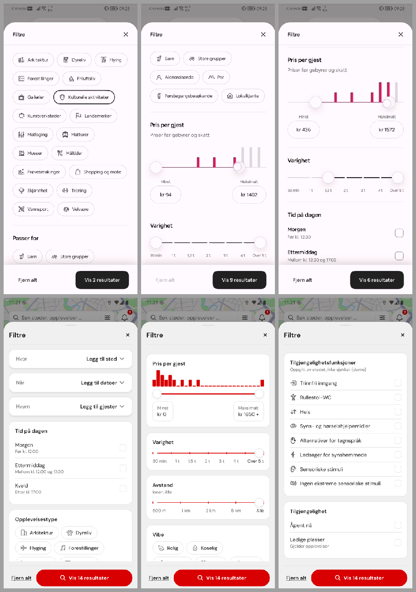

| Ledger | Commit    | Slice                                                                                                                                                           |
| ------ | --------- | --------------------------------------------------------------------------------------------------------------------------------------------------------------- |
| 0179   | `700772a` | Founder copy: plain rewrites of the PDF lines; rule lines left out; PDF em-dash allowlist emptied                                                               |
| 0180   | `0c48d16` | Ink accents (toggles, checkboxes, edit links, invite code, chart bar), Kalender bars removed, nb-NO decimals via `src/lib/format.ts`; status-bar guard restored |
| 0181   | `8e1e899` | "Du er nå Skaper!" as its own deep-link-only route                                                                                                              |
| 0182   | `aa8c67d` | Map: white place / ink experience pins, basemap POIs hidden (config repeats the light preset), measured peek                                                    |
| 0183   | `a9f1f2c` | Sveip tab icon from the founder's `sveip.svg`                                                                                                                   |
| 0184   | `221ce81` | Benchmark report: browse sheet, Filtre and Hvor / Når / Hvem against the recordings                                                                             |
| 0185   | `a603896` | Browse cards: near-square swipeable photos, result count, pill search bar                                                                                       |
| 0186   | `35214a4` | Filtre: flat sections, title handover, ink sliders and CTA, grouped accessibility, inactive "Fjern alt"                                                         |
| 0187   | `c433804` | Filtre count = list count (it counted places only); badge counts Opplevelsestype                                                                                |
| 0188   | `02bca9f` | Hvor / Når / Hvem steps (Hopp over / Neste); calendar month names above their grids (bug); neutral range band                                                   |
| 0189   | `f92138c` | Dark pass of 48 routes clean, 0 unlabeled controls, 44 dp targets for text links and small rows                                                                 |

**Phase 9** closed the three items left open after Phase 8:

| Ledger | Commit    | Slice                                                                                                     |
| ------ | --------- | --------------------------------------------------------------------------------------------------------- |
| 0193   | `f6118f6` | Android back closes the map detail sheet (one level at a time) before it leaves the map                   |
| 0194   | `666c060` | Sveip icon stroke 2, as in the founder's file                                                             |
| 0195   | this page | Calendar range band checked in dark: it reads (grey disc between the white start and end), no code change |

## 10. Addendum: Phase 10, feel and reaction (6 November 2026)

The founder asked for every screen to be checked for feel, look, reaction, feedback, retention and use of the whole screen. The full report is [FEEL_REVIEW_2026-11-06.md](FEEL_REVIEW_2026-11-06.md); in short:

- **Reaction:** measured on the production JS bundle, most taps paint within a frame. Fixed the real slow spots: the Filtre deferred mount (lower half 1.2–1.4 s → 0.02–0.33 s), the swipe glide (0.83–0.93 s → 0.62–0.72 s) and fake waits (splash 1.2 s, map 0.5 s).
- **Feedback:** no dead controls left in the sweep; demo confirms close with an honest toast; disabled buttons say why and no longer look broken.
- **Whole screen:** sheets fit a 640 dp phone, forms stay above the keyboard on edge-to-edge Android, single-goal screens pin their main action, the experience detail pins its join bar (PDF p6).
- **Retention:** shared notification reads, undo on unsave, rows that open their detail, and four founder-approved surfaces (Nylig sett, group swipe from Lagret with "Lagre til senere", Til samtalen, Neste plan).

17 slices, ledger 0196–0212. Open items (R27–R30) and limits (iOS, emulator timings, haptics checked in code) are listed in the report.

## 11. Addendum: Phase 11, the experience page and the founder's list (6 November 2026)

The founder sent a screen recording of a reference experience page (used as a benchmark only, nothing traced) and asked for seven things. Decisions taken with the founder before building: remove every demo marker and let actions confirm like a finished product (payments stay structure only), white background, download free photos, and apply the video to the map's experience detail and the Sveip detail.

| Request                                 | What changed                                                                                                                                                                                                                                                                                                                                                                                                          | Commits / ledger              |
| --------------------------------------- | --------------------------------------------------------------------------------------------------------------------------------------------------------------------------------------------------------------------------------------------------------------------------------------------------------------------------------------------------------------------------------------------------------------------- | ----------------------------- |
| Remove all demo badges                  | Every DEMO pill, demo note, "(demo)"/"eksempel" label and "nothing was saved" toast is gone (91 notes, 15 badges, 48 files). Actions confirm in product voice (`confirmToast`); note-only buttons now act (share, report, block, join chat, invite, import, listings, collab). Dev-only switches moved to `_sandbox/simulate`.                                                                                        | bff0af4, 638ce9b · 0215, 0219 |
| Airbnb background colour                | Light background `#FFFFFF`; cards keep a hairline (settings groups gained one). Dark theme unchanged.                                                                                                                                                                                                                                                                                                                 | db7aaa2 · 0216                |
| At least two images for everything      | 26 free Unsplash photos (credited in `assets/library/CREDITS.md`); every place, business, group, experience and listing has two or more; galleries on place, business, group and listing detail and in the Steder deck.                                                                                                                                                                                               | f1a0a7b · 0217                |
| Marker icons that match                 | `markerIcon()` gives each place, experience, business and group its own glyph; native pins draw it in an emissive layer so dusk and night presets never dim it.                                                                                                                                                                                                                                                       | 723c697, 56db101 · 0218       |
| Experience modal like the video         | Shared `ExperiencePage` in the video's order (inset gallery with full-screen viewer, centred title, status line, chips, icon rows, more experiences, Om verten, footer links), keeping every ThirdPlace item. Sveip shows it as a page with a floating join card; on the map the experience sheet slides up into a full-screen page (no handle, square corners, page top bar, tab bar covered); back returns to 60 %. | 4ed5fbd, 482a5ef · 0220, 0221 |
| Skeleton under 2 s, loader after        | `useLoadPhase` + `Loader` + `LoadingImage`; the map shows skeleton cards, then the loader.                                                                                                                                                                                                                                                                                                                            | 6e7a804 · 0222                |
| User icon the same on every map; locate | Our own puck (ember dot, white ring, halo, heading wedge) replaces the native one that changed with each light preset; "Posisjon" flies to the user at street zoom.                                                                                                                                                                                                                                                   | 05b9a45 · 0223                |
| Open items R27–R30                      | Taps during the swipe glide are queued; Sveip is pre-rendered after the map loads; card-like presses get press feedback; Betalingsstatus follows PDF p18 (money structure only); Bli Skaper and workspace "Kom i gang" link to the next step.                                                                                                                                                                         | cbebb40 · 0224                |

**Video vs ours (Sveip page and photo viewer):**

**Map experience sheet: mid snap over the tab bar, the full-screen page at the top, back to mid:**

**Marker glyphs and the user's location on every basemap (night, day, dawn; dusk in the second image):**

**Galleries, no markers, and the open items:**

**What did not work first time (kept in the ledger):** hiding the tab bar at the top snap resized the sheet's container and snapped it back to the middle; handing off to a second full-screen page at the top made the sheet vanish for about a second while the page mounted. The sheet now renders in an app-root portal above the tab bar, so the top snap is the page itself. A test commit (723c697) failed the design-system guard and was fixed in 56db101; commit chains now stop on a failing test run.

**Found in the closing review and fixed (0226):** the experience sheet stayed above routes opened from it (host profile, chat, Rediger) because it lives at the app root — it now shows only while the map is focused and reopens on return; "Posisjon" opened the permission explainer even when the phone had already granted location — it now flies straight in; Sveip photos follow the loading rule (spinner after 2 s); the new surfaces were checked in dark mode.

**Honest not-done:** release-build timing for the Sveip pre-render (dev build only shows the background mount); the loader path is covered by a unit test but not seen on device (nothing loads for more than 2 s); while an experience sheet is open the tab bar is covered (places keep the docked sheet); the heading wedge needs a device with a compass; the floating join card covers much of the 35 % peek on a 640 dp phone; iOS not verified; the Play Store listing behind "Oppdater nå" does not exist yet.

## 12. Addendum: Phase 12, the experience page in full, everything on the map, pages instead of modals (7 November 2026)

The founder sent the reference recording again and asked for: the experience modal to gain every section of the video (rating under the description, duration, language, what's included, a recent review, "what you'll do", the reviews section, availability, where we meet, things to know) with no fact twice, plus vibe, capacity, a chat section and everything a creator enters; experiences on the map with fitting markers and every place and experience on the map with images and full data; a TikTok-style Legg til button; groups from Legg til; and the Phase 11 open items. Plan review added: Airbnb's colours everywhere, faster images, marker colour per category and night-readable labels, Sveip's filter identical to the map's, places on Sveip working like experiences, no open/closed status on experiences, no arrows on buttons, not every page a modal (app-wide), "Kom i gang" straight to onboarding, and modernising outdated pages. The video stays a benchmark (nothing traced); booking and payment screens stay out (payments are structure only).

| Request                          | What changed                                                                                                                                                                                                                                                                                                                                                                                                                            | Commits · ledger                                              |
| -------------------------------- | --------------------------------------------------------------------------------------------------------------------------------------------------------------------------------------------------------------------------------------------------------------------------------------------------------------------------------------------------------------------------------------------------------------------------------------- | ------------------------------------------------------------- |
| Airbnb colours                   | Tokens take Airbnb's values (ink #222222, #FF385C for text-less pink, #E31C5F for pink with text, the button gradient #E61E4D → #E31C5F → #D70466), Airbnb-style dark theme, pink logo, icon and splash (native rebuild).                                                                                                                                                                                                               | c93b94f · 0227                                                |
| Images load slowly               | Every bundled photo re-encoded to WebP in two sizes with a 16 px blurred preview painted on the first frame; thumbnails use the small file; all photos through expo-image with memory/disk cache; Sveip preloads the next cards. Median photo paint 1638 → 952 ms (dev), 1385 → 131 ms with prefetch (production bundle).                                                                                                               | f8a7d49 · 0228                                                |
| Phase 11 open items              | Experience sheet peek on a 640 dp phone; a slow-load switch shows skeleton then loader on device; Reanimated's settled-animation flag off so sheets opened by code stay open on Android.                                                                                                                                                                                                                                                | 6738424 · 0229                                                |
| Complete data                    | Every experience: category, duration, languages, included, vibes, energy, access, cancellation (the host's choice), repeat, meeting point, 3–5 steps, sessions from an injectable "now", 3+ MOCK reviews (counts and scores come from the lists), its own chat. Places: full detail and two reviews each.                                                                                                                               | fe25d6a · 0230                                                |
| Everything on the map            | For deg, Utforsk, Trending and Lagret list places and experiences; Live keeps experiences; the first view fits every pin; clusters only where pins overlap.                                                                                                                                                                                                                                                                             | 55dfb3c, 59c5d8e · 0231                                       |
| Marker colours, night labels     | Pins coloured by category from Airbnb's secondary palette (never the brand pink, which marks selection); places ringed white, experiences ink; titles light on a dark halo at dusk/night.                                                                                                                                                                                                                                               | 0d99cc1 · 0232                                                |
| Experience page like the video   | Rating line, icon rows (host, place, duration + language, included, latest review, participants, group), Vurderinger with all-reviews page (sort sheet, search), Hva dere skal gjøre with a step carousel, Ledige tider with "Velg tidspunkt" (sticky Velg) driving the join card, Hvor vi møtes (map card, ask-host sheet with a 20-character minimum), Samtalen, Om verten, Ting å vite; no status pill, no fact twice.               | 3a5622d, 45a86a8 · 0233, 0234                                 |
| Not every page a modal           | Audit of every Sheet/Overlay (table below). Whole entities, lists you browse and forms became pages with a real back: experience, place, group and person pages; chat info, members, invite, archive, new chat; settings sub-pages, blocked users, delete account, edit profile; Marketplace listing, listing editor, collab offer and contract; notifications, map search, write a review. Back from a cold deep link goes to the map. | 236a0c9, 8796a02, 1979929, 124009a, adcc4a7 · 0235–0238, 0240 |
| No arrows on buttons             | Nine labels lost their "→"; chat send is a paper plane, Sveip's expand an "i"; a copy test rejects arrows in owned copy and in JSX.                                                                                                                                                                                                                                                                                                     | 9bb620c · 0239                                                |
| TikTok-style Legg til            | Ink rounded rectangle with a white +, ember layer left, grey layer right (white button with a muted-grey layer in dark).                                                                                                                                                                                                                                                                                                                | fdc3146 · 0241                                                |
| Groups from Legg til             | Gruppe in the Add menu → about, area, photos (two+), who can join → "Gruppen er opprettet" → group page and a group chat at the top of Chat. Experiences gain an optional step for what's included and what you'll do; a published experience joins the map with its own chat and page.                                                                                                                                                 | e6764ee · 0242                                                |
| Sveip filter = the map's         | Sveip opens the map's Filtre sheet with its own state and a count for its deck; experiences go through one filter pipeline on both surfaces.                                                                                                                                                                                                                                                                                            | be1f532 · 0243                                                |
| Places on Sveip like experiences | One deck over one card model for every tab (same card, gestures, stamps, undo, action bar, "i" to the page); a liked place is saved and offers its chat; experience cards show places left, never a status word. The place page follows the experience page's layout.                                                                                                                                                                   | e20f776, 4975ce4 · 0244, 0245                                 |
| Kom i gang → onboarding          | Welcome → onboarding → "Lag kontoen din" → code → map (both branches); "Registrer deg" keeps the old order; back from the last step keeps the answers; the session start clears the whole stack.                                                                                                                                                                                                                                        | 8358839 · 0246                                                |
| Modernise outdated pages         | All 58 routes captured and scored against an Airbnb-style rubric; the dated pattern (grey capitals over boxed cards) gave way to a back-button row with a large title on hub pages, sentence-case section titles (28 places) and edge-to-edge settings rows; Profil's review stars are ink.                                                                                                                                             | 15cb8ac · 0247                                                |

**Experience page in the video's order (gallery, rating line, rows, steps, reviews, times):**

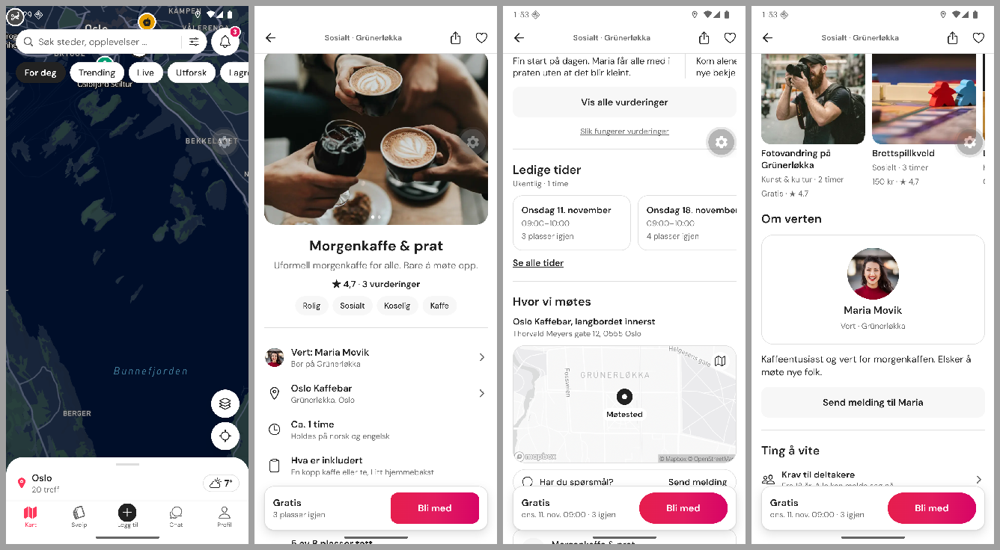

**Picking a time drives the join card; ask the host (20-character minimum); Ting å vite:**

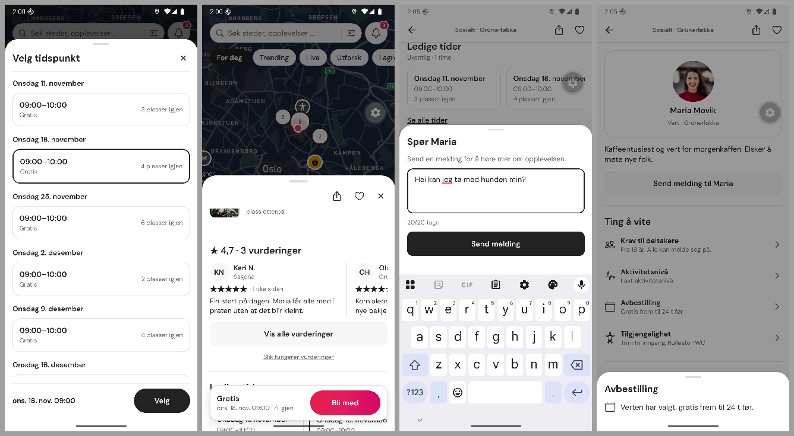

**Every place and experience on the map, coloured by category, readable at night:**

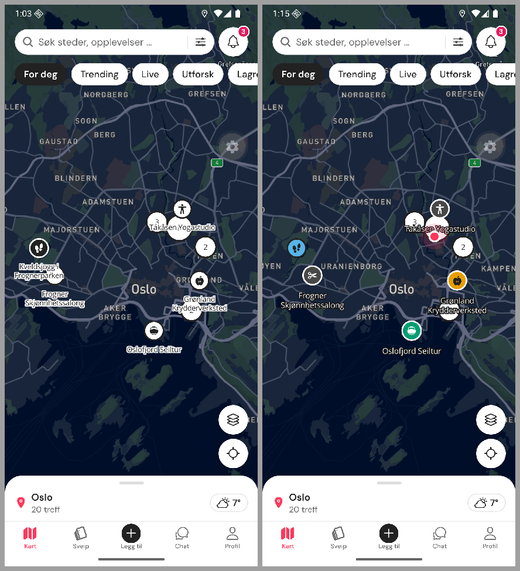

**Pages instead of modals (experience, person, chat info, account; listing, collab offer, Varsler, search):**

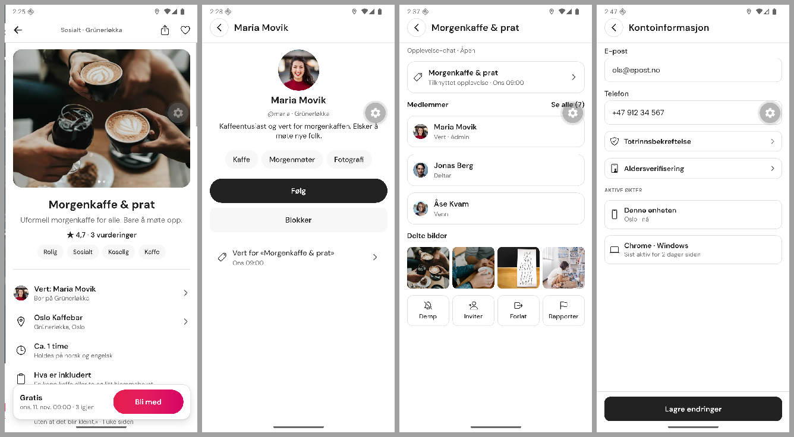

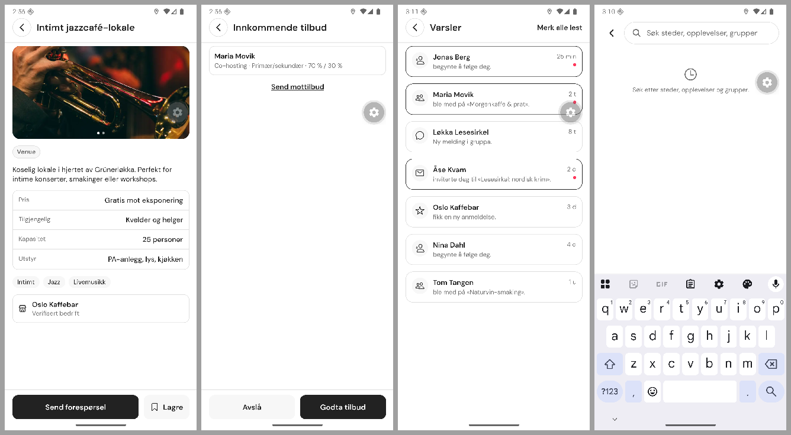

**Legg til: the TikTok-style button (light, dark) and a new group (the access option now reads "Lukket", the chat's own word):**

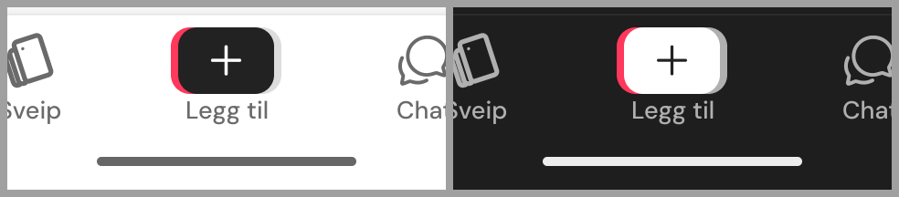

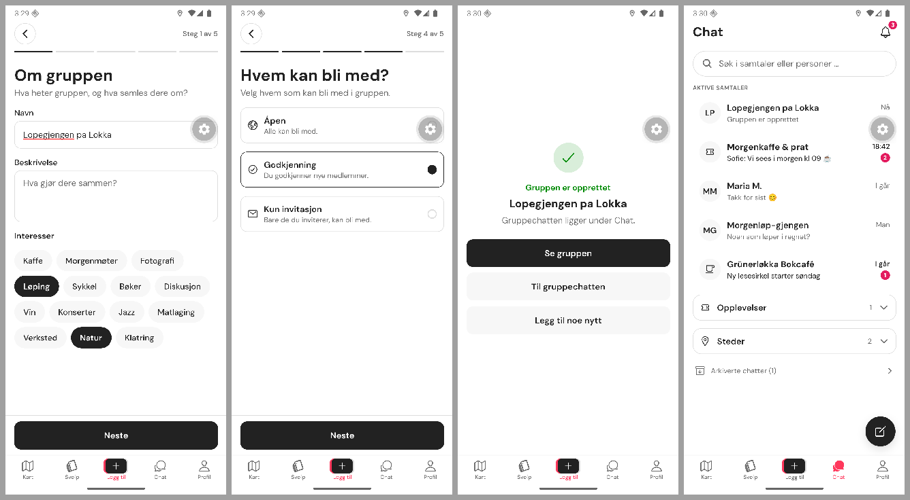

**Sveip: the map's Filtre ("Morgen" → 2 results), and places as the same card with the like sheet:**

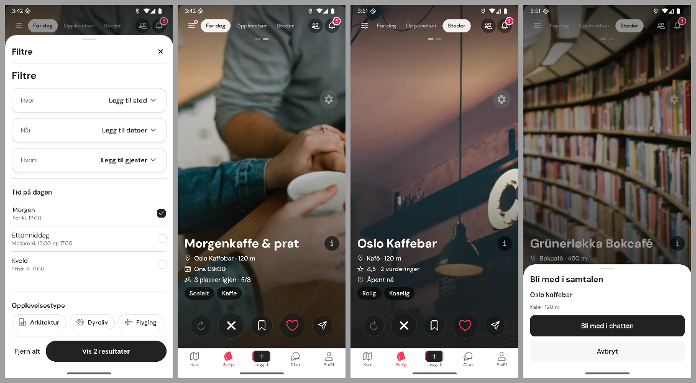

**Place page in the experience page's layout; chat send without an arrow:**

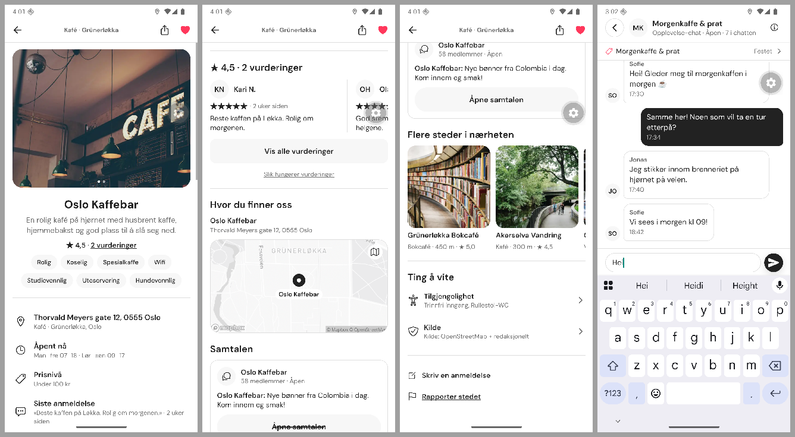

**Start flow: "Lag kontoen din" after onboarding, then the code:**

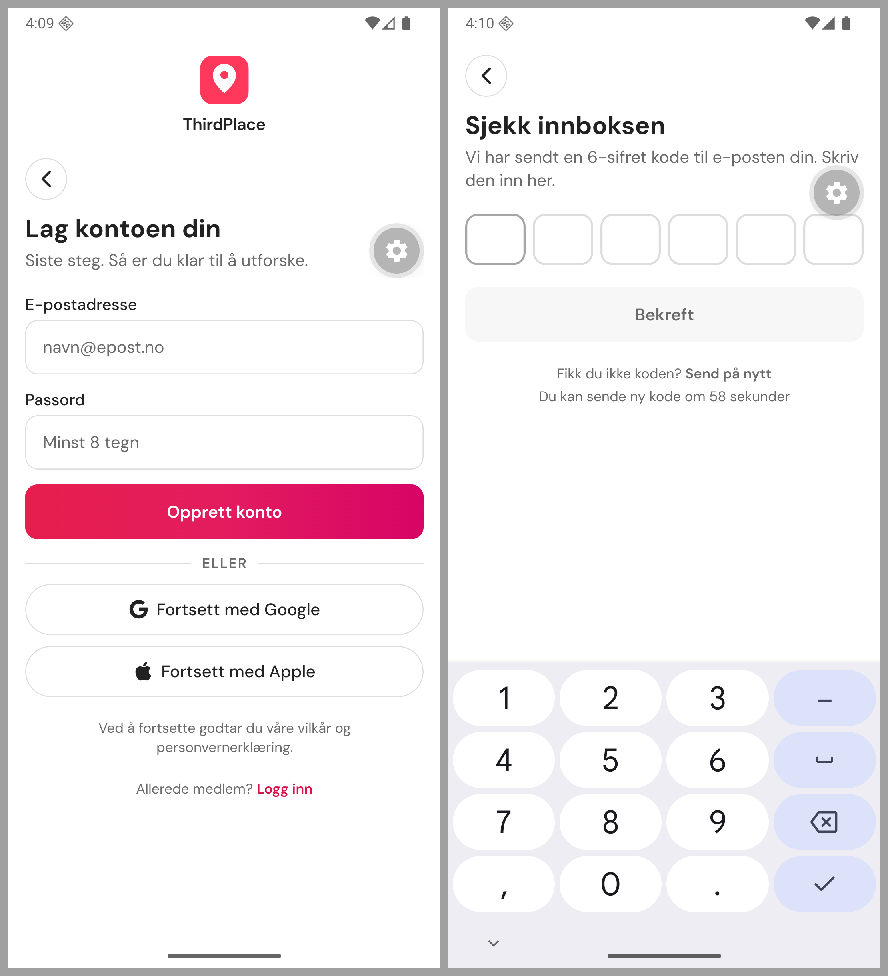

**Outdated pages, before and after (Innstillinger, Personvern, Betaling, Utbetalinger, Chat, Aldersverifisering):**

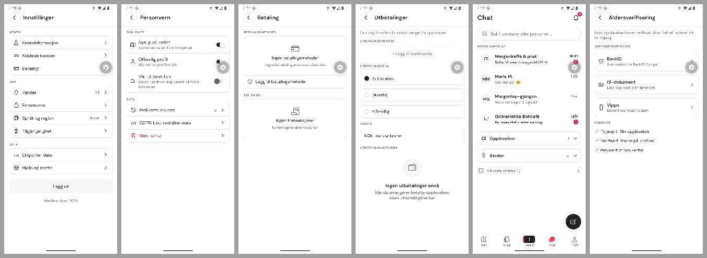

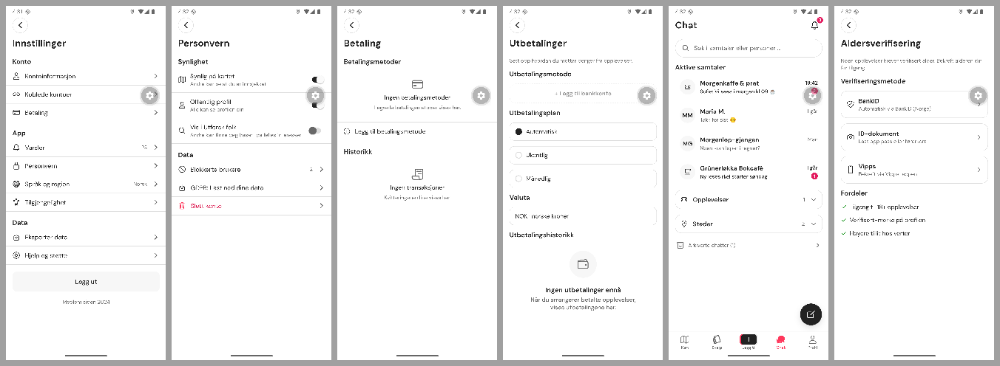

**Pages or sheets, decided by one rule** (user, app-wide: content you read, browse or fill in over several fields is a page; a sheet is only for a short choice, picker, confirmation, filter, share/report/block, sign-in prompt or viewer):

| Now a page                                                                                                                                                                                                                                                                                                                                                                                         | Stays a sheet / overlay                                                                                                                                                                                                                                                                                                                                     |
| -------------------------------------------------------------------------------------------------------------------------------------------------------------------------------------------------------------------------------------------------------------------------------------------------------------------------------------------------------------------------------------------------- | ----------------------------------------------------------------------------------------------------------------------------------------------------------------------------------------------------------------------------------------------------------------------------------------------------------------------------------------------------------- |
| Experience, place, group and person pages; all reviews; chat info, members, invite, archived chats, Ny chat; Innstillinger sub-pages (Kontoinformasjon, Koblede kontoer, Varsler, Språk og region, Tilgjengelighet, Hjelp og støtte), Blokkerte brukere, Slett konto, Rediger profil; Marketplace listing, Ny / Rediger listing, collab tilbud and kontrakt; Varsler, map search, Skriv anmeldelse | Filtre (map and Sveip), Kartlag, Posisjon, Velg tidspunkt, sort, Ting å vite details, ask-host, Slik fungerer vurderinger, pickers, action sheets (Del, Rapporter, Blokker, Forlat, Venteliste, Pay, Avlys, Del regningen), Eksporter data, Logg ut, sign-in prompt, "Bli med i samtalen", step carousel and photo viewer; map pins keep their detail sheet |

**Found on the way and fixed** (beyond the requests): guests could message a host (now the sign-in prompt); "Velg" sat at the end of a long time list (now a sticky footer); "Se alle (n) →" and eight more arrow labels; a rule stated as fact in chat info ("arkiveres etter kvelden") and an e-mail promise in the export sheet (both removed); two different "Eksporter data" sheets (one now); "1 medlemmer"; a doubled "Filtre" title after reopening; the place page's stored "(128)" count and pink star (now from its reviews); Sveip cards' "Fullt"/"Venteliste" status words; Android back returning to onboarding after sign-up (sign-up screens moved to the root stack).

**Honest not-done:** the experience publish path in Legg til is unit-tested but was not driven through all eight steps on the device (its pickers are Modal sheets the UI dump cannot see); created groups, chats and experiences live in memory for the session (persistence is contract-blocked); the "Registrer deg" order (account first) is unit-tested, the welcome order was walked on the device for both branches; a full JS reload while the map streams location can crash the dev client natively (`@rnmapbox/maps` 10.3.8, stale callback; production has no in-app reload, so it is noted in CLAUDE.md rather than patched); the browse list's "slow to update" message is a dev-mode hint on an already memoized, windowed list; iOS is not verified; the Play Store listing behind "Oppdater nå" does not exist yet. Contract markers (`BLOCKED_NOT_V22_CERTIFIED`, `BLOCKED_CONTRACT_GAP`) stay.

## 13. Addendum: Phase 13, what was left (7 November 2026)

After Phase 12 the founder asked what was left. The answer had four parts: PDF screens that had never been built, flows that were only unit-tested, register rows that had drifted from the app, and things that need the founder, the V2.2 contract or a device this PC does not have. The founder chose to build everything that could be built here, to push the branch as a draft pull request so CI runs, to keep the open founder approvals open for now, and to leave the PC running at the end.

| What was left                    | What changed                                                                                                                                                                                                                                                                                                                                                                                                                                                                                                                                                                     | Commit · ledger |
| -------------------------------- | -------------------------------------------------------------------------------------------------------------------------------------------------------------------------------------------------------------------------------------------------------------------------------------------------------------------------------------------------------------------------------------------------------------------------------------------------------------------------------------------------------------------------------------------------------------------------------- | --------------- |
| Register rows out of date        | CLAUDE.md and the map's native-verification register now say the dev client includes GPS and haptics (rebuilt in Phase 12); clustering and camera rows carry their emulator evidence; the surface matrix and screen inventory drop the removed demo markers and list what was still missing.                                                                                                                                                                                                                                                                                     | 00e3988 · 0250  |
| Branch never pushed              | `feat/design-system` pushed and opened as a draft pull request into `main` (ThirdPlace-AS/ThirdPlace-Frontend#11). CI's quality and bundle jobs passed. Nothing merged.                                                                                                                                                                                                                                                                                                                                                                                                          | ·               |
| PDF p13 Preferanser              | New page under Innstillinger (Konto): the onboarding's preference rows plus Gruppestørrelse, saved for the session. The PDF's lines about recommendations and scores are left out (ranking rules are not specified).                                                                                                                                                                                                                                                                                                                                                             | cff54a2 · 0251  |
| PDF p13 Rediger profil           | Photo with "Bytt bilde", Interesser with "+ Legg til", Språk. Lagre now updates the profile everywhere it shows; onboarding answers carry into the profile and Preferanser.                                                                                                                                                                                                                                                                                                                                                                                                      | cff54a2 · 0251  |
| PDF p13 person page              | Shared interests marked, "Offentlige opplevelser", Følg and Melding side by side; Melding opens or starts the direct message; Rapporter and Blokker behind the •••.                                                                                                                                                                                                                                                                                                                                                                                                              | 3ecd5f4 · 0252  |
| PDF p13 Følgere / Følger, Venner | Profil's counts come from follow lists (6 / 3 / 2 instead of the fixed 48 / 61 / 12) and open two new pages: followers and followed people with "Følg tilbake", and Venner with search and a DM button. "Sist aktiv" is left out (presence is not specified).                                                                                                                                                                                                                                                                                                                    | 5939a96 · 0253  |
| PDF p18 Venteliste               | A full listing in Mine listings links to its waitlist: capacity bar, people in the order they joined, "Tilby" opens Nytt samarbeid with that partner filled in. "Auto-godta" is left out (no acceptance rule).                                                                                                                                                                                                                                                                                                                                                                   | 8649c08 · 0254  |
| Notifications open nothing       | Each card opens what it names (the person, the experience, the group, a place's reviews) and is marked read. A follower's page now offers "Følg tilbake".                                                                                                                                                                                                                                                                                                                                                                                                                        | 3116b2f · 0255  |
| Flows only unit-tested           | Publishing an experience from Legg til and "Registrer deg" (account first) walked end to end on the device. On the way: the sign-in fields looked editable but ignored typing; they now take input (nothing is checked or sent) and the auth screens pad for the keyboard.                                                                                                                                                                                                                                                                                                       | 8fbe871 · 0256  |
| Release speed, TalkBack          | Timed on a release APK (no Metro): every measured action paints within a frame or settles with its animation, as in Phase 10. A spoken TalkBack pass (real touch events, speech read from TalkBack's log) found the map sheets speaking the bottom-sheet library's English with a handle that could not be used; it is now "Endre størrelse" (swipe up or down) and the backdrop says "Lukk". Sveip no longer reads the card hidden under the top card, an empty label on the photo pager is gone, info rows read as one item, and Profil's following count reads "Du følger 3". | ae69797 · 0257  |
| One rating per place             | Found in the TalkBack pass: the map's place sheet said "4,6 (128)" from stored fields while the place page said "4,5 · 2 vurderinger". Every surface (sheet, cards, Lagret, filter, sorts) now counts the place's reviews.                                                                                                                                                                                                                                                                                                                                                       | 635bae1 · 0258  |

**Preferanser, Rediger profil with the interest picker, and Profil after an edit:**

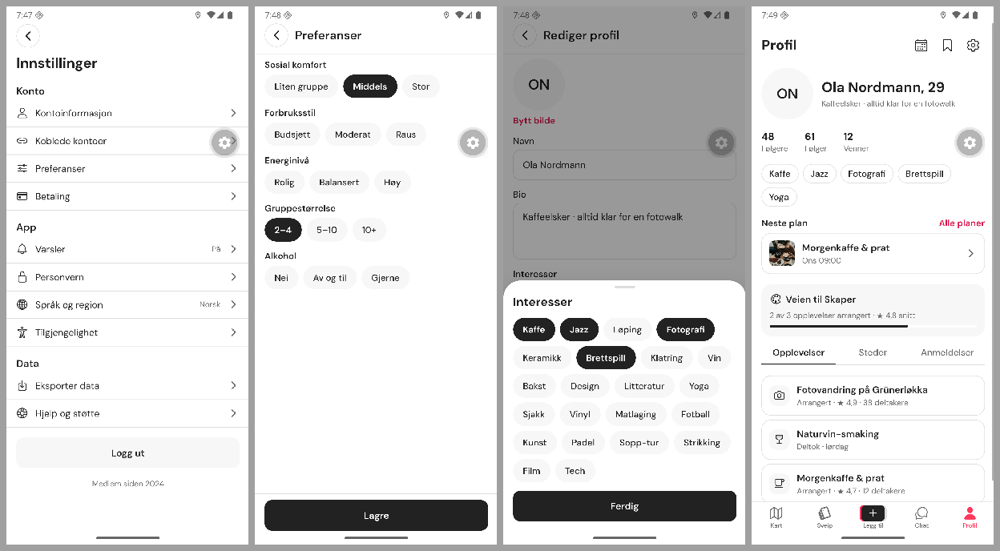

**Profil's counts open Følgere, Følger and Venner:**

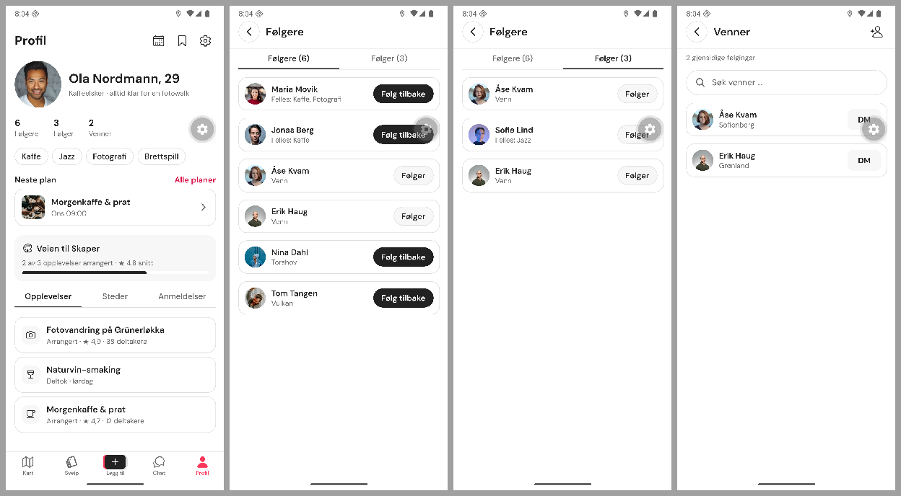

**A person's page per PDF p13, the ••• menu, a new direct message, and Chat with it on top:**

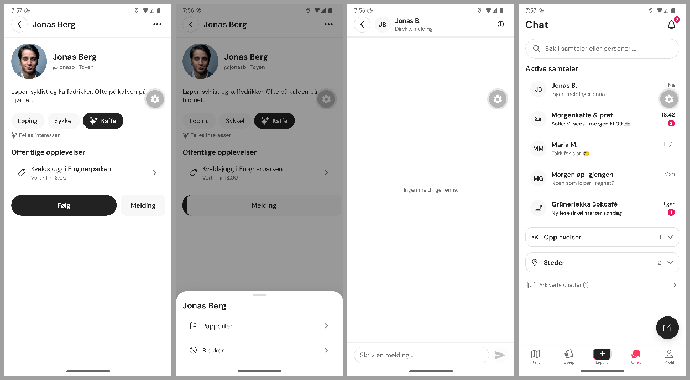

**Mine listings → Venteliste → Tilby, and the waitlist in dark mode:**

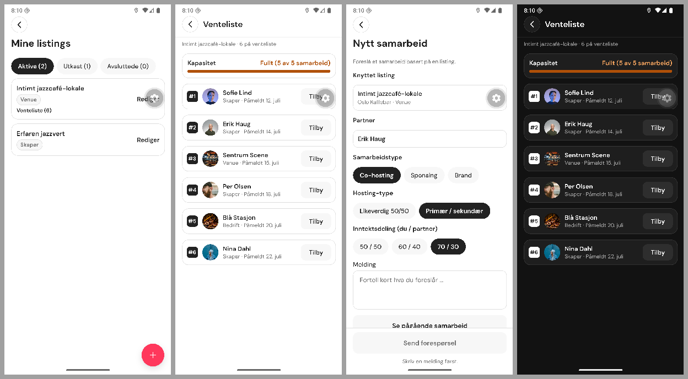

**Varsler opens what each card names:**

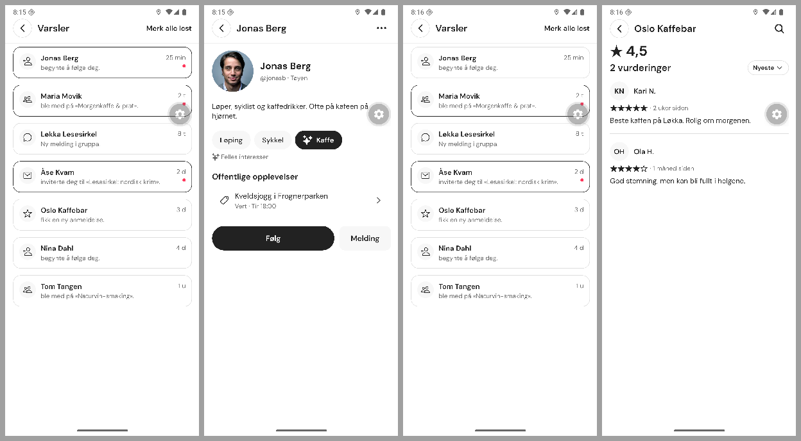

**Legg til → publish an experience, its page and its pin:**

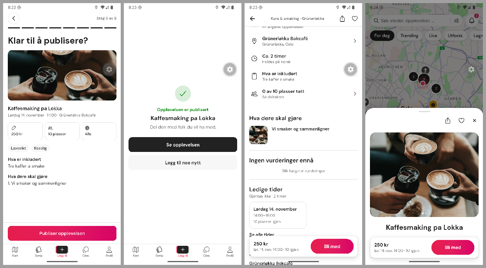

**"Registrer deg": account, code, onboarding, then Profil with the onboarding answers:**

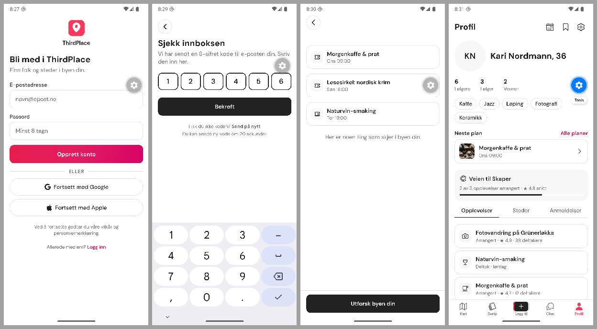

**Sign-in fields take typing; the button stays reachable above the keyboard:**

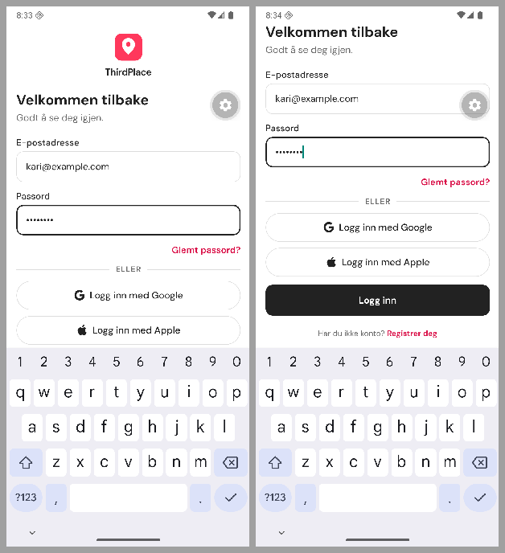

**Release build timings** (x86_64 release APK on the emulator, three runs each, from screen recordings with touch dots):

| Action                               | Phase 10 (production JS in the dev client)      | Phase 13 (release APK)                                       |
| ------------------------------------ | ----------------------------------------------- | ------------------------------------------------------------ |
| First Sveip visit after a cold start | first paint within a frame, settled 0.47–0.62 s | within a frame (3 of 3)                                      |
| Sveip skip, next card settled        | 0.62–0.72 s                                     | 0.66 s (the fly-off animation)                               |
| Filtre open, settled                 | 0.02–0.33 s                                     | 0–0.36 s                                                     |
| Varsler page (new this phase)        | ·                                               | first change 74–135 ms, settled 0.44–0.50 s (push animation) |

**TalkBack, what it says now** (excerpts from TalkBack's own log): the map reads "Endre størrelse, Slider, Sveip opp for å vise mer, eller ned for å vise mindre.", "Oslo", "20 treff", "Søk steder og opplevelser, Button", "Filtre, Button", "Varsler, 3 uleste, Button"; the experience page "Morgenkaffe & prat, 2 bilder. Åpne bildene", "4,7 av 5, 3 vurderinger. Vis alle, Link", "Ca. 1 time, Holdes på norsk og engelsk", "Steg 1 av 4: Hils på de andre, Button"; Følgere "Følg tilbake Maria Movik, Button"; Preferanser rows as radio buttons. Role words are English because the emulator's system language is English.

**Still open after Phase 13.** Founder approvals that stay open by choice: type sizes and motion values marked provisional (FA-1), For deg and Venner as same-for-everyone lists (FA-2), the mock filter bands (FA-3), the category pin colours and the pink active-tab label. Contract-blocked (V2.2 not imported): real accounts, keeping anything after a restart, real joins and waitlists, payments and payouts, search, push and notification preferences, ranking, friend presence and business verification; a new account still shows the fixture profile's activity and follow lists. Not possible on this PC: iOS, the Play Store listing behind "Oppdater nå", and real-phone checks (compass heading, haptic feel, real GPS, 60 fps). In the dev build only: Expo's tools bubble overlaps some right-edge controls, and a full reload while the map streams location can crash the dev client.

## 14. Addendum: Phase 14, Kartlag after a reference and the missing-screen audit (7 November 2026)

The founder sent a screenshot of another map app's layer sheet, asked for Kartlag to look like it, and asked for a search for screens still missing.

| What                               | What changed                                                                                                                                                                                                                                                                                                                                                                                                                                                                             | Commit · ledger |
| ---------------------------------- | ---------------------------------------------------------------------------------------------------------------------------------------------------------------------------------------------------------------------------------------------------------------------------------------------------------------------------------------------------------------------------------------------------------------------------------------------------------------------------------------- | --------------- |
| Kartlag like the reference         | Centred title, a "Kartstil" section with ⓘ, and every base map as a preview tile in a three-column grid (Auto, Daggry, Dag, Skumring, Natt) with the name under it and a pink ring on the one in use. The style names were English (Dawn / Day / Dusk / Night). The previews are crops of our own Studio styles; Auto shows day next to night, and ⓘ gives its schedule. The reference's second section (that app's own capture overlays) has no ThirdPlace counterpart and is left out. | 6bf4560 · 0260  |
| Missing: Marketplace-analyse (p18) | New page from Marketplace's "Analyse" (it used to open the workspace Analyse): Uke / Måned / Total, Listing-visninger, Forespørsler, Konverteringsrate, Snitt svartid, Samarbeid initiert, Fullførte, the request chart, Topplistinger and the average rating given. Every figure is computed from the published listings and the collaboration history. Samarbeidshistorikk now follows p18 (counts, Alle / Fullførte / Avsluttede, statuses; amounts left out).                        | d333f5a · 0261  |
| Missing details (p21, p7)          | Personvern gains p21's Datadeling toggles (Del aktivitet med venner, Personalisert innhold, Analytiske data). Check-in at the place reads p7's "Du er fremme!".                                                                                                                                                                                                                                                                                                                          | 681eb69 · 0262  |

**How the audit was done.** Every screen title on PDF p1–p28 (from the screen inventory) was searched for in the code; the few with no match were checked against the rendered PDF pages. Besides the three rows above, nothing is missing. Left out on purpose and recorded: p24 "Fullfører betaling …" and "Du er med!" (a card number and a processing step; payments are structure only), the p21 "Personvernerklæring" link (no statement text exists), and p25's separate "Velg dato og tid" picker (Legg til picks date and time inline).

**Kartlag: Natt in use, ⓘ open, Auto in use in dark mode:**

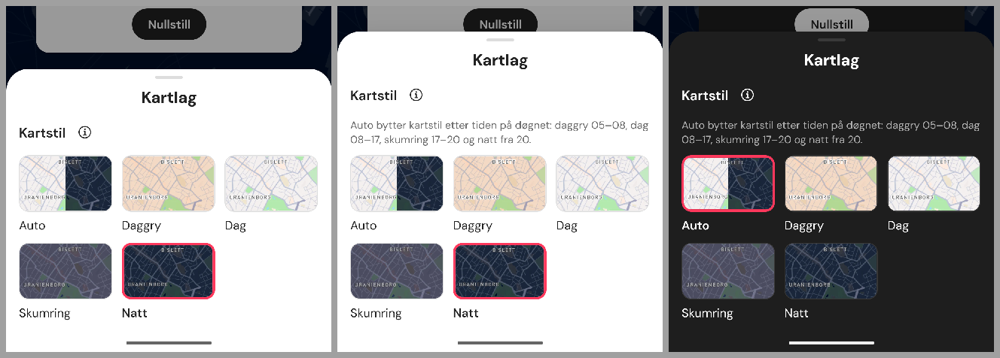

**Marketplace-analyse and Samarbeidshistorikk, light and dark:**

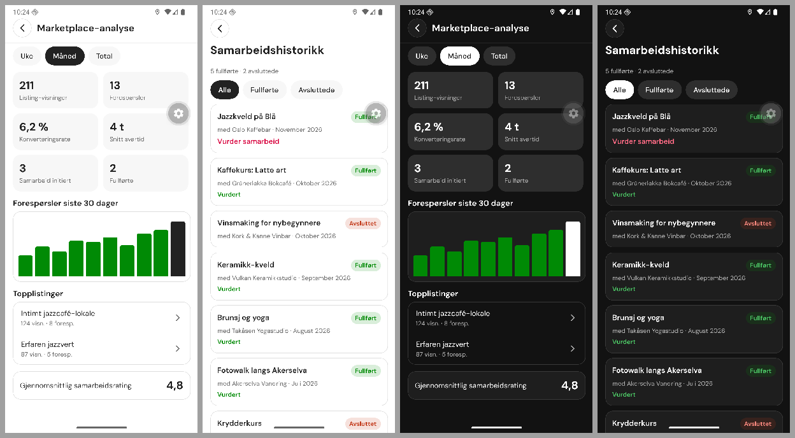

**Personvern with Datadeling, and "Du er fremme!":**

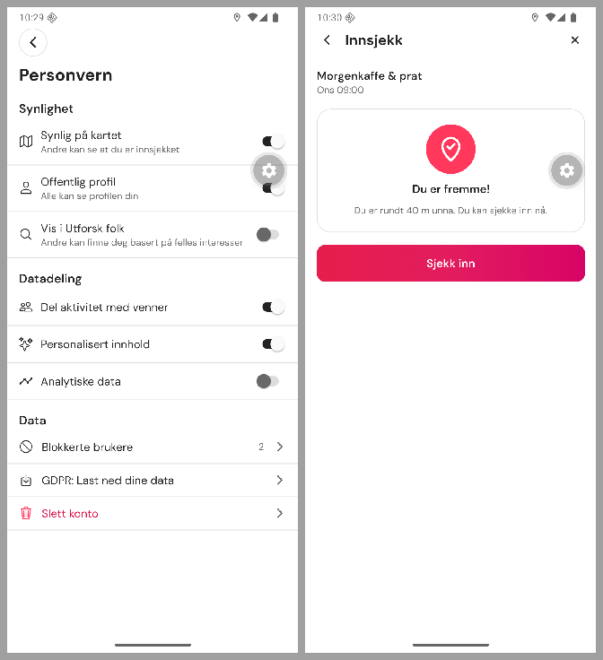

## 15. Addendum: Phase 15, Karttype and the screens the docs did not have (7 November 2026)

The founder asked for a choice between satellite, terrain and the standard map, and which screens the app needs that the docs do not have; then, asked what else to consider, added three more items.

| What                           | What changed                                                                                                                                                                                                                                                                                                                                                                                                         | Commit · ledger |
| ------------------------------ | -------------------------------------------------------------------------------------------------------------------------------------------------------------------------------------------------------------------------------------------------------------------------------------------------------------------------------------------------------------------------------------------------------------------- | --------------- |
| Karttype                       | Kartlag gets "Karttype" above "Kartstil": Standard, Satellitt (Mapbox Standard Satellite with the same light preset) and Terreng (hill shading and contour lines with metre labels over our map, so Auto and night still work). A pick keeps the sheet open. The Mapbox logo and ⓘ moved above the browse sheet's peek, and the sheet credits its sources; the satellite preview loads live instead of being stored. | 3519b5f · 0264  |
| Broken links and crashes       | A Norwegian "Fant ikke siden" page instead of expo-router's English screen; a crash screen with p26's "Noe gikk galt" and "Prøv igjen"; shared `join/…` links open their chat or experience and `i/…` invite links open Welcome or the map; the dev screens no longer open in release builds.                                                                                                                        | 299d21d · 0265  |
| PDF p19 and small fixes        | Kontoinformasjon gets p19's Passord field (Endre passord page) and session sign-out. Denied location offers "Åpne innstillinger". Chat and Varsler have empty states. Slett konto signs you out; Blokker fills Blokkerte brukere; a DM has no "Inviter"; Forlat asks first.                                                                                                                                          | 1721c9c · 0266  |
| Spec-safe wording              | Lines that stated rules the master spec contradicts are gone (deletion permanence, report anonymity, location as required, map visibility, an export e-mail, a Skaper application that approved itself); Del regningen, the Belønninger tiers and the payout schedule are hidden as V1 non-goals. A test keeps them out.                                                                                             | bce316b · 0267  |
| Tilgjengelighet                | Større tekst, Reduser bevegelse and Vis kun rullestolvennlige now change the app; Høy kontrast and Skjermleser-optimalisert are hidden until defined.                                                                                                                                                                                                                                                                | 9afc57d · 0268  |
| Choices kept on the phone      | The map type and style and the Tilgjengelighet switches survive a restart (AsyncStorage; the dev client was rebuilt). Account data stays in memory.                                                                                                                                                                                                                                                                  | c718e98 · 0269  |
| Om ThirdPlace and Lisenser     | The app version and every open-source package in the bundle with its own licence text, plus font, map and photo credits.                                                                                                                                                                                                                                                                                             | 937a341 · 0270  |
| Launch checklist and spec gaps | `docs/LAUNCH_CHECKLIST.md` (texts, store forms, services, safety, open decisions, checks) and `docs/surfaces/SPEC_SURFACE_GAPS.md` (what the spec asks for beyond the PDF, and why it is blocked).                                                                                                                                                                                                                   | 0271            |

**Which screens the docs did not have.** Built now: the not-found and crash screens, shared-link routes, Om ThirdPlace and Lisenser, and p19's password and session controls. Waiting for texts: Brukervilkår, Personvernerklæring, Retningslinjer for fellesskapet, Skaper/selger-vilkår, payment and refund terms, and web pages for account deletion and support. Waiting for the contract: appeals and report status, consent, data-request status, receipts and refunds, check-in problem states, Skaper and business-claim progress, subscriptions and people / business search (SPEC_SURFACE_GAPS A1–A20).

**Karttype: the sheet, Satellitt, Terreng by day and at night:**

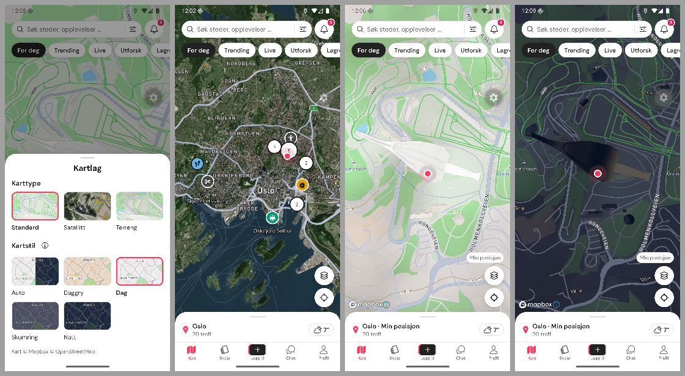

**After a restart: the chosen map and larger text are still there:**

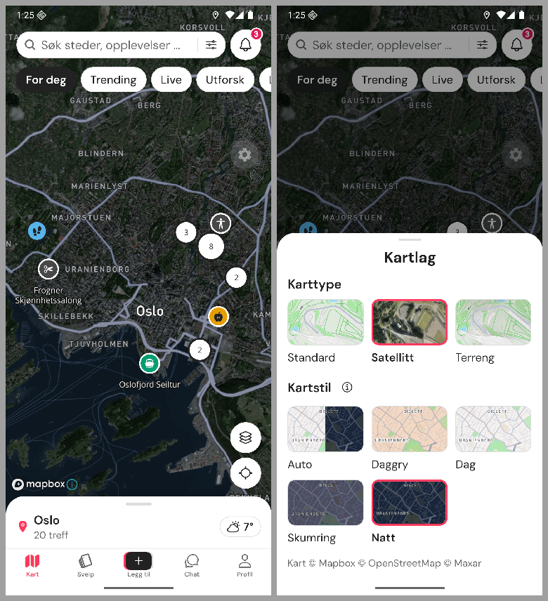

**Fant ikke siden, Noe gikk galt, a join link opening its chat:**

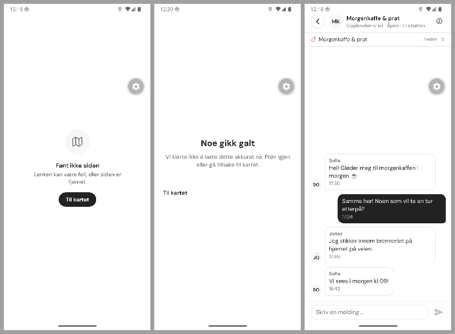

**Kontoinformasjon (p19), Endre passord, Tilgjengelighet, a licence:**

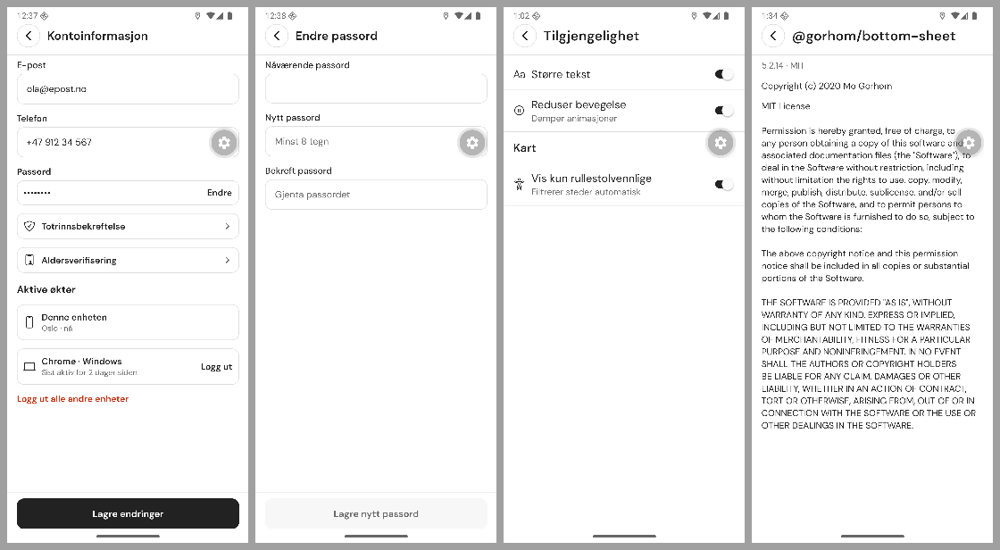

**Spec-safe screens: Utbetalinger, Inviter venner, Slett konto, Personvern:**

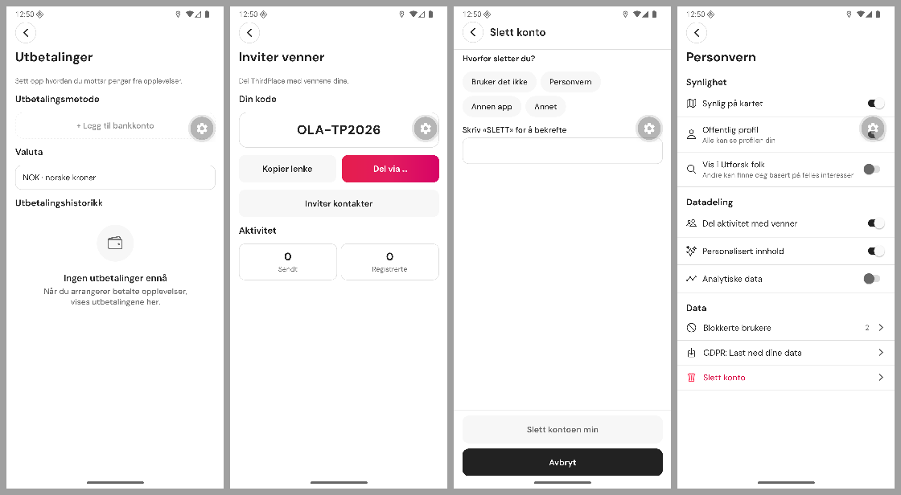

## 16. Addendum: each section against the leading apps (7 November 2026)

The full comparison also lives in `docs/reviews/SECTION_BENCHMARK_2026-11-07.md`. The same day the centre Legg til button became grey while another tab is open (founder; db44ce6 · 0273).

The founder asked to compare each section of the app with the leading apps in that category. For each section: the apps that set expectations, what they do that users now take for granted, where ThirdPlace stands today (the build at commit db44ce6), and what to do about it.

This is a benchmark only. Nothing here copies another app's look, names or layout; a suggestion describes a common pattern that ThirdPlace would build in its own design system. Each suggestion carries a tag:

- **UI** — buildable now on the fixtures, inside the governance rules (no invented counts, rules, payments or backend success). Still a founder call, because the PDF does not draw it.
- **UI + native** — as UI, but needs a native module and a rebuild of the test app.
- **Policy** — needs a written rule (privacy, safety, moderation) before it can be built.
- **Contract** — needs the backend contract (V2.2).

Sources for the 2025–2026 features are listed at the end; well-established patterns (Google Maps, WhatsApp, Instagram) are described from the apps as they ship.

### Summary

| Section               | Benchmarks                                                          | Where ThirdPlace stands                                                                         | Top gap                                                                  |
| --------------------- | ------------------------------------------------------------------- | ----------------------------------------------------------------------------------------------- | ------------------------------------------------------------------------ |
| Kart                  | Google Maps, Airbnb map search, Snap Map / Instagram Map            | Close: category pins, clusters, browse sheet with count, shared filters, Kartlag with map types | The list ignores where you panned ("Søk i dette området"); no directions |
| Sveip                 | Tinder, Hinge, BFF by Bumble                                        | Close: full-bleed cards, gestures with undo, like → join the chat, group swipe                  | No first-time hint; nothing shows who else is going                      |
| Opplevelse / sted     | Airbnb Experiences, Meetup, Partiful, Google Maps place sheet       | Close: Airbnb-style page with reviews, times, meeting point, chat, things to know               | No "who's going" faces, no add to calendar, no directions                |
| Legg til              | Partiful, Meetup, Airbnb hosting                                    | Good: Sted / Opplevelse / Gruppe wizards with review and success                                | No "start from a past experience"; no live preview                       |
| Chat                  | WhatsApp, Instagram DMs, Meetup event chat, BFF Groups              | Behind: list, thread, info, members, invite link                                                | No reactions or replies; no unread badge on the tab; no polls            |
| Profil                | Instagram, Airbnb profile, Hinge                                    | Good: counts from lists, interests, next plan, tabs                                             | No "people you've met"; no prompts that start a conversation             |
| Varsler               | Instagram activity, Airbnb                                          | Good: cards, unread, mark all read, taps open the item                                          | Not grouped by day; no inline "Følg tilbake"                             |
| Lagret / Mine planer  | Airbnb Wishlists and Trips, Meetup "Your events"                    | Good: tabs, onward empty states, "Til samtalen"                                                 | No countdown on the next plan; no calendar                               |
| Oppdag folk           | BFF by Bumble, Instagram suggestions                                | Good: shared interests, follow, filter, invite                                                  | Thin reason for a suggestion; no light first hello                       |
| Bedrift / Marketplace | Airbnb Host, Instagram professional dashboard, Meetup organizer app | Good: hub, calendar, analytics from lists, listings, collaborations                             | No "today" view for hosts                                                |
| Innstillinger         | iOS Settings, Instagram, Airbnb account                             | On par for its size: sections, account, privacy, Tilgjengelighet, Om / Lisenser                 | Legal pages wait for texts (launch checklist)                            |

### Kart

**Leaders do:** Airbnb and Google Maps refresh the results for the area you pan to (a "search this area" button, or automatic refresh), and the list and the map always show the same set. Google Maps' place sheet puts **Directions** first and lets you choose standard, satellite or terrain from a layers sheet. Snap Map and the Instagram map (August 2025) show friends who chose to share their location, with per-friend controls, and content posted from places.

**ThirdPlace today:** category-coloured pins with glyphs, clusters, a browse sheet with "N treff", the map's Filtre shared with Sveip, Kartlag with Standard / Satellitt / Terreng and times of day, Posisjon that flies to you, a search page with recent searches. The Venner mode is a same-for-everyone shell (FA-2).

| Gap                                        | Suggestion                                                                                                                     | Tag               |
| ------------------------------------------ | ------------------------------------------------------------------------------------------------------------------------------ | ----------------- |
| The list is per mode, not per visible area | "Søk i dette området" after a pan: the browse list and the count follow the visible map (client-side filter over the fixtures) | UI                |
| No way to get there                        | "Veibeskrivelse" on a place and on "Hvor vi møtes", opening the phone's maps app at the coordinate                             | UI                |
| Friends on the map                         | Opt-in location sharing with chosen friends (the Instagram / Snap model)                                                       | Policy + Contract |

### Sveip

**Leaders do:** Tinder's cards with photo tap zones and Rewind (undo the last swipe); Tinder **Double Date** (2025) lets two friends swipe together on other pairs and opens a four-person chat; Tinder's **Chemistry** gives a daily curated pick from a Q&A. Hinge lets you like one specific photo or answer and add a comment. BFF by Bumble (relaunched September 2025 as its own app) moved from swiping to a scroll with "waves" and added a **Groups** tab with chat rooms and an in-app calendar. A one-time hint on the first card is the usual way to teach the gestures.

**ThirdPlace today:** one deck for experiences and places, full-bleed cards with photo carousel and tap zones, velocity gestures with stamps, one-level undo, like → "Bli med i samtalen", the map's filters, and group swipe from Lagret ("Sveip lagrede med venner").

| Gap                             | Suggestion                                                                                 | Tag                       |
| ------------------------------- | ------------------------------------------------------------------------------------------ | ------------------------- |
| A new user meets the deck cold  | A one-time hint on the first card (swipe right to join the chat, left to skip, up to save) | UI                        |
| You can't see who else is going | Small avatar stack and "N skal" on the card, from the experience's attendee list           | Policy (who may be shown) |
| Daily curated pick              | A "Dagens forslag" card                                                                    | Contract (ranking)        |

### Opplevelse- og stedsider

**Leaders do:** Airbnb Experiences (2025 social features) show **who's going** before you book, with where they are from, let you message co-guests, and add the people you met to **Connections** on your profile, all with a per-experience opt-in. Partiful event pages show the guest list, comments and a shared photo album, send **text blasts** and let guests vote between date options. Meetup has an attendee list, event chat and a waitlist that moves people up automatically. Event apps add the event to your calendar; Google Maps puts directions on the place.

**ThirdPlace today:** an Airbnb-style page (gallery, rating line, rows, what you'll do, reviews with sort, times, "Hvor vi møtes" with a map card and "Send melding", the chat section, things to know, a pinned join card), a place page in the same layout, Deltakere behind a row.

| Gap                    | Suggestion                                                                                              | Tag         |
| ---------------------- | ------------------------------------------------------------------------------------------------------- | ----------- |
| Faces of who's going   | Avatar stack on the join card and next to Deltakere                                                     | Policy      |
| Add to calendar        | "Legg til i kalender" on the page and on Mine planer (the spec says calendar export "may be supported") | UI + native |
| Directions             | "Veibeskrivelse" next to the meeting-point map                                                          | UI          |
| Photos after the event | A shared album                                                                                          | Contract    |

### Legg til

**Leaders do:** Partiful builds an event page from a few fields and lets a host invite the same guests again next time; Meetup organizers can copy an event; Airbnb's hosting flow saves progress and shows a preview before publishing. Instagram and TikTok keep "create" one tap from anywhere.

**ThirdPlace today:** Sted / Opplevelse / Gruppe, import from link, step wizards with a review step and a success screen, published experiences on the map. The centre button now turns grey when another tab is open.

| Gap                                | Suggestion                                                                | Tag      |
| ---------------------------------- | ------------------------------------------------------------------------- | -------- |
| Hosts retype repeating experiences | "Start fra en tidligere opplevelse": prefill the wizard from one of yours | UI       |
| No preview until the end           | A small "Slik ser det ut" card on the step footer                         | UI       |
| Co-hosts, date polls               | Co-host invites; let guests vote between times                            | Contract |

### Chat

**Leaders do:** WhatsApp and Instagram set the baseline: long-press reactions, swipe-to-reply with a quoted message, an unread count on the tab, polls and events in group chats (WhatsApp), photos and voice notes. Instagram keeps **message requests** from people you don't follow apart. Meetup has an event chat for attendees; BFF Groups are chat rooms with plans.

**ThirdPlace today:** the chat list (Aktive, Opplevelser, Steder, Arkiverte), the thread with the pinned experience, chat info, members, invite link and QR, Demp, Forlat (with confirmation), Rapporter.

| Gap                                        | Suggestion                                                                                                   | Tag      |
| ------------------------------------------ | ------------------------------------------------------------------------------------------------------------ | -------- |
| No reactions or replies                    | Long-press a message for a reaction row; swipe right to reply with the quoted message (local to the session) | UI       |
| Unread chats are invisible from other tabs | An unread count on the Chat tab, counted from the chats                                                      | UI       |
| Polls for "when do we meet"                | A poll message type                                                                                          | Contract |
| Message requests                           | Keep DMs from people you don't follow apart                                                                  | Policy   |

### Profil

**Leaders do:** Airbnb's 2025 profile shows past trips and the people you met (Connections); Hinge profiles use prompts that give others an easy opening line; Instagram shares a profile by link or QR.

**ThirdPlace today:** name and age, bio, Følgere / Følger / Venner counted from the lists, interests, Neste plan, Veien til Skaper, tabs for Opplevelser / Steder / Anmeldelser.

| Gap                          | Suggestion                                             | Tag                            |
| ---------------------------- | ------------------------------------------------------ | ------------------------------ |
| No record of who you met     | "Folk du har møtt", from experiences you attended      | Contract (attendance) + Policy |
| Hard to start a conversation | One or two prompts ("Spør meg om …") in Rediger profil | UI (new profile fields)        |
| Can't share your profile     | "Del profil" (link)                                    | UI                             |

### Varsler

**Leaders do:** Instagram groups activity by period (today, this week, earlier) and puts the action on the row ("Follow back"); Airbnb links each notice to its trip or message.

**ThirdPlace today:** cards with type glyphs, unread dots, "Merk alle lest", each card opens its person, experience, chat or place.

| Gap                                 | Suggestion                                                         | Tag |
| ----------------------------------- | ------------------------------------------------------------------ | --- |
| One long list                       | Headings "I dag", "Denne uken", "Tidligere" from the fixture times | UI  |
| An extra tap for the obvious action | "Følg tilbake" on follow notices (the follow store already exists) | UI  |

### Lagret og Mine planer

**Leaders do:** Airbnb wishlists (named lists) and Trips with what's next; Meetup "Your events"; Timeleft keeps a countdown to your next event on the lock screen.

**ThirdPlace today:** Lagret with type tabs and an onward empty state, Sveip lagrede med venner, Mine planer with Kommende / Venteliste / Tidligere / Avlyst, "Til samtalen", "Vurder opplevelsen", Neste plan on Profil.

| Gap                  | Suggestion                                                                      | Tag         |
| -------------------- | ------------------------------------------------------------------------------- | ----------- |
| No sense of how soon | A "om 2 dager" / "i kveld" chip on upcoming plans and Neste plan                | UI          |
| Calendar             | "Legg til i kalender"                                                           | UI + native |
| Named lists          | Collections were weighed and left out in Phase 10; revisit only if saving grows | —           |

### Oppdag folk og venner

**Leaders do:** BFF by Bumble sends a light "wave" instead of a full message and builds groups; Instagram explains a suggestion ("followed by …").

**ThirdPlace today:** people with shared interests, Følg, Filter folk, Inviter venner and kontakter, Følgere / Følger / Venner, Melding on the person page.

| Gap                                 | Suggestion                                                             | Tag                           |
| ----------------------------------- | ---------------------------------------------------------------------- | ----------------------------- |
| The reason for a suggestion is thin | Name the overlap ("Kaffe og jazz", "Begge skal på Morgenkaffe & prat") | UI (from fixtures)            |
| A message is a big first step       | A light "Hei"-wave                                                     | Policy (who may contact whom) |

### Bedrift, Marketplace og Workspace

**Leaders do:** Airbnb Host opens on **Today** (who arrives, what needs you), with Calendar, Listings, Messages and Insights; Instagram's professional dashboard and Meetup's organizer app put the next action first.

**ThirdPlace today:** the workspace hub (Dashbord, Kalender, Lokasjoner, Utbetalinger, Marketplace), Analyse and Marketplace-analyse computed from the lists, listings, Venteliste, collaborations.

| Gap                      | Suggestion                                                                                         | Tag      |
| ------------------------ | -------------------------------------------------------------------------------------------------- | -------- |
| No "what needs me today" | An "I dag" block on the hub: today's and this week's experiences from Kalender, the waitlist count | UI       |
| Attendance on the day    | Check-in list for the host                                                                         | Contract |
| Message all guests       | A host broadcast                                                                                   | Contract |

### Innstillinger

**Leaders do:** short sections, account first, privacy controls with plain explanations, legal pages one tap away.

**ThirdPlace today:** Konto, App, Data, Om; Kontoinformasjon with Passord and sessions; Personvern with Datadeling; Tilgjengelighet that works; Om ThirdPlace and Lisenser. On par for an app this size; the legal pages wait for their texts ([../LAUNCH_CHECKLIST.md](../LAUNCH_CHECKLIST.md)).

### What to build first

UI-only suggestions, ordered by how much they close the gap to the leaders for a meet-new-people app:

1. **Chat reactions and replies**, plus the unread count on the Chat tab.
2. **"Søk i dette området"** on the map, and **Veibeskrivelse** from places and meeting points.
3. **Countdown chips** on upcoming plans, and **Varsler grouped by day** with "Følg tilbake".
4. **Start a new experience from a past one**, and a **first-time hint** on Sveip.
5. **An "I dag" block** on the business hub.

Needs a decision first: who's going (faces), friends on the map, light waves, message requests (privacy rules); add to calendar (native module and a rebuild).

### Sources

- Airbnb, [Introducing social features for Airbnb Experiences](https://news.airbnb.com/introducing-social-features-for-airbnb-experiences) and [2025 Summer Release](https://news.airbnb.com/airbnb-2025-summer-release).
- TechCrunch, [Bumble BFF's revamped app is here](https://techcrunch.com/2025/09/18/bumble-bffs-revamped-app-is-here-focusing-on-friend-groups-and-community-building/) (18 September 2025).
- Tinder, [Double Date help article](https://www.help.tinder.com/hc/en-us/articles/34712866048653-Double-Date) and [Tinder Sparks 2026](https://www.tinderpressroom.com/2026-03-12-Tinder-Debuts-Inaugural-Product-Keynote-Tinder-Sparks-2026-Start-Something-New).
- Hinge, [Your Turn Limits](https://hinge.co/newsroom/your-turn-limits).
- Partiful, [App Store listing](https://apps.apple.com/us/app/partiful-party-invite-maker/id1662982304) and [partiful.com](https://partiful.com/).
- Timeleft, [How does Timeleft work](https://timeleft.com/blog/how-does-timeleft-work/) and [App Store listing](https://apps.apple.com/us/app/timeleft-make-new-friends-irl/id6466442949).
- Meta, [New Instagram features to help you connect](https://about.fb.com/news/2025/08/new-instagram-features-help-you-connect/) (the Instagram map, August 2025).
- Meetup, [Enable a waitlist for your Meetup event](https://help.meetup.com/hc/en-us/articles/360003883411-Enable-a-Waitlist-for-your-Meetup-event).

### ThirdPlace today, by section

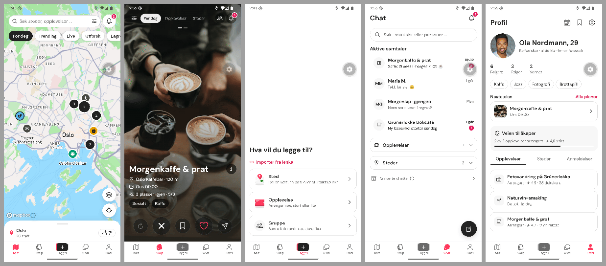

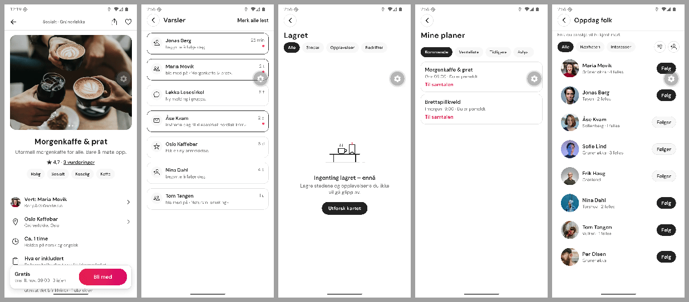

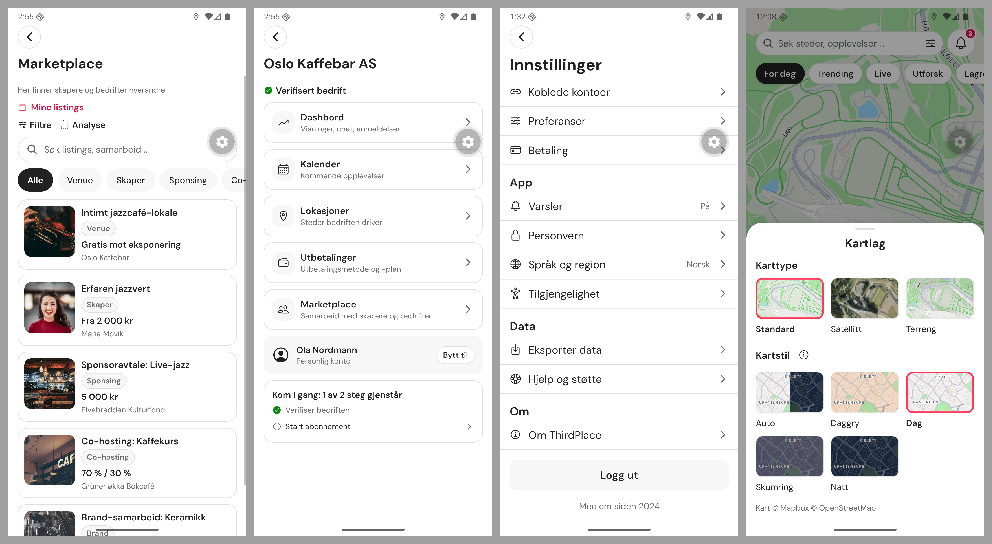

## 17. Addendum: Phase 16, the section-benchmark suggestions built (7 November 2026)

The founder asked for the Legg til button to turn grey when another tab is open, and for each section to be compared with the leading apps in its field (§16). From that comparison the founder chose to build the four UI groups, "add to calendar" (a new native module, so the dev client was rebuilt), and who's going with an opt-in per person, like Airbnb.

| What                   | What changed                                                                                                                                                                                                                                                                                                                                                                                                         | Commit · ledger |
| ---------------------- | -------------------------------------------------------------------------------------------------------------------------------------------------------------------------------------------------------------------------------------------------------------------------------------------------------------------------------------------------------------------------------------------------------------------- | --------------- |
| Legg til grey          | The centre button is grey like the other idle tabs while another tab is open; its colours come back when Legg til is open.                                                                                                                                                                                                                                                                                           | db44ce6 · 0273  |
| Section benchmark      | §16 and `docs/reviews/SECTION_BENCHMARK_2026-11-07.md`: each section against two or three leading apps, with what to build and what needs a decision.                                                                                                                                                                                                                                                                | 1e1039a · 0274  |
| Chat                   | Long-press a message for a reaction row and "Svar"; swipe a message right to reply with a quote; the Chat tab counts the chats with unread messages, and opening a chat reads it.                                                                                                                                                                                                                                    | 5811183 · 0275  |
| Map and directions     | "Søk i dette området" after a pan or pinch limited the pins, the browse list, its count and Filtre's "Vis N resultater" to the visible part of the map (removed again by the founder, 0283). "Veibeskrivelse" on places, in the map's place sheet and at "Hvor vi møtes" opens the phone's maps app. Each style now opens north up and flat (the Studio styles carried a saved camera, bearing 13.6° and pitch 14°). | a06c99e · 0276  |
| Plans and Varsler      | Countdown chips ("I kveld", "I dag", "I morgen", "Om 4 dager") on upcoming plans and Profil's Neste plan; Varsler under "I dag" / "Denne uka" / "Tidligere", with "Følg tilbake" on follow notices.                                                                                                                                                                                                                  | 48cca29 · 0277  |
| Create, swipe, hosts   | "Start fra en tidligere opplevelse" fills a new experience from one you host, except the time; a one-time "Slik sveiper du" card on Sveip, remembered by the phone; "I dag" on the workspace hub (today's times, the next 7 days, the listing waitlists).                                                                                                                                                            | a30c119 · 0278  |
| Who's going            | A face only for people who chose "Vis meg som deltaker" (a new Personvern switch, off by default); "N skal" counts everyone. On the Sveip card, the map's browse card and the join card, all following your own join; "Se deltakere" names the host and the people who opted in, then "og N andre".                                                                                                                  | 2c64f8c · 0279  |
| Add to calendar        | "Legg til i kalender" on the experience page (the chosen time) and on upcoming plans opens the phone's calendar app with the title, time, meeting point and link filled in; the app asks for no calendar permission.                                                                                                                                                                                                 | 81ddb58 · 0280  |
| Map fix after review   | After Posisjon the map stays where the user pans it; it used to fly back to the user on every GPS update. (The same commit made "Søk i dette området" read the map when tapped; that went with the feature in 0283.)                                                                                                                                                                                                 | 33d6a75 · 0282  |
| Area search removed    | Founder decision: "Søk i dette området" is gone again; the list and its count follow the mode and filters only. The rotate and tilt lock that came with it is lifted; each style still opens north up and flat.                                                                                                                                                                                                      | revert · 0283   |
| Legg til like the tabs | Founder: the centre tab fits in with the others. A plus in a rounded square, outline and grey while idle, filled ember with the plus cut out while open (replaces the TikTok-style stacked button).                                                                                                                                                                                                                  | 0284            |

**Still open from §16** (each needs a decision or the contract): friends on the map and "light waves" (privacy rules), message requests, polls and co-hosts, a "Slik ser det ut" preview card in Legg til, and "Folk du har møtt" (attendance).

**Chat: the unread count on the tab, a reaction row with "Svar", a reply with its quote:**

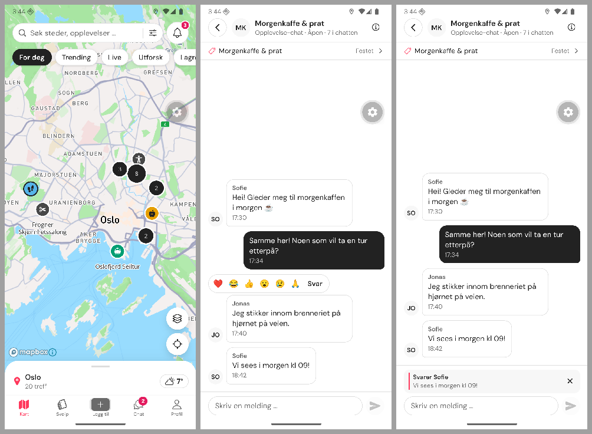

**Søk i dette området (removed again in 0283): the pill after a pan, 2 treff in the area, an empty area; Veibeskrivelse on a place (kept):**

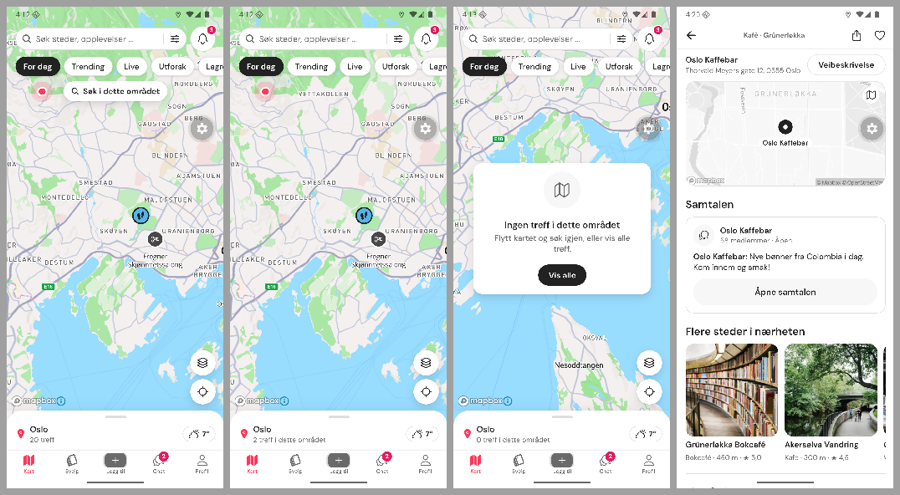

**Mine planer and Neste plan count down; Varsler by day, before and after "Følg tilbake":**

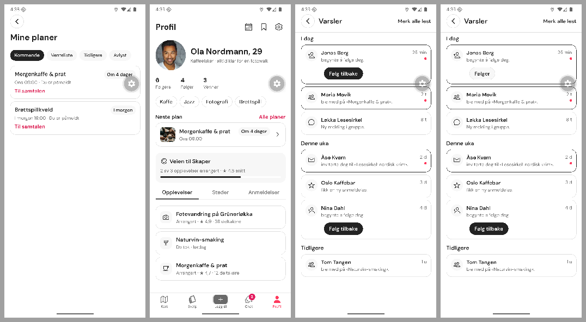

**Start from a past experience, the filled step, the Sveip hint, "I dag" on the hub:**

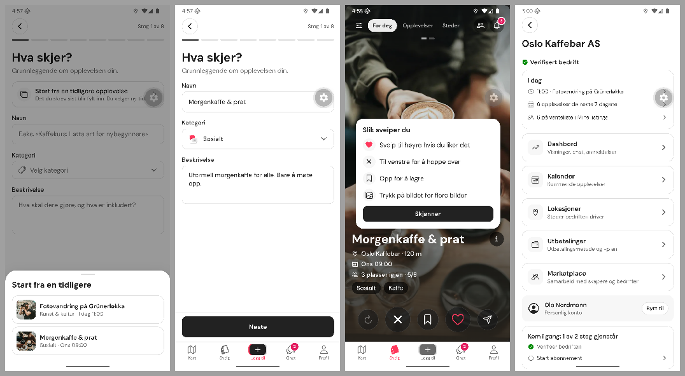

**Who's going: the Sveip card, the Personvern switch, joined with my face first, Se deltakere:**

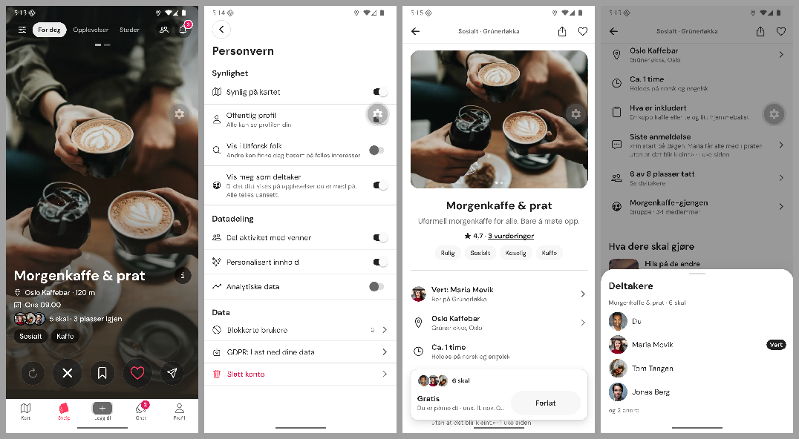

**Legg til i kalender, next to "Se alle tider" (on the emulator the calendar app asks for a Google account before it shows the filled-in event):**

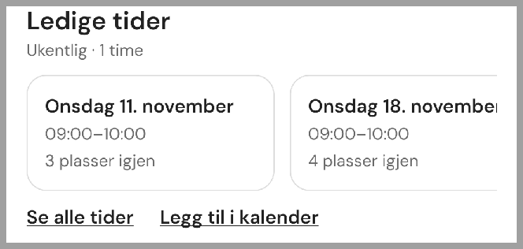

**Legg til, before and after (0284): the old stacked button while idle; the new plus in a rounded square while idle, while open, and open in dark mode:**

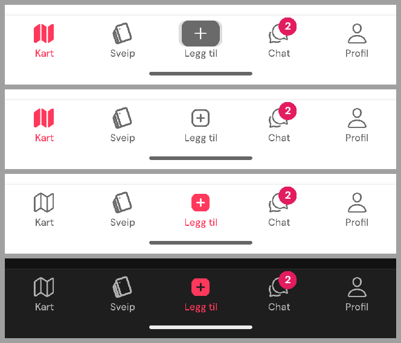

## 18. Addendum: Phase 17, the five best apps per screen type (7 November 2026)

The founder asked for each screen type (the Mobbin taxonomy, from onboarding and splash to timeline and history) and for the other screens ThirdPlace has: which five apps do it best, and what can ThirdPlace take or learn, using all apps and not only the ones used before. The same content is in `docs/reviews/SCREEN_PATTERN_BENCHMARK_2026-11-07.md`. Phase 17 also removed "Søk i dette området" again and gave Legg til the same icon style as the other tabs (§17). Nothing below is built until the founder picks it.

### Method and rules

- **Pool:** apps from every category, not only the earlier set (Airbnb, Instagram, Meetup, Tinder, Google Maps, Partiful, Hinge, WhatsApp, Bumble, Timeleft, Snap Map, TikTok). Earlier apps appear only where they are among the best for that screen. Of the 76 different apps named below, 64 were not in the earlier benchmark (system apps such as Settings and the share sheet count once as Apple iOS; Snap Map counts as Snapchat).
- **Picks:** the reviewer's choice among apps widely cited for that screen (pattern libraries, case studies, design awards), one line each on what they do best. App behaviour is described from the apps' public releases and help pages; no app was installed or signed into for this report, and where a line has no linked source it is general knowledge of the shipped app.
- **Pattern references:** each section links a public pattern article (ScreensDesign's recorded-screen articles, Mobbin, NN/g, Courier, Appcues GoodUX and others). Those articles show their own examples, which are often different apps; they back the pattern, not the pick.
- **ThirdPlace now:** the route or component that covers the screen today (`docs/SCREEN_INVENTORY.md`), as have / partial / missing.
- **Take:** what to borrow, tagged as in SECTION_BENCHMARK: **UI** (buildable on fixtures within the PDF and founder decisions), **Contract** (needs the V2.2 backend contract), **Policy** (needs a written rule: privacy, safety, moderation, payments), **Founder** (a product choice). Nothing here is built until the founder picks it.
- Benchmark only: no tracing, no lookalikes, no invented counts, rules or payment behaviour (CLAUDE.md governance).

**Start**

### Splash

ThirdPlace now: `app/index.tsx`, logo and "Finn folk og steder i byen din", waits for fonts only (Phase 10). **Have.**

| App       | What it does best                                                                    |
| --------- | ------------------------------------------------------------------------------------ |
| Instagram | The logo for a moment, then the cached feed straight away.                           |
| Spotify   | Logo on black, then the cached home; no tagline to wait for.                         |
| Duolingo  | A short mascot moment in the brand colour that leads straight into the first choice. |
| Apple     | Its own apps launch on a screen that looks like the first screen, as its HIG asks.   |
| Airbnb    | The logo, then browsing as a guest: no sign-in wall.                                 |

Pattern reference: [Apple HIG, launching](https://developer.apple.com/design/human-interface-guidelines/launching), [Duolingo teardown (ScreensDesign)](https://screensdesign.com/articles/duolingo-onboarding-design/).

Take: **UI** a dark-mode splash background, so a phone in dark mode does not flash pink then dark (the app follows the system theme since Phase 5; the splash colour is one value in `app.json`, which needs a dev-client rebuild).

### Onboarding

ThirdPlace now: `app/onboarding.tsx` (role, "Dette er deg" with the 18+ birthday, interests, preferences, permissions) before "Lag kontoen din" (founder 2026-11-06); Bedrift has its own flow. **Have.**

| App       | What it does best                                                                                                 |
| --------- | ----------------------------------------------------------------------------------------------------------------- |
| Duolingo  | You finish a first lesson before any account; signing up is framed as saving that progress.                       |
| Spotify   | "Pick three or more artists" in one bubble screen gives a personal home at once.                                  |
| Headspace | One question about your goal, then a first short session that fits it.                                            |
| Airbnb    | Hardly any onboarding: browse first, sign in at the moment it is needed (saving, booking).                        |
| Timeleft  | A short personality quiz decides which table of strangers you are seated with, so every answer has a visible use. |

Pattern reference: [UXCam, 16 onboarding examples](https://uxcam.com/blog/10-apps-with-great-user-onboarding/), [Duolingo (Appcues GoodUX)](https://goodux.appcues.com/blog/duolingo-user-onboarding), [personalized onboarding (ScreensDesign)](https://screensdesign.com/articles/personalized-app-onboarding/).

Take: **UI** a sentence under each optional step saying where the answer is used ("Brukes til å velge hva du ser i Sveip"), only where it is true today, and "Hopp over" on every optional step. **Contract** answers that actually change For deg (FA-2: For deg is a same-for-everyone shell until ranking exists).

### Guided tour and tutorial

ThirdPlace now: a one-time "Slik sveiper du" card on Sveip (Phase 16, `src/lib/hints.ts`). Other hidden gestures have no hint: long-press a message (reactions, "Svar"), long-press Profil (account switch, PDF p27). **Partial.**

| App      | What it does best                                                               |
| -------- | ------------------------------------------------------------------------------- |
| YouTube  | One coach mark for one unfamiliar gesture, at the moment it applies.            |
| Tinder   | The first cards teach tap-for-photos and swipe in place, not in a slideshow.    |
| Apple    | TipKit tips in its own apps: contextual, dismissible, shown once, rate-limited. |
| Duolingo | Teaches inside the first lesson instead of a tour.                              |
| Notion   | A "Getting started" page you learn by editing.                                  |

Pattern reference: [NN/g, instructional overlays and coach marks](https://www.nngroup.com/articles/mobile-instructional-overlay/), [tutorial carousels (ScreensDesign)](https://screensdesign.com/articles/mobile-app-tutorial-carousel-examples/), [coach marks (Mobbin)](https://mobbin.com/explore/mobile/ui-elements/coach-marks).

Take: **UI** two more one-time hints through the same `hints.ts` store, at most one per session: "Hold inne en melding for å reagere eller svare" the first time a chat opens, and "Hold inne Profil for å bytte konto" for people with more than one role.

### Feature info

ThirdPlace now: ⓘ sheets (Kartstil Auto, "Slik fungerer vurderinger", Ting å vite). No "what's new" after an update. **Partial.**

| App         | What it does best                                                           |
| ----------- | --------------------------------------------------------------------------- |
| Apple       | The "What's New" sheet: three rows of icon, title and line, then Continue.  |
| Airbnb      | Plain-language info sheets for trust features (how reviews work, AirCover). |
| Instagram   | A one-time bottom sheet the first time you meet a new feature.              |
| Google Maps | An intro card the first time a new layer or view is opened.                 |
| Duolingo    | New features are introduced with an illustration when you first reach them. |

Pattern reference: general knowledge (no single public article).

Take: **UI** a "Nytt i ThirdPlace" sheet shown once per app version (a hint key per version), three rows; **Founder** writes what goes in it.

**Account**

### Signup

ThirdPlace now: `/register` "Lag kontoen din" after onboarding, e-post/passord plus Google and Apple, then `/verify-code`. **Have (no backend).**

| App           | What it does best                                                                           |
| ------------- | ------------------------------------------------------------------------------------------- |
| Airbnb        | One "Log in or sign up" field that branches by itself; social options under it.             |
| Duolingo      | Asks for the account only after value: "save your progress".                                |
| Slack         | Passwordless: a magic link or code by e-mail.                                               |
| Vipps (Login) | Norway: one tap in the Vipps app shares verified name, phone and, with consent, birth date. |
| Revolut       | One field per screen with visible progress; phone number first.                             |

Pattern reference: [signup flows (ScreensDesign)](https://screensdesign.com/articles/mobile-app-signup-flow-examples/), [login and signup UX (Authgear)](https://www.authgear.com/post/login-signup-ux-guide/).

Take: **Contract** one field that tells login from signup (the server knows whether the e-mail exists), magic link or passkeys. **Founder + Contract** Vipps Login as the Norwegian sign-in, which would also give a verified age for the 18+ gate (TP-D-001).

### Verification

ThirdPlace now: `/verify-code` (six boxes, one-time-code autofill), Aldersverifisering in Innstillinger; business verification is contract-blocked. **Have (no backend).**

| App      | What it does best                                                                    |
| -------- | ------------------------------------------------------------------------------------ |
| WhatsApp | SMS code read automatically on Android, "Call me" as the fallback, edit the number.  |
| Uber     | Code autofill on iOS and Android, a resend countdown, "I didn't get a code" options. |
| Bumble   | Photo verification (a selfie in a given pose) for a badge other people can see.      |
| Airbnb   | Identity check with a plain reason why, before the camera opens.                     |
| BankID   | Norway's strong ID: one recognised flow for age and identity.                        |

Pattern reference: [OTP verification (ScreensDesign)](https://screensdesign.com/articles/mobile-app-otp-verification-screen-examples/).

Take: **Contract** resend timing and a phone-call fallback. **Policy + Founder** a photo-verified badge on profiles: a trust signal for meeting strangers, which needs a moderation rule.

### Account setup

ThirdPlace now: the onboarding steps, `/profile/edit`, and "Veien til Skaper" requirement rows. **Have.**

| App        | What it does best                                                               |
| ---------- | ------------------------------------------------------------------------------- |
| Hinge      | A profile built from prompts you choose and answer, photos you drag to reorder. |
| LinkedIn   | A profile-strength meter that always names the next step.                       |
| Strava     | Setup ends with connecting a device and finding people to follow.               |
| Discord    | Creating a server starts from templates ("for a club", "for friends").          |
| Bumble BFF | Interest badges and prompts that give others something to open with.            |

Pattern reference: [profile screens (ScreensDesign)](https://screensdesign.com/articles/mobile-app-profile-screen-design-examples/).

Take: **UI** a "Fullfør profilen" card on Profil with the steps still open (bilde, om meg, interesser, "Vis meg som deltaker"), from the profile fixture, gone when done. **Founder** Hinge-style prompts on the profile ("Jeg blir gjerne med på …").

### Delete and deactivate account

ThirdPlace now: `/settings/delete`: confirming signs out like Logg ut; the line "Alle data slettes permanent" was removed because the spec contradicts it (Phase 15). **Have (no backend).**

| App       | What it does best                                                                                                                                                                                        |
| --------- | -------------------------------------------------------------------------------------------------------------------------------------------------------------------------------------------------------- |
| Snapchat  | Delete starts 30 days of deactivation; logging in again restores the account ([help page](https://help.snapchat.com/hc/en-us/articles/7012328360596-How-do-I-deactivate-or-delete-my-Snapchat-account)). |
| Instagram | "Deactivate" and "Delete" side by side, each with its consequence.                                                                                                                                       |
| Discord   | Blocks deletion while you own servers and says so: transfer them first.                                                                                                                                  |
| Spotify   | Handles the subscription first, then the account, with an e-mail confirmation.                                                                                                                           |
| Duolingo  | Data export sits next to account deletion in the privacy settings.                                                                                                                                       |

Pattern reference: [account deletion flows (ScreensDesign)](https://screensdesign.com/articles/mobile-app-account-deletion-flow-examples/).

Take: **UI** list what you host and own before the confirm (your groups, hosted experiences, listings), from the fixtures, without saying what happens to them. **Policy** what happens to them, a grace period, deactivate versus delete, data export.

### Login

ThirdPlace now: `/login` (fields take typing since Phase 13; Google and Apple), "Glemt passord" → reset. **Have (no backend).**

| App     | What it does best                                                     |
| ------- | --------------------------------------------------------------------- |
| Slack   | No password to remember: a link or code by e-mail.                    |
| Airbnb  | "Welcome back" with your account and the way you signed in last time. |
| Google  | Passkeys and a one-tap account chooser.                               |
| Vipps   | Log in by confirming in the Vipps app (Norway).                       |
| Revolut | After the first login, a passcode or Face ID for quick return.        |

Pattern reference: [login screens (ScreensDesign)](https://screensdesign.com/articles/mobile-app-login-screen-examples/), [password reset (ScreensDesign)](https://screensdesign.com/articles/mobile-app-password-reset-flow-examples/).

Take: **Contract** passkeys, magic link, Vipps. **Founder** whether the phone may remember the last login method (a device setting, but about the account).

**Profile and settings**

### Profile (your own)

ThirdPlace now: Profil tab: photo, name, Følgere / Følger / Venner from the lists, Neste plan with a countdown, Veien til Skaper. **Have.**

| App        | What it does best                                                             |
| ---------- | ----------------------------------------------------------------------------- |
| Strava     | Recent activities and the week's numbers first, follow counts second.         |
| Duolingo   | The profile is achievements: streak, XP, friends, "Add friends".              |
| Airbnb     | "About me" prompts and places you have been, beside a verified-identity line. |
| Instagram  | "Edit profile" and "Share profile" side by side under the header.             |
| Letterboxd | Four favourite films pinned at the top: your taste in one glance.             |

Pattern reference: [profile screens (ScreensDesign)](https://screensdesign.com/articles/mobile-app-profile-screen-design-examples/).

Take: **UI** "Del profil" next to "Rediger profil" (the share sheet with the profile link, as Del does elsewhere). **Founder** four "Favorittsteder" pinned on the profile (Letterboxd), chosen from Lagret.

### User and group profile

ThirdPlace now: `/people/[id]` (Følg + Melding, shared interests, ••• Rapporter / Blokker), `/group/[id]`, the creator profile. **Have.**

| App             | What it does best                                                            |
| --------------- | ---------------------------------------------------------------------------- |
| Hinge           | You like one photo or one answer, with a comment: a reason to start talking. |
| Meetup          | A group page that leads with the next event, then members and organisers.    |
| Discord         | Preview a server (channels, people online) before joining.                   |
| Facebook Groups | Rules and membership questions on the group page, before "Join".             |
| Spond           | Norway: a group's next events with RSVP at the top, members below.           |

Pattern reference: general knowledge.

Take: **UI** the group page leads with "Neste møte" (the group's next experience from the fixtures) and gets a "Regler" field the creator writes in the Gruppe wizard (their words, not ours). **Founder** liking one part of a person's profile with a comment.

### Settings and preferences

ThirdPlace now: `/settings` (Konto, Personvern, Varsler, Tilgjengelighet, Språk, Om, Hjelp og støtte), `/settings/preferences`. **Have.**

| App          | What it does best                                                                                     |
| ------------ | ----------------------------------------------------------------------------------------------------- |
| iOS Settings | A search field at the top; grouped rows with icons.                                                   |
| Instagram    | Grouped by question: how you use the app, who can see your content, how others can interact with you. |
| Telegram     | Fine privacy choices ("who can see …") with exceptions per person.                                    |
| WhatsApp     | "Privacy checkup": a short guided pass through the important switches.                                |
| Spotify      | Each switch has a one-line explanation under it.                                                      |

Pattern reference: [settings screens](https://screensdesign.com/articles/mobile-app-settings-screen-design-examples/), [privacy settings](https://screensdesign.com/articles/mobile-app-privacy-settings-examples/), [notification settings](https://screensdesign.com/articles/mobile-app-notification-settings-examples/) (ScreensDesign).

Take: **UI** a search field at the top of Innstillinger that filters the rows; Personvern grouped as "Hvem kan se deg" / "Hvem kan kontakte deg"; a "Personvernsjekk" walk through the existing switches.

### Edit

ThirdPlace now: `/profile/edit`, the listing editor, Kalender "Rediger". **Have.**

| App           | What it does best                                            |
| ------------- | ------------------------------------------------------------ |
| Hinge         | "Edit" and "View" tabs: see your profile as others will.     |
| Instagram     | Edit profile and captions in place, with clear Done.         |
| Notion        | Edit inline anywhere, saved as you type, undo.               |
| Google Docs   | Autosave with a quiet "Saved" status.                        |
| Airbnb (host) | A listing edited one section at a time, each with a preview. |

Pattern reference: general knowledge.

Take: **UI** "Forhåndsvis" on Rediger profil (the person page as others see it); asking before leaving with unsaved changes ("Forkaste endringene?").

**Feedback states**

### Success

ThirdPlace now: "Opplevelsen er publisert", "Gruppen er opprettet", "Du er fremme!", confirmations in product voice (`confirmToast`). Joining an experience ends in a toast. **Have.**

| App      | What it does best                                                                       |
| -------- | --------------------------------------------------------------------------------------- |
| Airbnb   | A confirmed trip turns into a card with what to do next: message, directions, calendar. |
| Duolingo | Lesson complete: celebration, what you earned, one button on.                           |
| Cash App | Payment sent: a big tick, the amount and the person, done.                              |
| Uber     | "Request" turns straight into a live status card.                                       |
| Asana    | Rare, optional delight on completing work (and a switch to turn it off).                |

Pattern reference: [purchase success screens](https://screensdesign.com/articles/subscription-purchase-success-screen-examples/), [onboarding microinteractions](https://screensdesign.com/articles/onboarding-microinteractions/) (ScreensDesign).

Take: **UI** after "Bli med", a short "Du er med" sheet with the chosen time and place and "Legg til i kalender", "Veibeskrivelse" and "Til samtalen" (all exist; reduced motion respected; paid experiences stay structure only).

### Action option

ThirdPlace now: action sheets (Del, Rapporter, Blokker, Forlat, Venteliste), ••• menus, message long-press (Phase 16). **Have.**

| App           | What it does best                                                             |
| ------------- | ----------------------------------------------------------------------------- |
| iOS           | Long-press any item: a preview with its actions.                              |
| WhatsApp      | Long-press a message: reactions on top, actions under.                        |
| Google Photos | A bottom action bar for the selection; destructive actions move to the trash. |
| Instagram     | One "…" sheet, destructive items last and red.                                |
| Telegram      | Context menus that blur the background and show the item.                     |

Pattern reference: general knowledge.

Take: **UI** long-press on cards (browse card, Sveip card, place rows) for Lagre, Del, Vis på kartet.

### Confirmation

ThirdPlace now: confirm sheets (Forlat, Slett konto, Avlys), undo after unsave (Phase 10). **Have.**

| App           | What it does best                                              |
| ------------- | -------------------------------------------------------------- |
| Gmail         | "Undo send" instead of an "are you sure?" dialog.              |
| Google Photos | Delete goes to the trash, with undo.                           |
| GitHub        | Type the name to confirm something that cannot be undone.      |
| Airbnb        | A summary screen before "Confirm and pay".                     |
| Slack         | Leaving a private channel says you need an invite to get back. |

Pattern reference: general knowledge.

Take: **UI** undo instead of a question wherever the action can be reversed in the app (saving, following, leaving an open group). **Policy** the consequence lines ("du må inviteres på nytt"), which state rules.

### Cancel

ThirdPlace now: Avlys (host), Forlat, leaving a waitlist; payments are structure only and there are no subscriptions. **Partial.**

| App        | What it does best                                            |
| ---------- | ------------------------------------------------------------ |
| Airbnb     | Shows the refund breakdown before you cancel, then asks why. |
| Uber       | Says whether a fee applies and how close the driver is.      |
| Netflix    | A short cancel that keeps access until the period ends.      |
| Spotify    | Shows the date Premium ends and what changes.                |
| Eventbrite | A refund request with a clear status afterwards.             |

Pattern reference: [subscription cancellation and win-back (ScreensDesign)](https://screensdesign.com/articles/subscription-cancellation-win-back-examples/).

Take: **UI** the host's Avlys shows the experience card and who has joined (from the list) and asks for a reason. **Policy** what attendees are told and any refund (no "deltakerne varsles" until the spec says so).

### Empty state

ThirdPlace now: `EmptyState` across lists (Lagret → Sveip, Mine planer → Kart, Chat "Her starter praten", Varsler "Ingen varsler ennå", search and map "Nullstill"). **Have.**

| App           | What it does best                                                                                                                         |
| ------------- | ----------------------------------------------------------------------------------------------------------------------------------------- |
| Airbnb        | No results: names the filters and offers to remove them ([Mobbin](https://mobbin.com/glossary/empty-state)).                              |
| Slack         | A first empty channel that teaches by doing ([Eleken](https://www.eleken.co/blog-posts/empty-state-ux)).                                  |
| Google Gemini | First use: a greeting and suggestions to start from.                                                                                      |
| Spotify       | An empty library suggests things to follow.                                                                                               |
| Tiimo         | "All done" is a calm completion, not a blank list ([ScreensDesign](https://screensdesign.com/articles/mobile-app-empty-state-examples/)). |

Take: **UI** zero results name the filter to drop ("Fjern «I kveld»", one tap each) instead of only "Nullstill".

### Error

ThirdPlace now: `/state/[kind]` (offline, error, maintenance, suspended, update), "Fant ikke siden", the crash screen "Noe gikk galt". **Have.**

| App      | What it does best                                                                                                                      |
| -------- | -------------------------------------------------------------------------------------------------------------------------------------- |
| Spotify  | Offline is a banner, and what is downloaded still plays.                                                                               |
| WhatsApp | Unsent messages wait with a clock icon; "Waiting for network" in the title.                                                            |
| Slack    | A "Connecting…" banner that clears itself; status page linked on outages.                                                              |
| HEY      | Retry and back stay visible on a failed action ([ScreensDesign](https://screensdesign.com/articles/mobile-app-error-state-examples/)). |
| Airbnb   | The 404 page offers ways forward.                                                                                                      |

Take: **UI** a thin "Ingen nett" banner on the map and in chat for short drops, keeping the full offline screen for longer ones. **Policy** sending later (the "sendes automatisk" promise was removed in Phase 7).

### Loading

ThirdPlace now: skeletons for two seconds, then a loader (`useLoadPhase`); blurred image previews; local actions answer at once. **Have.**

| App       | What it does best                                                |
| --------- | ---------------------------------------------------------------- |
| Instagram | Skeletons in the exact layout of the content.                    |
| YouTube   | Skeleton thumbnails, then content as it comes.                   |
| Airbnb    | Card shimmer and blurred photo previews.                         |
| Linear    | Optimistic changes: instant on screen, synced behind.            |
| Uber      | Long waits say what is happening ("Connecting you to a driver"). |

Pattern reference: [loading states (ScreensDesign)](https://screensdesign.com/articles/mobile-app-loading-state-examples/).

Take: nothing new; ThirdPlace already does this. Keep the 2-second rule when real loading arrives (**Contract**).

### Progress

ThirdPlace now: wizard and onboarding steps, "Veien til Skaper" rows, countdown chips on plans. **Have.**

| App           | What it does best                                                |
| ------------- | ---------------------------------------------------------------- |
| Duolingo      | Streaks and a path: progress you can see every day.              |
| Apple Fitness | Rings: today's goal at a glance.                                 |
| LinkedIn      | Profile strength that names the next step.                       |
| Strava        | Weekly goal progress and monthly challenge badges.               |
| Headspace     | Gentle totals (minutes, run streak) without shame when you miss. |

Pattern reference: [streaks](https://screensdesign.com/articles/mobile-app-streak-design-examples/), [onboarding progress indicators](https://screensdesign.com/articles/onboarding-progress-indicator-examples/) (ScreensDesign).

Take: **UI** a progress bar on Veien til Skaper from the requirement rows that are already there. **Founder** streaks or monthly goals ("tre nye steder denne måneden"), which are engagement mechanics and need real data (**Contract**).

**Social and trust**

### Notification

ThirdPlace now: `/notifications` grouped I dag / Denne uka / Tidligere, inline "Følg tilbake", read state, taps open the item, the bell badge. **Have.**

| App       | What it does best                                            |
| --------- | ------------------------------------------------------------ |
| Instagram | Similar events collapse ("Jonas and 2 others followed you"). |
| LinkedIn  | Filter chips over the list (All, My posts, Mentions).        |
| GitHub    | Inbox actions: done, save, mark read in bulk.                |
| Linear    | Snooze a notification until later.                           |
| Duolingo  | Push with personality and easy frequency control.            |

Pattern reference: [notification centers (ScreensDesign)](https://screensdesign.com/articles/mobile-app-notification-center-design-examples/), [Courier, notification center best practices](https://www.courier.com/guides/how-to-build-a-notification-center/chapter-3-best-practices-for-notification-centers), [NN/g, push notifications](https://www.nngroup.com/articles/push-notification/).

Take: **UI** collapse same-kind notifications in a group ("Jonas Berg og 2 andre begynte å følge deg", from the fixture list); filter chips (Alle, Invitasjoner, Følgere). **Contract** push.

### Reviews and rating

ThirdPlace now: reviews pages with sort and "Slik fungerer vurderinger", a write-review page, "Vurder opplevelsen" on past plans, one rating per place. **Have.**

| App         | What it does best                                                                  |
| ----------- | ---------------------------------------------------------------------------------- |
| Airbnb      | Category ratings, and two-sided reviews shown when both are in (or after 14 days). |
| Uber        | Stars plus one-tap compliments ("Great conversation") right after the trip.        |
| Booking.com | Category scores and reviews filtered by traveller type.                            |
| Letterboxd  | Half stars, and reviews you can like.                                              |
| Google Maps | Quick questions after a visit and an easy photo add.                               |

Pattern reference: general knowledge.

Take: **UI** one-tap compliment chips in "Vurder opplevelsen" ("Hyggelig vert", "Som beskrevet"), stored with the fixture review; filter reviews "Med bilder". **Policy** blind two-sided reviews between host and guest.

### Feedback

ThirdPlace now: "Hjelp og støtte" with a support form ("Supportsaken er opprettet"). No general "send tilbakemelding". **Partial.**

| App      | What it does best                                                                                                    |
| -------- | -------------------------------------------------------------------------------------------------------------------- |
| Revolut  | Rates the support chat right after it ends ([Userpilot](https://userpilot.com/blog/app-onboarding-best-practices/)). |
| Uber     | Rating with tags and an optional note, in one sheet.                                                                 |
| Airbnb   | Public review, private note to the host, and a note to Airbnb kept apart.                                            |
| Google   | "Send feedback" with an optional screenshot and logs.                                                                |
| Duolingo | "Report a problem" inside the exercise, so the context comes along.                                                  |

Pattern reference: [in-app feedback surveys (ScreensDesign)](https://screensdesign.com/articles/in-app-feedback-survey-design-examples/).

Take: **UI** "Send tilbakemelding" in Hjelp og støtte with the screen it came from filled in, confirming "Takk for tilbakemeldingen" (sending is **Contract**).

### Help and support

ThirdPlace now: Hjelp og støtte (questions, contact form). **Have (no backend).**

| App     | What it does best                                                          |
| ------- | -------------------------------------------------------------------------- |
| Uber    | Help starts from the trip: the issues listed are about that trip.          |
| Airbnb  | Help Center search, suggested articles before "Contact us", a safety line. |
| Revolut | In-app chat from bot to person, with the case's status.                    |
| Amazon  | "Get help" on each order.                                                  |
| Monzo   | Help search and chat in the same place.                                    |

Pattern reference: general knowledge.

Take: **UI** "Få hjelp" on a plan row and on the experience page, opening the contact form with that experience filled in. **Policy + Founder** safety help (112 / 113 and how to report), already on `docs/LAUNCH_CHECKLIST.md`.

### Invite and refer friends

ThirdPlace now: `/invite` (code and share link), invite to a chat or group; Belønninger hidden (V1 non-goal). **Have.**

| App      | What it does best                                                            |
| -------- | ---------------------------------------------------------------------------- |
| Partiful | A link per event; guests see it and answer without the app.                  |
| Airbnb   | Invite friends to a trip or a wishlist: the invite is about something to do. |
| Dropbox  | The classic two-sided referral, with the reward spelled out.                 |
| Revolut  | A referral tracker: invited, joined, done.                                   |
| WhatsApp | Invite from contacts with a ready message.                                   |

Pattern reference: [referral programs (ScreensDesign)](https://screensdesign.com/articles/mobile-app-referral-program-examples/).

Take: **UI** "Inviter venner" on the experience page and in group info using the existing share sheet and links. **Contract** web pages for links opened without the app, invite status. **Policy** rewards stay hidden (V1 non-goal).

### Flag and report

ThirdPlace now: Rapporter sheet with reasons, Blokker, the blocked list (`src/lib/blocked.ts`), on people, places, experiences and chats. **Have.**

| App       | What it does best                                                                                                                                                 |
| --------- | ----------------------------------------------------------------------------------------------------------------------------------------------------------------- |
| Instagram | Restrict, Mute, Block and Report as separate, explained choices ([Instagram](https://about.instagram.com/blog/tips-and-tricks/restrict-mute-block-report-guide)). |
| Discord   | Report a single message by category; the message comes along.                                                                                                     |
| Bumble    | "Block & report" in one flow, with a safety centre.                                                                                                               |
| Tinder    | "Does this bother you?" asks the receiver about a hurtful message.                                                                                                |
| Reddit    | Report reasons that include the community's own rules.                                                                                                            |

Take: **UI** "Rapporter" on a single message (long-press) with that message attached; "Demp" (mute a chat) next to Blokker. **Policy** what mute and report do, and what the reporter is told.

**Discover and keep**

### Search

ThirdPlace now: map search page with grouped results, recent searches and "Nylig sett". **Have.**

| App         | What it does best                                                     |
| ----------- | --------------------------------------------------------------------- |
| Airbnb      | Structured search: where, when, who.                                  |
| Spotify     | Instant results with a top result, and browse categories while empty. |
| Google Maps | Category chips (coffee, restaurants) under the search bar.            |
| Pinterest   | Guided refinements as chips under the query.                          |
| Apple Maps  | "Find nearby" categories when the field is empty.                     |

Pattern reference: [search screens (ScreensDesign)](https://screensdesign.com/articles/mobile-app-search-screen-examples/).

Take: **UI** browse categories (with the category art) when the query is empty, and a top-result card when one result clearly matches.

### Map

ThirdPlace now: Kart with category pins, clusters, the browse sheet, Kartlag (type × style), Posisjon, Filtre. "Søk i dette området" was removed again (founder, 0283). **Have.**

| App         | What it does best                                          |
| ----------- | ---------------------------------------------------------- |
| Google Maps | Category chips over the map; place sheets that snap.       |
| Apple Maps  | Clean place cards and editorial Guides.                    |
| Airbnb      | The list and the map stay in step; a "Map" pill to switch. |
| Citymapper  | What matters now (live times) right on the map.            |
| Snap Map    | Friends and activity on the map, with Ghost Mode.          |

Pattern reference: [map and location pickers (ScreensDesign)](https://screensdesign.com/articles/mobile-app-map-location-picker-examples/).

Take: **UI** category quick chips (Kafé, Bøker, Natur, …) as a row under the mode chips, using the existing Filtre categories. **Policy + Contract** friends on the map (open since §16).

### Location and address

ThirdPlace now: the Posisjon sheet (explainer, manual area), Hvor areas, "Hvor vi møtes", Veibeskrivelse, address rows. **Have.**

| App         | What it does best                                                  |
| ----------- | ------------------------------------------------------------------ |
| Uber        | A pickup pin with suggested spots and saved places.                |
| Wolt        | Address with a map pin, entrance, floor and notes for the courier. |
| Google Maps | The place sheet: address, copy, directions, share.                 |
| Airbnb      | An approximate area until you book, the exact address after.       |
| Snap Map    | Ghost Mode: you choose who sees where you are.                     |

Pattern reference: [address entry](https://screensdesign.com/articles/mobile-app-address-entry-screen-examples/), [map and location pickers](https://screensdesign.com/articles/mobile-app-map-location-picker-examples/) (ScreensDesign).

Take: **UI** a "Slik finner du frem" note the host writes for the meeting point (entrance, floor), and "Kopier adresse". **Policy** an approximate meeting point until you have joined (for experiences held at home).

### Favorite and pin

ThirdPlace now: hearts on cards and pages, Lagret, the map's Lagret mode. Chats cannot be pinned. **Have (chats: missing).**

| App         | What it does best                                       |
| ----------- | ------------------------------------------------------- |
| Airbnb      | Heart, then "Saved to …" with a way to change the list. |
| Google Maps | Saved lists shown as their own icons on the map.        |
| WhatsApp    | Pin up to three chats to the top.                       |
| Spotify     | Pin favourites to the top of the library.               |
| Pinterest   | One tap saves to the last board used.                   |

Pattern reference: [favorites and saved items (ScreensDesign)](https://screensdesign.com/articles/mobile-app-favorites-saved-items-examples/).

Take: **UI** pin chats in the chat list (long-press → "Fest"), in memory like the other demo stores.

### Collections

ThirdPlace now: one Lagret list; group swipe from Lagret. Collections were left out in Phase 10. **Missing (by choice).**

| App         | What it does best                                       |
| ----------- | ------------------------------------------------------- |
| Pinterest   | Boards with sections, shared with others.               |
| Airbnb      | Wishlists you plan with friends.                        |
| Spotify     | Playlists, collaborative ones, and Blend.               |
| Google Maps | Lists with an emoji, shared or followed.                |
| Instagram   | Private saved collections, or one shared with a friend. |

Take: **Founder** lists in Lagret ("Helgeplaner", "Med Ola"), shared with friends for planning (would revisit the Phase 10 choice; group swipe already covers choosing together).

### Dashboard

ThirdPlace now: the Bedrift / Skaper hub with "I dag" (Phase 16), Kalender, Analyse, Lokasjoner, Utbetalinger. **Have.**

| App                  | What it does best                                          |
| -------------------- | ---------------------------------------------------------- |
| Airbnb (host)        | "Today": who arrives, what is next, what needs an answer.  |
| Shopify              | The day's orders and a live view in a few cards.           |
| Stripe               | The key numbers, recent payments, a push for what matters. |
| Eventbrite Organizer | Event day: check people in and see sales by ticket type.   |
| Strava               | A weekly snapshot before the details.                      |

Pattern reference: [home screens (ScreensDesign)](https://screensdesign.com/articles/mobile-app-home-screen-design/).

Take: **UI** a "Venter på svar" block in the hub for join requests on approval-only experiences (from fixtures). **Contract** event-day check-in for hosts.

### Timeline and history

ThirdPlace now: Mine planer "Tidligere", Samarbeidshistorikk, "Nylig sett", an empty payout history. **Have.**

| App                  | What it does best                                 |
| -------------------- | ------------------------------------------------- |
| Google Maps Timeline | Places by day, kept on the phone, easy to delete. |
| Strava               | A training log as a calendar.                     |
| Spotify              | Recently played, and a yearly Wrapped story.      |
| Uber                 | Past trips with receipts and help for each.       |
| Airbnb               | Past trips, with the reviews still to write.      |

Pattern reference: [order tracking](https://screensdesign.com/articles/mobile-app-order-tracking-screen-examples/), [purchase history](https://screensdesign.com/articles/purchase-history-receipt-screen-examples/) (ScreensDesign).

Take: **Founder + Contract** a yearly recap ("Året ditt på ThirdPlace") from real history.

**Create and plan**

### Add and create

ThirdPlace now: Legg til → Sted / Opplevelse / Gruppe wizards, "Start fra en tidligere", "Importer fra lenke". **Have.**

| App       | What it does best                                                       |
| --------- | ----------------------------------------------------------------------- |
| Partiful  | One screen: title, time, a playful cover, then share the link.          |
| Luma      | One page with sensible defaults (cover, time zone, capacity, approval). |
| Instagram | One create menu for every format, and drafts.                           |
| Notion    | Start from a template.                                                  |
| Meetup    | Guided event creation for organisers.                                   |

Pattern reference: general knowledge.

Take: **UI** "Utkast": a wizard left halfway is kept for the session and offered again; illustrated covers when there is no photo yet.

### Calendar

ThirdPlace now: the creator / business Kalender, "Legg til i kalender" (phone's calendar app), the Når calendar in Filtre. **Have.**

| App             | What it does best                                                                                  |
| --------------- | -------------------------------------------------------------------------------------------------- |
| Fantastical     | Natural-language entry ("middag torsdag kl. 19") ([Flexibits](https://flexibits.com/fantastical)). |
| Google Calendar | A schedule view and quick add.                                                                     |
| Notion Calendar | A clean week and shareable availability.                                                           |
| Apple Calendar  | Year, month and day zoom; an inbox for invitations.                                                |
| Calendly        | Free slots grouped by day.                                                                         |

Pattern reference: [calendar and scheduling (ScreensDesign)](https://screensdesign.com/articles/mobile-app-calendar-scheduling-screen-examples/), [calendar UI examples (Eleken)](https://www.eleken.co/blog-posts/calendar-ui).

Take: **UI** a month view in Mine planer (dots on days with plans), switching with the list.

### Date and time

ThirdPlace now: Når quick tiles and range calendar, "Velg tidspunkt" by day with places left, wizard pickers. **Have.**

| App         | What it does best                                                                                                                  |
| ----------- | ---------------------------------------------------------------------------------------------------------------------------------- |
| Airbnb      | Flexible dates (± days, a weekend, a week) next to the exact range ([Mobbin](https://mobbin.com/glossary/date-picker)).            |
| Things 3    | "When": Today, This Evening, Someday, or typed words ([Cultured Code](https://culturedcode.com/things/support/articles/9780167/)). |
| Calendly    | Times grouped by day with the time zone shown.                                                                                     |
| Fantastical | Typed dates and times parsed as you type.                                                                                          |
| Booking.com | Clear check-in and check-out labels on the range.                                                                                  |

Take: **UI** an "I kveld" tile in Når (the countdown chips already say "I kveld" from 17.00), and "± 1 dag" next to a chosen day.

### Camera and scanner

ThirdPlace now: none. Photos come from a fixed pool in the wizards; "Legg til profilbilde" uses a library portrait. **Missing.**

| App         | What it does best                                    |
| ----------- | ---------------------------------------------------- |
| Snapchat    | Opens on the camera: the fastest capture.            |
| BeReal      | Front and back at once, in a shared moment.          |
| Google Lens | Point at something, get results, with framing hints. |
| Adobe Scan  | Finds the edges and captures by itself.              |
| Instagram   | One camera with modes and the gallery a swipe away.  |

Pattern reference: [camera and scanner screens (ScreensDesign)](https://screensdesign.com/articles/mobile-app-camera-scanner-screen-examples/).

Take: **Founder + Contract** QR check-in at a venue as an alternative to GPS check-in; photos from the phone in Legg til (needs an image-picker dependency, a permission decision and uploads).

**Screens ThirdPlace has that the taxonomy does not name**

### Chat list and thread

ThirdPlace now: sections Aktive samtaler / Opplevelser / Steder, an unread badge on the tab, reactions and replies (Phase 16), a pinned experience in a thread. **Have.**

| App      | What it does best                                        |
| -------- | -------------------------------------------------------- |
| WhatsApp | Reactions, replies and read states everyone understands. |
| Telegram | Folders and pinned chats.                                |
| iMessage | Tapbacks and inline reply threads.                       |
| Discord  | Threads, and "jump to first unread".                     |
| Slack    | A "new messages" line where you left off.                |

Take: **UI** a "Nye meldinger" line at the first unread message, and pinned chats (see Favorite and pin).

### Swipe deck (Sveip)

ThirdPlace now: one deck for experiences and places with the map's Filtre, undo, the one-time hint. **Have.**

| App                | What it does best                                              |
| ------------------ | -------------------------------------------------------------- |
| Tinder             | Gestures everyone knows; rewind; swipe up for a strong yes.    |
| Hinge              | Like a specific thing with a comment instead of a blind swipe. |
| Bumble BFF         | The same deck aimed at friendship, with interest badges.       |
| Coffee Meets Bagel | A small daily batch, so the deck ends.                         |
| Timeleft           | No deck at all: a set group of strangers at one table.         |

Pattern reference: [dating apps (ScreensDesign)](https://screensdesign.com/categories/dating-apps/).

Take: **Founder** "Dagens utvalg": a deck that ends each day.

### Detail page (experience and place)

ThirdPlace now: the experience and place pages in the layout of the founder's video (Phase 12). **Have.**

| App         | What it does best                                                          |
| ----------- | -------------------------------------------------------------------------- |
| Airbnb      | The listing page: photos, highlights, reviews, map, host, things to know.  |
| Google Maps | Popular times, photos by category, "know before you go".                   |
| Yelp        | Popular dishes and questions answered by the community.                    |
| Luma        | The guests' faces, and an address the host can keep for registered guests. |
| Eventbrite  | Organiser, refund policy and "add to calendar" on the page.                |

Take: **Policy** the meeting address shown only after joining (Luma, Partiful). **Contract** popular times.

### Filter and sort

ThirdPlace now: Filtre (the same sheet on Kart and Sveip), "Vis N resultater" counting the list. **Have.**

| App         | What it does best                                       |
| ----------- | ------------------------------------------------------- |
| Airbnb      | "Show N places" live as you choose; clear all.          |
| Booking.com | Popular filters first, with a count beside each option. |
| Zillow      | Filters as chips on the map screen.                     |
| Amazon      | Applied filters as chips you remove one by one.         |
| Etsy        | A short sheet with sort at the top.                     |

Pattern reference: [filter and sort UI (ScreensDesign)](https://screensdesign.com/articles/mobile-app-filter-sort-ui-examples/).

Take: **UI** applied filters as removable chips under the search bar on Kart (and the "Fjern «…»" from Empty state).

### Share

ThirdPlace now: Del sheets with the link. **Have.**

| App       | What it does best                                    |
| --------- | ---------------------------------------------------- |
| iOS       | The share sheet with recent people in the first row. |
| Instagram | Share to your story as a sticker.                    |
| Spotify   | A designed share card for each destination.          |
| TikTok    | A quick row of recent DMs in the share sheet.        |
| Airbnb    | Links that open with a rich preview.                 |

Pattern reference: [sharing and export screens (ScreensDesign)](https://screensdesign.com/articles/mobile-app-sharing-export-screen-examples/).

Take: **UI** "Send i ThirdPlace" with recent chats as the first row in Del. **Contract** link previews (the web page behind the link).

### Permissions

ThirdPlace now: the Posisjon explainer and onboarding's permission step; "Åpne innstillinger" when location is denied. **Have.**

| App         | What it does best                                                     |
| ----------- | --------------------------------------------------------------------- |
| Duolingo    | Asks you to pick a reminder time before the system prompt.            |
| Uber        | Explains location, and lets you set the pickup by hand if you say no. |
| Snapchat    | Asks who may see your location at the same time.                      |
| Google Maps | Explains precise versus approximate location.                         |
| Strava      | Privacy zones explained before you share activities.                  |

Pattern reference: [permission screens](https://screensdesign.com/articles/mobile-app-permission-screen-examples/), [push pre-permission](https://screensdesign.com/articles/push-notification-pre-permission-examples/) (ScreensDesign).

Take: **Contract** a notification ask at the moment it helps ("Påminnelse før opplevelsen starter?", after joining), when push exists.

### Pay sheet (structure only)

ThirdPlace now: a pay sheet that joins without card or bank fields; nothing is charged. **Structure only (by rule).**

| App       | What it does best                                        |
| --------- | -------------------------------------------------------- |
| Apple Pay | One sheet, total and confirm with Face ID.               |
| Vipps     | The payment Norwegians expect, confirmed in its own app. |
| Spond     | Payment requests inside a group (Norway).                |
| Uber      | The method shown before you confirm; split the fare.     |
| Stripe    | Saved details for one-tap checkout.                      |

Pattern reference: [checkout](https://screensdesign.com/articles/mobile-app-checkout-design-examples/), [payment methods](https://screensdesign.com/articles/mobile-app-payment-method-screen-examples/) (ScreensDesign).

Take: **Founder + Contract** Vipps as the payment method when payments come (split bill stays a V1 non-goal).

### Marketplace listing and waitlist

ThirdPlace now: Marketplace, Mine listings, the owner's Venteliste (p18), the experience waitlist sheet. **Have.**

| App    | What it does best                                          |
| ------ | ---------------------------------------------------------- |
| Fiverr | Packages (basic, standard, premium) compared side by side. |
| Etsy   | A listing page that leads with photos and the seller.      |
| Vinted | Make an offer from the listing.                            |
| Resy   | "Notify" for a full slot, with what happens next.          |
| Luma   | Approval and waitlist chosen by the host per event.        |

Take: **Policy** waitlist order and offers (who gets a free place, and how long they have).

### Group and chat info

ThirdPlace now: `/chat/[id]/info`, members, invite. **Have.**

| App      | What it does best                                                              |
| -------- | ------------------------------------------------------------------------------ |
| WhatsApp | Shared media, links and documents; admins; invite link; disappearing messages. |
| Telegram | Rich group settings without clutter.                                           |
| iMessage | Details with shared photos and links.                                          |
| Discord  | Channel settings with roles.                                                   |
| Slack    | Channel details: about, members, pinned, files.                                |

Take: **UI** a "Delt i chatten" section (photos and links from the fixture messages).

### About and licences

ThirdPlace now: Om ThirdPlace and Lisenser (Phase 15). **Have.**

| App      | What it does best                                 |
| -------- | ------------------------------------------------- |
| Signal   | Open-source licences one tap from About.          |
| Firefox  | About with version, what's new and licences.      |
| Telegram | Version and help in the same place.               |
| Spotify  | Third-party software listed plainly.              |
| Apple    | Legal and acknowledgements under General → About. |

Take: nothing new.

### System states (offline, maintenance, update, suspended, not found)

ThirdPlace now: `/state/[kind]` and the not-found page. **Have.**

| App       | What it does best                                         |
| --------- | --------------------------------------------------------- |
| WhatsApp  | "This version has expired" with a single update button.   |
| Instagram | A suspended account screen with "Disagree with decision". |
| Spotify   | Offline mode that keeps working.                          |
| Slack     | A link to the status page during outages.                 |
| Airbnb    | A 404 that offers ways forward.                           |

Take: **Policy** an appeal route on the suspended screen (`docs/surfaces/SPEC_SURFACE_GAPS.md` lists appeals).

### The fifteen strongest takeaways

Ranked by what they add for people meeting at ThirdPlace against the work; all **UI** unless tagged.

| #   | Take                                                                                            | From                     | Size   |
| --- | ----------------------------------------------------------------------------------------------- | ------------------------ | ------ |
| 1   | "Du er med" sheet after Bli med: time, place, Legg til i kalender, Veibeskrivelse, Til samtalen | Airbnb, Uber             | Small  |
| 2   | One-time hints for hidden gestures (message long-press, Profil long-press)                      | YouTube, Apple TipKit    | Small  |
| 3   | Zero results name the filter to drop ("Fjern «I kveld»"); applied filters as removable chips    | Airbnb, Amazon           | Small  |
| 4   | "Fullfør profilen" card on Profil                                                               | LinkedIn, Hinge          | Small  |
| 5   | Pin chats; a "Nye meldinger" line at the first unread                                           | WhatsApp, Slack          | Small  |
| 6   | Browse categories on an empty search; category quick chips on the map                           | Spotify, Google Maps     | Medium |
| 7   | Settings search, Personvern grouped by question, a "Personvernsjekk"                            | iOS, Instagram, WhatsApp | Medium |
| 8   | Notifications: collapse same-kind items, filter chips                                           | Instagram, LinkedIn      | Small  |
| 9   | "Forhåndsvis" on Rediger profil; ask before discarding changes                                  | Hinge                    | Small  |
| 10  | Long-press menus on cards (Lagre, Del, Vis på kartet)                                           | iOS, WhatsApp            | Medium |
| 11  | "Få hjelp" from a plan or an experience, prefilled                                              | Uber, Amazon             | Small  |
| 12  | Group page leads with "Neste møte"; a "Regler" field the creator writes                         | Meetup, Facebook Groups  | Medium |
| 13  | "Send tilbakemelding" with context; compliment chips in "Vurder opplevelsen"                    | Google, Uber             | Small  |
| 14  | Month view in Mine planer; "I kveld" and "± 1 dag" in Når                                       | Google Calendar, Airbnb  | Medium |
| 15  | "Nytt i ThirdPlace" once per version (text from the founder)                                    | Apple, Instagram         | Small  |

### Decisions these raise (not UI-only)

| Topic                                                           | Tag                | From                   |
| --------------------------------------------------------------- | ------------------ | ---------------------- |
| Vipps Login (verified identity and age for the 18+ gate)        | Founder + Contract | Vipps                  |
| Photo-verified badge on profiles                                | Policy + Founder   | Bumble                 |
| Meeting address only after joining (experiences held at home)   | Policy             | Luma, Partiful, Airbnb |
| QR check-in at venues next to GPS check-in                      | Founder + Contract | Venue apps, Snapchat   |
| Blind two-sided reviews (host and guest)                        | Policy             | Airbnb                 |
| Deactivate versus delete, grace period, data export             | Policy             | Snapchat, Instagram    |
| Lists in Lagret shared with friends                             | Founder            | Pinterest, Airbnb      |
| Streaks or monthly goals                                        | Founder + Contract | Duolingo, Strava       |
| A daily batch in Sveip ("Dagens utvalg")                        | Founder            | Coffee Meets Bagel     |
| Vipps as the payment method when payments come                  | Founder + Contract | Vipps, Spond           |
| Photos from the phone in Legg til (picker, permission, uploads) | Founder + Contract | Instagram, Snapchat    |
| Notification ask after joining                                  | Contract           | Duolingo               |

## 19. Addendum: Phase 18, the screen-benchmark picks built (7 November 2026)

From §18 the founder chose all four groups: finding things, joining and plans, profile and settings, and chat, groups and alerts. None of it is drawn in the PDF, so each item is a founder decision, built on fixtures in product voice, with no new rules, counts or payments. Each slice has its own commit and ledger line (0286 to 0293).

| What                        | What changed                                                                                                                                                                                                                                                                                                                                                                                                      | Commit · ledger |
| --------------------------- | ----------------------------------------------------------------------------------------------------------------------------------------------------------------------------------------------------------------------------------------------------------------------------------------------------------------------------------------------------------------------------------------------------------------- | --------------- |
| Tips and quick actions      | A one-time tip for the two hidden gestures: holding a message (first chat a signed-in person opens) and holding the Profil tab (account switch). One tip per session at most, and "Skjønner" or the gesture ends it for good. A long press on a map browse card offers Lagre, Del and Veibeskrivelse; on a Lagret row, Fjern fra Lagret, Del and Vis på kartet. Screen readers get the same through "Flere valg". | d6c7456 · 0286  |
| Categories and filter chips | Quick chips under the mode chips on Kart: every applied filter with an ✕, then the eight pin categories in their pin colours. The same choice is a new "Kategori" section in Filtre (so Sveip has it too). An empty map names what to drop ("Mat og drikke ✕"); the search page shows the categories while it is empty.                                                                                           | ae6c67e · 0287  |
| Joining and plans           | "Du er med" after joining: the time, where to meet, Legg til i kalender, Veibeskrivelse and Til samtalen. Mine planer gets a month view with a dot on each day that has a plan. Når gets "I kveld" and "± 1 dag" for one picked day, and a picked day or period now keeps only experiences with a time in it. "Få hjelp" on plans and on the experience page opens a support form with the experience filled in.  | 5d27cd9 · 0288  |
| Profile                     | "Fullfør profilen" on Profil while a Rediger profil field is empty (photo, bio, interests, languages). "Vis meg som deltaker" is deliberately not a step, since it is a privacy choice. Rediger profil gets "Forhåndsvis" (the unsaved draft as others see a person page) and asks "Forkaste endringene?" before leaving with changes.                                                                            | 916b4da · 0289  |
| Settings                    | "Søk i innstillinger" finds rows and what their pages hold. Personvern is grouped as "Hvem kan se deg" and "Hvem kan finne og kontakte deg" (Blokkerte brukere moved up; no new contact rules). "Personvernsjekk" walks the same switches in three steps. "Nytt i ThirdPlace" shows once on the map after an app update, never on a first install; its text is a draft for the founder.                           | 9f5b4ce · 0290  |
| Chat                        | A long press on a chat offers "Fest øverst" / "Løsne" and "Merk som lest"; pinned chats lead the list under "Festet". A thread opened with unread messages shows a "Nye meldinger" line above the first of them.                                                                                                                                                                                                  | ff786b6 · 0291  |
| Varsler                     | Chips filter the list (Alle, Invitasjoner, Følgere). New followers in a time group share one card ("Erik Haug og 2 andre begynte å følge deg.", which opens Følgere), and joins collapse per experience. Two MOCK follow notices from existing followers were added so the card shows.                                                                                                                            | 47400a4 · 0292  |
| Groups, rating, feedback    | The group page leads with "Neste møte" and shows "Regler" in the group's own words; the Gruppe wizard gets an optional "Regler for gruppen" field. A sent "Hvordan var det?" stays on the past plan ("Din vurdering: ★ 4 · Verten"). Hjelp og støtte gets "Send tilbakemelding".                                                                                                                                  | 125dd63 · 0293  |

**For the founder:**

- "Nytt i ThirdPlace" text (`src/copy/whatsNew.ts`) is a draft that names this version's features; rewrite it before a release. It only shows after a version bump (app.json is 0.0.0), or through the dev sandbox.
- The fixtures link "Kveldsjogg i Frognerparken" to Morgenkaffe-gjengen, so that group's "Neste møte" is a jog. Moving the experience to a group of its own is a data change for later.
- Not built from §18 because they need a decision: Hinge-style profile prompts, a "Hvem kan sende deg melding" choice (a messaging rule), compliment phrases beyond the PDF's "Hva var bra?" chips, and anything that sends support cases, feedback or reviews anywhere.

**Finding things: the chat tip, long-press actions on a browse card, category chips, and "Fjern «…»" on an empty map:**

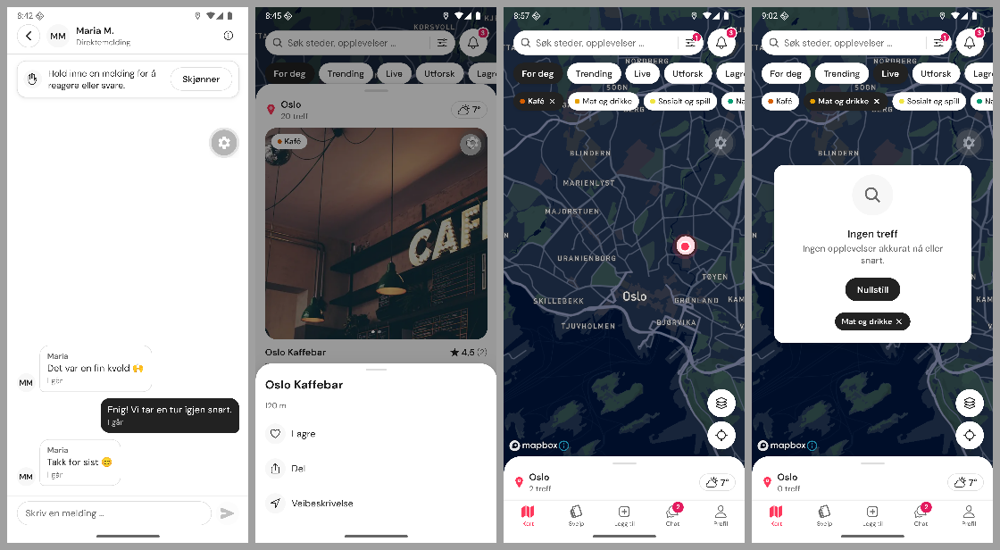

**Joining and plans: "Du er med", the month view in Mine planer, "I kveld" in Når, and help that starts from a plan:**

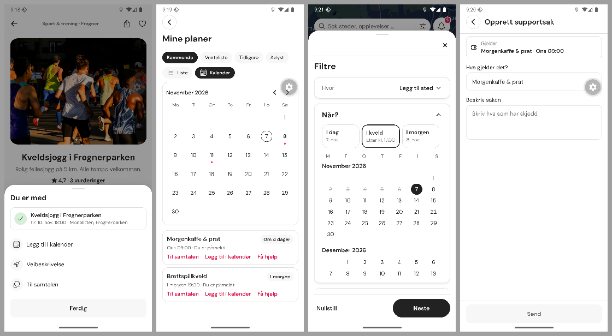

**Profile and settings: "Fullfør profilen", "Forhåndsvis", "Forkaste endringene?", Personvern by question, Personvernsjekk, and "Nytt i ThirdPlace":**

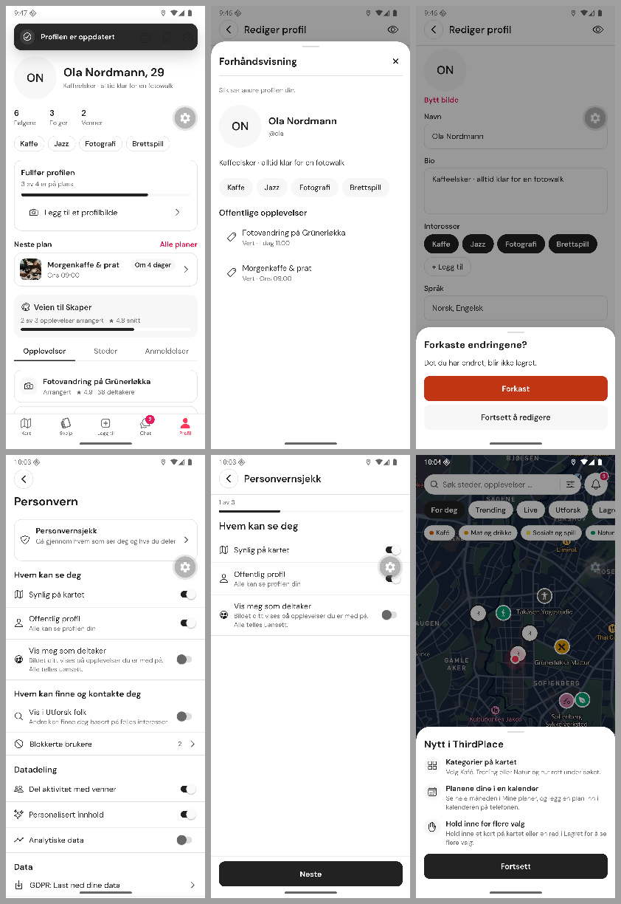

**Chat, groups and alerts: "Festet", "Nye meldinger", collapsed Varsler, the group page, a kept rating, and "Send tilbakemelding":**

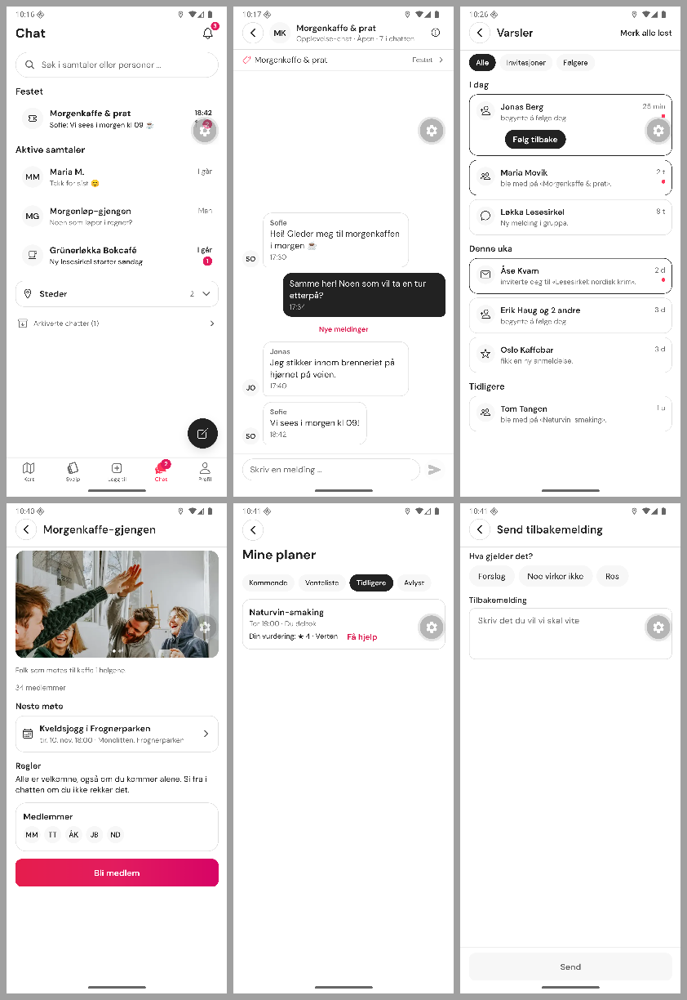
