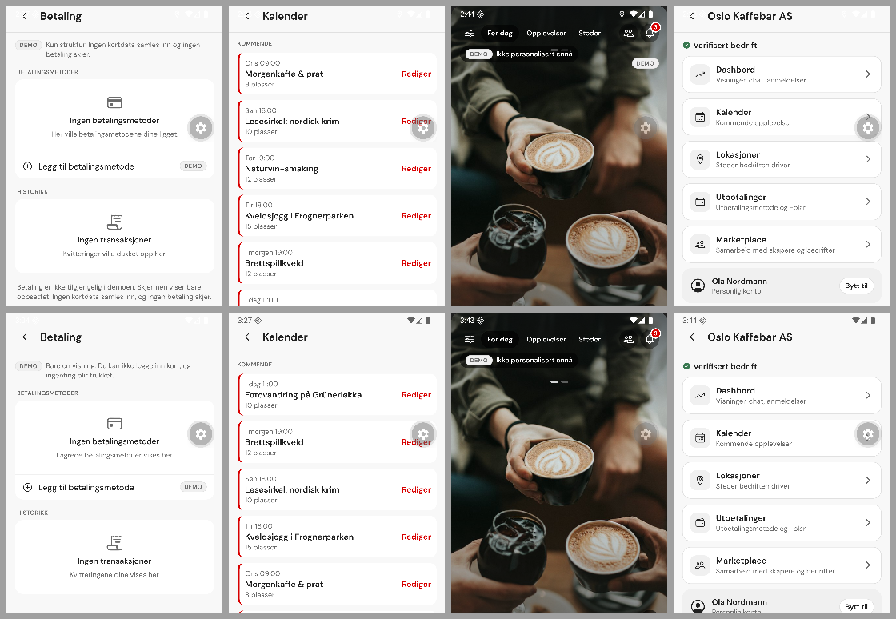
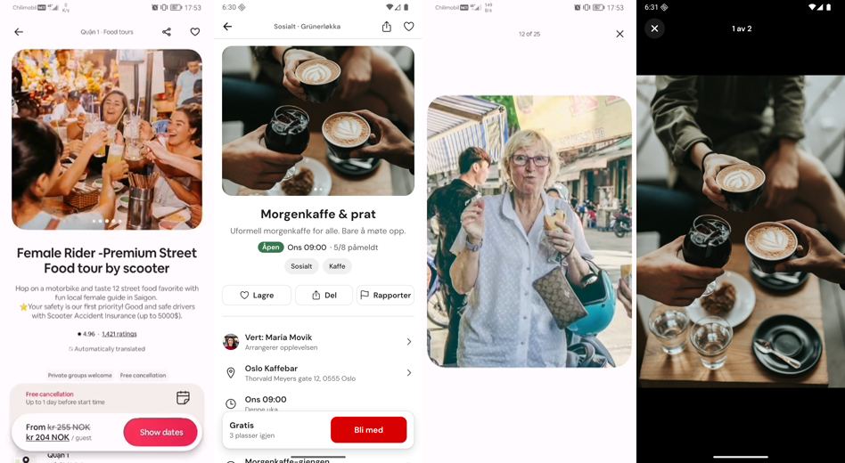
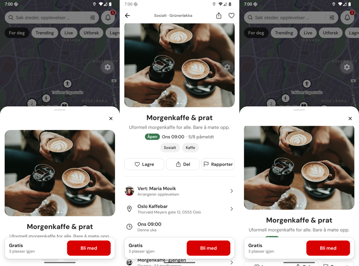
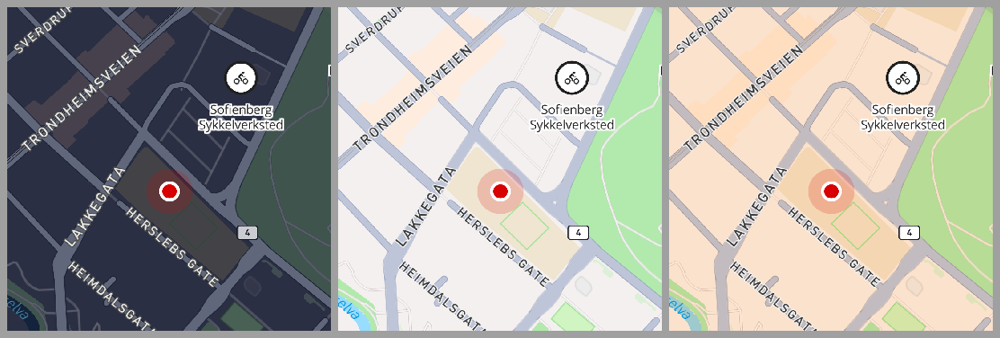
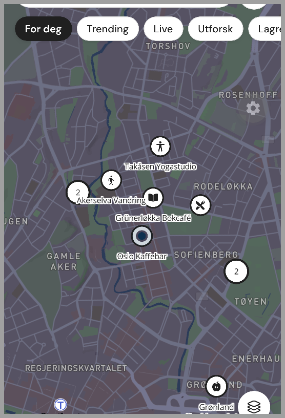
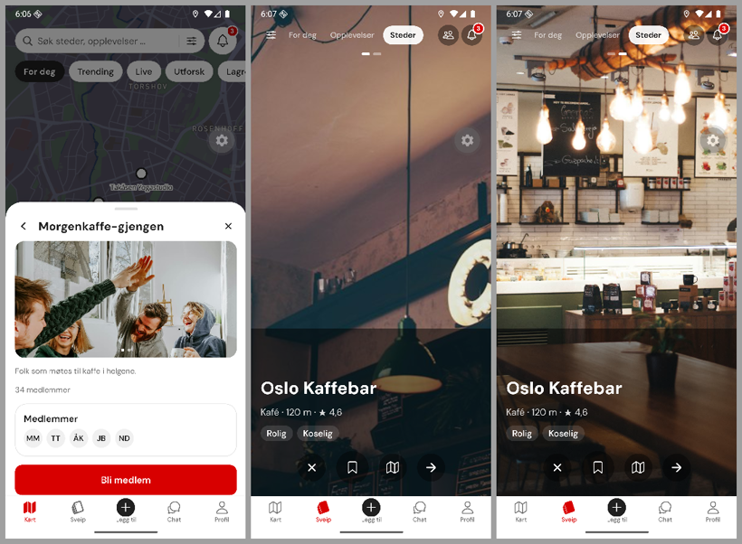
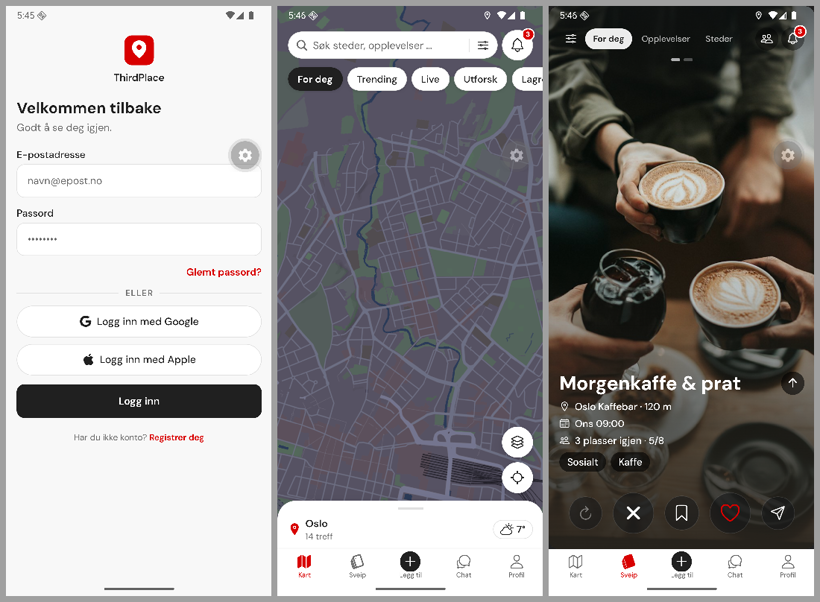
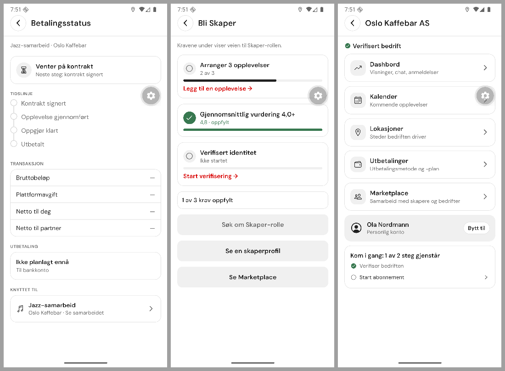

# ThirdPlace app review, 6 November 2026

Phase 6 of the design-system run. Branch `feat/design-system`, local commits only. Android emulator dev build (fresh native build on 2026-11-06). iOS was not run.

## 1. Summary

After the design-system rollout (Phases 1–5) the whole app was reviewed in three passes:

1. **Screenshot pass** of 45 routes on the emulator, plus a re-capture. The capture script ran behind navigation, so several file names do not match their content; the review names screens by what the image shows (41 distinct screens).
2. **Fresh-eyes reviewer** that only saw the screenshots and an extracted table of every string the app owns, and answered per screen: does this look, feel or sound AI-made, and why. 5 high, 25 medium, 20 low findings, plus a copy table.
3. **Benchmark** of eight apps (Airbnb, Meetup, Hinge, Bumble BFF, Strava, Partiful, Timeleft, Instagram) for onboarding, discovery, social proof, re-engagement and retention patterns.

Every finding was checked against `ThirdPlace_All_Screens.pdf` before acting. Many of the reviewer's points turned out to be PDF copy or PDF styling; those stay as designed and are listed for the founder (§6). Everything else in scope was fixed in seven slices and one correction (ledger 0170–0176 and 0178, §7).

**Verdict.** The app now reads as made by a person with a restrained brief: monochrome UI with one red, real photos, hand-drawn state illustrations, no gradients, glow or sparkle icons. The remaining AI-made signals were the honesty copy (one repeated sentence frame), a few template set-pieces, a broken status bar, and real organisations used as fake partners. All of those are fixed or, where the PDF draws them, documented.

## 2. Scored lenses (1–5, before → after Phase 6)

| Lens                             | Before | After | Why                                                                                                                                                                                                          |
| -------------------------------- | ------ | ----- | ------------------------------------------------------------------------------------------------------------------------------------------------------------------------------------------------------------ |
| Visual design                    | 3.5    | 4     | Status-bar icons were invisible on most screens and headers sometimes sat under the clock; fixed. Ember use is still heavy where the PDF draws it (toggles, Kalender, invite code).                          |
| UI consistency                   | 3      | 4     | One back-button style, one avatar size, chips that scroll instead of orphan-wrapping, one honesty marker per screen. Card stacks on Kalender/workspace stay (PDF).                                           |
| UX flows                         | 3.5    | 4     | Kalender in date order; Bli Skaper no longer invites an application that cannot qualify; collab states and defaults agree; dead "(ikke aktiv)" labels became disabled controls.                              |
| Accessibility                    | 3.5    | 4     | Auth links regained their colour (className on `Link` was dropped), disabled states carry `accessibilityState`, weather and checklist steps have labels, swipe tab contrast raised. TalkBack pass not done.  |
| Motion / feel                    | 4      | 4     | Unchanged in P6: motion was fixed in P5a (sheets static once settled). No shimmer overload, haptics only on local results.                                                                                   |
| Human-made (look / feel / sound) | 3      | 4.5   | Owned copy rewritten twice (P6b, P6c) and guarded by a test; real organisations removed from fixtures; duplicate badges and placeholder leaks gone. PDF copy that reads machine-made is listed, not changed. |
| Retention mechanics              | n/a    | n/a   | Contract-blocked (counts, notifications, ranking, social proof). Recommendations only (§5).                                                                                                                  |

## 3. Human-made check

**Look.** The reviewer found no gradients, glow, glassmorphism, sparkle or emoji icons. The template feel came from identical bordered-card stacks, a 0/0/0 stat-tile row with trophy milestones (Inviter venner), KPI tiles over an unlabelled chart (Analyse), red accent bars on every Kalender card, and stock-looking headshots. The stat tiles, milestones, KPI tiles and accent bars are drawn in the PDF (p14, p15, p22) and stay. Fixed: duplicate DEMO badge and carousel dashes through the swipe pill, mismatched profile icons, chip rows, avatar sizes, back buttons.

**Feel.** No fake typing indicators, artificial delays or shimmer. The broken status bar (white icons on white screens) and the intermittent header under the status bar were the strongest "unfinished" signals; both are fixed (ledger 0172).

**Sound.** `scripts/extract-copy.js` extracts every owned string (JSX text, readable props, toasts, `src/copy`, and since 0171 the string branches inside JSX children). `tests/copyVoice.test.ts` fails on em-dash constructions outside a 10-line PDF allowlist, on machine-marketing phrases and on doubled punctuation. P6b rewrote 53 lines; P6c rewrote about 35 more, broke up the repeated "Ingen X …, og ingen Y …" frame, removed internal-process leaks ("eksempler fra designet", "når betalingsflyten er fastsatt", "Kun struktur", "serverforespørsel") and left out three PDF lines that state rules CLAUDE.md bans (waitlist hand-over, manual place review, fee subtitle). Every rewritten note still says nothing real happens.

Before (top) and after (bottom): Betaling, Kalender, Sveip, workspace hub.

## 4. Findings and what happened to them

Status: **Fixed** (ledger id) · **Kept (PDF)** = drawn or written that way in the design PDF · **Recommended** = needs work outside this run · **Not reproduced**.

### High

| #   | Finding                                                                              | Status                                                                                                                                                                                                                          |
| --- | ------------------------------------------------------------------------------------ | ------------------------------------------------------------------------------------------------------------------------------------------------------------------------------------------------------------------------------- |
| H1  | Stack headers sometimes drawn under the status bar                                   | Fixed 0172: reproduced once (right after a system dark-mode switch); `Screen` now pads from provider insets seeded with `initialWindowMetrics`. Root cause (late native inset measurement) fits the evidence but is not proven. |
| H2  | Status-bar icons unreadable almost everywhere                                        | Fixed 0172: focus-aware `StatusBarStyle`; guard rule bans `expo-status-bar` elsewhere.                                                                                                                                          |
| H3  | Kalender "Kommende" not in date order                                                | Fixed 0173 (`calendarOrder.ts`, tested).                                                                                                                                                                                        |
| H4  | Real organisations as counterparties (Kulturetaten, Mathallen Vinbar, Tim Wendelboe) | Fixed 0173: fictional names. The PDF uses some real names as illustration.                                                                                                                                                      |
| H5  | "Maximum update depth exceeded" on every frame of one capture run                    | Not reproduced. Seen only after about 60 rapid deep links with hot reloads; every cold-start run since (the P6 verification runs of this report) rendered normally. Kept on the watch list.                                     |

### Medium

| #   | Finding                                                                       | Status                                                                                                                                       |
| --- | ----------------------------------------------------------------------------- | -------------------------------------------------------------------------------------------------------------------------------------------- |
| M1  | Primary colour inconsistent (ember vs ink CTAs, FABs)                         | Kept (PDF): ember for acquisition CTAs (Kom i gang, Opprett konto, Del via) and FABs on Kalender/Marketplace/Mine listings, ink elsewhere.   |
| M2  | Ember overloaded (toggles, Rediger, chart bar, invite code)                   | Fixed 0180: toggles, checkboxes, edit links, invite code and the current chart bar are ink; Kalender accent bars removed (founder decision). |
| M3  | Logg inn button separated from its form by social buttons                     | Kept (PDF p1 order).                                                                                                                         |
| M4  | Decimal full stops (4.8) vs nb-NO (4,8)                                       | Fixed 0180: decimals use the Norwegian comma (4,8 · 1,1 km) through `src/lib/format.ts` (founder decision).                                  |
| M5  | Norwegian/English term mix (Dashboard, Chat-joins, Rating, listings, Venue …) | Fixed 0179: Dashbord, “Ble med i chat”, “Vurdering”. Marketplace terms (listings, Venue, Brand, Co-hosting) stay as designed.                |
| M6  | Swipe: dashes through the pill, second DEMO badge, flat placeholder           | Fixed 0175 (dashes below pill, one badge); the placeholder colour already exists.                                                            |
| M7  | Profile icons don't match content                                             | Fixed 0175.                                                                                                                                  |
| M8  | 2FA toggle ON plus "Aktiver 2FA" button                                       | Kept (PDF p2).                                                                                                                               |
| M9  | Bli Skaper invites an application that cannot qualify                         | Fixed 0174 (CTA muted until requirements are met, as in PDF p14).                                                                            |
| M10 | One row pattern, three treatments (card stacks)                               | Fixed 0180/0186: Kalender bars removed, Filtre flat. The workspace hub keeps the PDF's cards.                                                |
| M11 | Lokasjoner pill crowds the name                                               | Fixed 0175.                                                                                                                                  |
| M12 | Chat header subtitle truncated by DEMO badge                                  | Fixed 0174.                                                                                                                                  |
| M13 | Chips wrap with orphans                                                       | Fixed 0175 (scrolling rows).                                                                                                                 |
| M14 | Uneven top spacing under headers                                              | Fixed 0174/0175 (Marketplace, Mine planer).                                                                                                  |
| M15 | Honesty markers uneven                                                        | Fixed 0174 (Utbetalinger, Marketplace, Nytt samarbeid, map weather) and 0171 (Betaling down to one note, Aldersverifisering).                |
| M16 | Aldersverifisering perks stated as fact                                       | Fixed 0171 (marked as examples; PDF list kept).                                                                                              |
| M17 | "Del ThirdPlace og få belønninger" promises rewards                           | Fixed 0179: “Del ThirdPlace med vennene dine.” (founder decision).                                                                           |
| M18 | Workspace checklist ✓ ambiguous                                               | Fixed 0175.                                                                                                                                  |
| M19 | Analyse chart without axis labels                                             | Kept (PDF p14 chart has none). Recommended once real data exists.                                                                            |
| M20 | Map pins compete with basemap POIs                                            | Fixed 0182: white place pins / ink experience pins, basemap POIs hidden (config repeats the light preset).                                   |
| M21 | Chat list avatar sizes differ                                                 | Fixed 0175 (`Avatar icon`).                                                                                                                  |
| M22 | Nytt samarbeid defaults contradict                                            | Fixed 0173.                                                                                                                                  |
| M23 | Kontrakt/Avtale state mismatch                                                | Fixed 0173.                                                                                                                                  |
| M24 | "Oppdater nå" looks disabled                                                  | Fixed 0174.                                                                                                                                  |
| M25 | Bekreft kode contradicts itself                                               | Demo line fixed 0171; subtitle and active "Send på nytt" kept (PDF p2).                                                                      |

### Low

| #   | Finding                                                        | Status                                                        |
| --- | -------------------------------------------------------------- | ------------------------------------------------------------- |
| L1  | Password placeholder dots                                      | Kept (PDF p1).                                                |
| L2  | Inline links don't look like links                             | Fixed 0174 (className on `Link` was dropped; now ember Text). |
| L3  | Welcome card drag handle                                       | Kept (PDF p1).                                                |
| L4  | Text glyphs (→, ✓) as icons                                    | Kept (PDF labels).                                            |
| L5  | Full-body avatar photos                                        | Fixed 0175 (crop from top).                                   |
| L6  | Solid black Følg pills                                         | Kept (PDF p22).                                               |
| L7  | Import sources box without heading                             | Kept; low impact.                                             |
| L8  | Visibility settings default ON                                 | Kept (PDF p19). Privacy default is a founder decision.        |
| L9  | Hjelp og støtte under DATA                                     | Kept (PDF p19).                                               |
| L10 | Two names for export / Oppdag folk                             | Kept (PDF p19, p21).                                          |
| L11 | Map peek shows a sliver of photo                               | Fixed 0182: peek height measured from its header.             |
| L12 | Innleveringer link-looking line, Ventende vs Under gjennomgang | Em dash fixed 0173; labels kept (PDF p12).                    |
| L13 | Collab button grid, same party icon                            | Fixed 0176.                                                   |
| L14 | Swipe tab contrast                                             | Fixed 0176.                                                   |
| L15 | Title heights, centred creator profile, three tab styles       | Kept (PDF).                                                   |
| L16 | Profile DEMO badge placement, BankID icon, popover anchor      | Badge and BankID fixed (0176, 0171); popover kept.            |
| L17 | Two back-button styles                                         | Fixed 0176 (circled back everywhere, as in the PDF).          |
| L18 | Two "Hvem er du?" steps                                        | Kept (PDF p2).                                                |
| L19 | Terms sentence without links                                   | Kept: no terms page exists in the PDF or spec.                |
| L20 | Invented status page link                                      | Fixed 0179: status line left out (no status page exists).     |

## 5. Benchmark and retention recommendations

| Pattern                               | Apps                                 | ThirdPlace slot                                  |
| ------------------------------------- | ------------------------------------ | ------------------------------------------------ |
| Intent and interest capture at setup  | Meetup, Hinge, Timeleft, BFF         | partial (onboarding exists; using it is ranking) |
| Low-commitment save                   | Partiful, Airbnb, Meetup             | yes (`useMapSaved` across map, swipe, `/saved`)  |
| Collaborative list / group decision   | Airbnb, Partiful                     | partial (group swipe)                            |
| "Who's going" preview                 | Airbnb Experiences, Meetup, Partiful | partial (blocked: attendees, counts)             |
| Friends' activity                     | Instagram, Airbnb, Strava            | partial (Venner stays a demo shell)              |
| Reminder ladder + quiet hours         | Meetup, Partiful, Instagram          | partial (NotificationsSheet; no policy)          |
| Capacity + waitlist                   | Meetup, Partiful                     | yes (rules blocked)                              |
| Post-event rating                     | Hinge, Meetup, Timeleft, Airbnb      | partial (Rate sheet)                             |
| Safety signals                        | Timeleft, BFF, Hinge                 | yes (18+, report, block)                         |
| Groups and places over people-swiping | BFF relaunch, Meetup                 | yes (Sveip swipes places/experiences)            |

Recommendations, in order:

1. Audit that every browse card and detail sheet has the same save action and state. **UI-only** (check PDF first).
2. Start a group swipe from a saved list; share through the Del sheet (demo invite only). **UI-only**, needs a PDF slot.
3. Empty states that point to the next surface (Lagret → Sveip, Mine planer → map). **UI-only**; partly in place.
4. A fixture-based "Hva kan du forvente" block on experience detail, written as example content. **UI-only**, needs a PDF slot.
5. "Hvem blir med" on detail and in chat headers. **Needs spec/founder decision** (attendee data, privacy, counts).
6. Reminder ladder with quiet hours. **Needs spec/founder decision** (notification policy).
7. Post-experience check-in ("Ble du med?" + rating). **Needs spec/founder decision**.
8. Mutual "meet again" after an experience. **Needs spec/founder decision** (matching, safety, 18+).
9. Waitlist promotion behaviour. **Needs spec/founder decision**.
10. Weekly ritual or digest. **Needs spec/founder decision**.
11. Status for regulars / attendance toward "Veien til Skaper". **Needs spec/founder decision** (TP-D-004 role path).
12. Opt-in presence in Venner. **Needs spec/founder decision** (location policy).

## 6. For the founder: PDF lines and styling kept as designed

**Decided 6 November 2026 (Phase 7):** the founder approved plain rewrites of every line below, a calmer ink styling and Norwegian decimals. The rule lines are left out. The PDF line → app line table is in `docs/SCREEN_INVENTORY.md` ("Founder copy decisions"), and §9 lists the slices. The list is kept as it was reviewed:

- Welcome: "Oppdag nabolagets lune møteplasser. Finn din neste third place — der byen faktisk skjer." (suggestion: "Finn ditt neste stamsted i nabolaget.")
- Splash/Registrer: "Byen din, laget for deg." · Logg inn: "Finn veien tilbake til ditt lokale fellesskap."
- Onboarding: "Velg alt som passer, så skreddersyr vi byen etter deg.", "Finjuster hvordan vi matcher deg.", "Dette hjelper oss å forstå deg — aldri synlig for andre uten samtykke.", role hints ("Arranger opplevelser — låses opp etter hvert", "Flere lokasjoner og skreddersydd oppsett").
- Bedrift-onboarding: "Dette er admin-identiteten din — kundene ser bedriften, ikke deg.", "Gjør det lett for kunder å finne dere overalt.", "Vi tilpasser kartet og feeden til målene deres.", "Bedriftsintensjoner", "Interesse-tagger", "Slik vil kundene se dere — når dere er verifisert."
- "Mennesker du kanskje vil møte." · "Del ThirdPlace og få belønninger." · Bli Skaper / "Du er nå Skaper!" (English "Dashboard").
- Sveip: "Nye anbefalinger dukker opp gjennom dagen …", "Chat er gratis — billett kjøper du når du vil." (**states a payment rule**), group swipe "Stemmer avsløres ikke før match!".
- Marketplace subtitle and English terms (Venue, Brand, listings, Co-hosting); Analyse "Chat-joins", "Rating".
- State screens: "Sjekk status: status.thirdplace.app" (**invented status page**), suspended and update boilerplate, offline "sendes automatisk" (**promises behaviour**).
- 2FA: toggle ON plus "Aktiver 2FA" button; "Backupkoder".
- Styling: ember toggles, Kalender accent bars and red "Rediger", ember invite code and last chart bar, solid Følg pills, decimal full stops.

Left out by this run because CLAUDE.md bans stating them as product behaviour: "Plassen din tilbys først på ventelisten." (p23), "Steder gjennomgås manuelt av ThirdPlace …" (p11), "Priser før gebyrer og skatt" (Filtre).

## 7. Phase 6 slices

| Ledger | Commit                       | Slice                                                                                                                |
| ------ | ---------------------------- | -------------------------------------------------------------------------------------------------------------------- |
| 0170   | `dd3ce50` (+ `10bf8bd` deps) | Copy extractor, voice test, 53 owned lines rewritten                                                                 |
| 0171   | `910dea7`                    | Honesty notes varied, banned rule lines left out, extractor reads ternary children, lint fix                         |
| 0172   | `5827294`                    | Focus-aware status bar; `Screen` pads from seeded insets                                                             |
| 0173   | `521b290`                    | Fixtures: no real organisations as partners; calendar order; collab states                                           |
| 0174   | `c9532ea`                    | One honesty marker per money/ID/live screen; auth links; update button; Bli Skaper CTA                               |
| 0175   | `884dba5`                    | Chip rows scroll, icons follow content, one avatar size, swipe dashes clear the pill                                 |
| 0176   | `0702946`                    | One circled back button; readable swipe tab; collab actions restacked                                                |
| 0178   | `4fdfa24`                    | Correction: chip rows now really bleed to the edge (0175 claimed it); docs note the unreachable Skaper success state |

## 8. Honest not-done

- **iOS** not run (Windows host; Android-only by decision).
- **Contract markers** (`BLOCKED_NOT_V22_CERTIFIED`, `BLOCKED_CONTRACT_GAP`) stay; nothing in this run touches backend, counts, rules or payments.
- **H1** reproduced once and fixed by construction. It did not return in the Phase 7 dark pass (48 routes), but the root cause is still a reading, not a proof. **H5** never reproduced on a clean run.
- **TalkBack:** labels and roles were checked through UI dumps (0 unlabeled controls), not with a spoken pass. Sheets and overlays (Modal windows) were checked by screenshot only.
- **Price totals, price pins, sort explanations, guest-favourite tags** from the reference recordings stay out: they need price, ranking or policy contracts.
- **Mobbin** blocks the built-in browser (403); Airbnb mobile references came via Firecrawl screenshots instead.
- **Real 3D renders** remain an optional upgrade; hand-built SVG category art ships now.
- **Tap speed** was not measured on a release build. On the emulator's dev build, a tap takes about 2–2.5 s to show on screen, for a map mode chip and a calendar date alike, so it reads as the build and the host, not one screen.

## 9. Addendum: Phases 7 and 8 (6 November 2026)

**Phase 7** acted on §6 and §8 after the founder's decisions:

- plain rewrites of the PDF copy
- calmer ink styling with Norwegian decimals
- map polish
- the "Du er nå Skaper!" screen, reachable by deep link
- a dark-mode and accessibility pass

**Phase 8** compared the browse sheet and Filtre with three reference recordings from the founder ([BROWSE_FILTER_BENCHMARK_2026-11-06.md](BROWSE_FILTER_BENCHMARK_2026-11-06.md)), built the gaps that fit the PDF, and replaced the Sveip icon with the founder's SVG.

| Ledger | Commit    | Slice                                                                                                                                                           |
| ------ | --------- | --------------------------------------------------------------------------------------------------------------------------------------------------------------- |
| 0179   | `700772a` | Founder copy: plain rewrites of the PDF lines; rule lines left out; PDF em-dash allowlist emptied                                                               |
| 0180   | `0c48d16` | Ink accents (toggles, checkboxes, edit links, invite code, chart bar), Kalender bars removed, nb-NO decimals via `src/lib/format.ts`; status-bar guard restored |
| 0181   | `8e1e899` | "Du er nå Skaper!" as its own deep-link-only route                                                                                                              |
| 0182   | `aa8c67d` | Map: white place / ink experience pins, basemap POIs hidden (config repeats the light preset), measured peek                                                    |
| 0183   | `a9f1f2c` | Sveip tab icon from the founder's `sveip.svg`                                                                                                                   |
| 0184   | `221ce81` | Benchmark report: browse sheet, Filtre and Hvor / Når / Hvem against the recordings                                                                             |
| 0185   | `a603896` | Browse cards: near-square swipeable photos, result count, pill search bar                                                                                       |
| 0186   | `35214a4` | Filtre: flat sections, title handover, ink sliders and CTA, grouped accessibility, inactive "Fjern alt"                                                         |
| 0187   | `c433804` | Filtre count = list count (it counted places only); badge counts Opplevelsestype                                                                                |
| 0188   | `02bca9f` | Hvor / Når / Hvem steps (Hopp over / Neste); calendar month names above their grids (bug); neutral range band                                                   |
| 0189   | `f92138c` | Dark pass of 48 routes clean, 0 unlabeled controls, 44 dp targets for text links and small rows                                                                 |

**Phase 9** closed the three items left open after Phase 8:

| Ledger | Commit    | Slice                                                                                                     |
| ------ | --------- | --------------------------------------------------------------------------------------------------------- |
| 0193   | `f6118f6` | Android back closes the map detail sheet (one level at a time) before it leaves the map                   |
| 0194   | `666c060` | Sveip icon stroke 2, as in the founder's file                                                             |
| 0195   | this page | Calendar range band checked in dark: it reads (grey disc between the white start and end), no code change |

## 10. Addendum: Phase 10, feel and reaction (6 November 2026)

The founder asked for every screen to be checked for feel, look, reaction, feedback, retention and use of the whole screen. The full report is [FEEL_REVIEW_2026-11-06.md](FEEL_REVIEW_2026-11-06.md); in short:

- **Reaction:** measured on the production JS bundle, most taps paint within a frame. Fixed the real slow spots: the Filtre deferred mount (lower half 1.2–1.4 s → 0.02–0.33 s), the swipe glide (0.83–0.93 s → 0.62–0.72 s) and fake waits (splash 1.2 s, map 0.5 s).
- **Feedback:** no dead controls left in the sweep; demo confirms close with an honest toast; disabled buttons say why and no longer look broken.
- **Whole screen:** sheets fit a 640 dp phone, forms stay above the keyboard on edge-to-edge Android, single-goal screens pin their main action, the experience detail pins its join bar (PDF p6).
- **Retention:** shared notification reads, undo on unsave, rows that open their detail, and four founder-approved surfaces (Nylig sett, group swipe from Lagret with "Lagre til senere", Til samtalen, Neste plan).

17 slices, ledger 0196–0212. Open items (R27–R30) and limits (iOS, emulator timings, haptics checked in code) are listed in the report.

## 11. Addendum: Phase 11, the experience page and the founder's list (6 November 2026)

The founder sent a screen recording of a reference experience page (used as a benchmark only, nothing traced) and asked for seven things. Decisions taken with the founder before building: remove every demo marker and let actions confirm like a finished product (payments stay structure only), white background, download free photos, and apply the video to the map's experience detail and the Sveip detail.

| Request                                 | What changed                                                                                                                                                                                                                                                                                                                                                                                                          | Commits / ledger              |
| --------------------------------------- | --------------------------------------------------------------------------------------------------------------------------------------------------------------------------------------------------------------------------------------------------------------------------------------------------------------------------------------------------------------------------------------------------------------------- | ----------------------------- |
| Remove all demo badges                  | Every DEMO pill, demo note, "(demo)"/"eksempel" label and "nothing was saved" toast is gone (91 notes, 15 badges, 48 files). Actions confirm in product voice (`confirmToast`); note-only buttons now act (share, report, block, join chat, invite, import, listings, collab). Dev-only switches moved to `_sandbox/simulate`.                                                                                        | bff0af4, 638ce9b · 0215, 0219 |
| Airbnb background colour                | Light background `#FFFFFF`; cards keep a hairline (settings groups gained one). Dark theme unchanged.                                                                                                                                                                                                                                                                                                                 | db7aaa2 · 0216                |
| At least two images for everything      | 26 free Unsplash photos (credited in `assets/library/CREDITS.md`); every place, business, group, experience and listing has two or more; galleries on place, business, group and listing detail and in the Steder deck.                                                                                                                                                                                               | f1a0a7b · 0217                |
| Marker icons that match                 | `markerIcon()` gives each place, experience, business and group its own glyph; native pins draw it in an emissive layer so dusk and night presets never dim it.                                                                                                                                                                                                                                                       | 723c697, 56db101 · 0218       |
| Experience modal like the video         | Shared `ExperiencePage` in the video's order (inset gallery with full-screen viewer, centred title, status line, chips, icon rows, more experiences, Om verten, footer links), keeping every ThirdPlace item. Sveip shows it as a page with a floating join card; on the map the experience sheet slides up into a full-screen page (no handle, square corners, page top bar, tab bar covered); back returns to 60 %. | 4ed5fbd, 482a5ef · 0220, 0221 |
| Skeleton under 2 s, loader after        | `useLoadPhase` + `Loader` + `LoadingImage`; the map shows skeleton cards, then the loader.                                                                                                                                                                                                                                                                                                                            | 6e7a804 · 0222                |
| User icon the same on every map; locate | Our own puck (ember dot, white ring, halo, heading wedge) replaces the native one that changed with each light preset; "Posisjon" flies to the user at street zoom.                                                                                                                                                                                                                                                   | 05b9a45 · 0223                |
| Open items R27–R30                      | Taps during the swipe glide are queued; Sveip is pre-rendered after the map loads; card-like presses get press feedback; Betalingsstatus follows PDF p18 (money structure only); Bli Skaper and workspace "Kom i gang" link to the next step.                                                                                                                                                                         | cbebb40 · 0224                |

**Video vs ours (Sveip page and photo viewer):**

**Map experience sheet: mid snap over the tab bar, the full-screen page at the top, back to mid:**

**Marker glyphs and the user's location on every basemap (night, day, dawn; dusk in the second image):**

**Galleries, no markers, and the open items:**

**What did not work first time (kept in the ledger):** hiding the tab bar at the top snap resized the sheet's container and snapped it back to the middle; handing off to a second full-screen page at the top made the sheet vanish for about a second while the page mounted. The sheet now renders in an app-root portal above the tab bar, so the top snap is the page itself. A test commit (723c697) failed the design-system guard and was fixed in 56db101; commit chains now stop on a failing test run.

**Found in the closing review and fixed (0226):** the experience sheet stayed above routes opened from it (host profile, chat, Rediger) because it lives at the app root — it now shows only while the map is focused and reopens on return; "Posisjon" opened the permission explainer even when the phone had already granted location — it now flies straight in; Sveip photos follow the loading rule (spinner after 2 s); the new surfaces were checked in dark mode.

**Honest not-done:** release-build timing for the Sveip pre-render (dev build only shows the background mount); the loader path is covered by a unit test but not seen on device (nothing loads for more than 2 s); while an experience sheet is open the tab bar is covered (places keep the docked sheet); the heading wedge needs a device with a compass; the floating join card covers much of the 35 % peek on a 640 dp phone; iOS not verified; the Play Store listing behind "Oppdater nå" does not exist yet.
