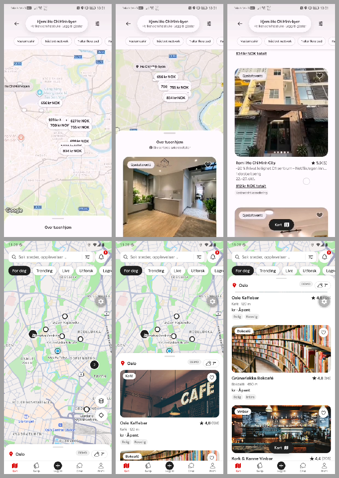
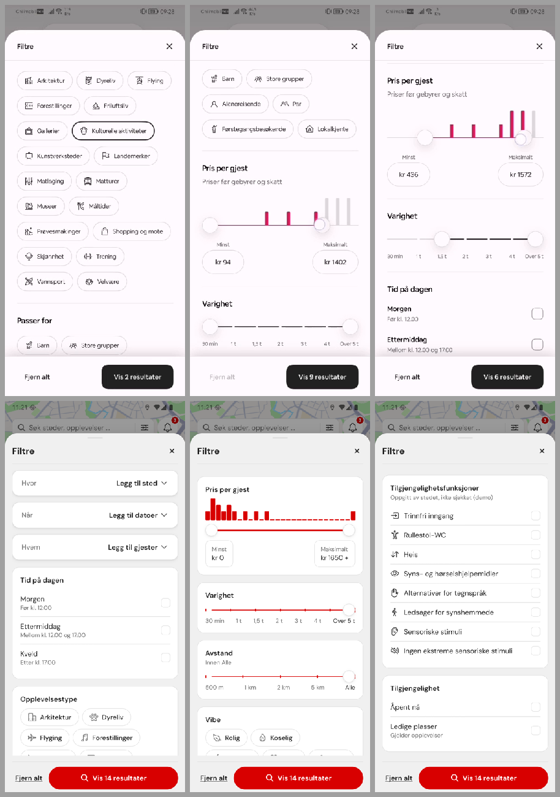
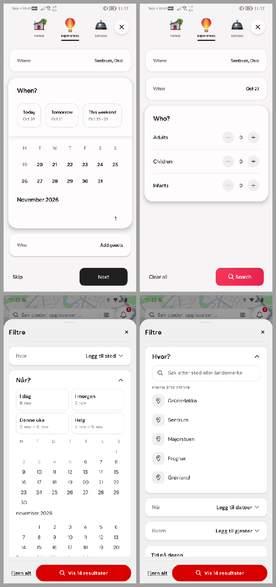

# Browse sheet and Filtre against three reference recordings

6 November 2026 · Phase 8 of the design-system run · Android emulator, light theme

The founder supplied three screen recordings from a large travel app (Android, Norwegian locale):

- `feed.mp4` (24 s): map with a browse bottom sheet.
- `filter.mp4` (64 s): the filter sheet.
- `when, where, how.mp4` (54 s): the Hvor / Når / Hvem search flow.

This note compares their look, feel and function with ThirdPlace's map browse sheet (`MapBrowseSheet`) and Filtre sheet (`MapFilterSheet`).

**Rules.**

- The recordings are a quality benchmark only. Nothing is traced or copied.
- `ThirdPlace_All_Screens.pdf` stays the authority wherever it draws something; on p5 that is the search pill, the round map pins and the Filtre sections ending in "Vis N resultater".
- Anything that needs a booking, price or ranking rule stays out (CLAUDE.md governance).

Each finding names the usability principle it rests on.

**Verdicts:**

- **Adopt:** build it.
- **Keep:** ours stays, because of the PDF or governance.
- **Out:** needs a contract or rule that does not exist.

## 1. Browse sheet (`feed.mp4`)

| #   | Aspect                   | Reference                                                                     | ThirdPlace before                                                                 | Verdict                                                                                                                          |
| --- | ------------------------ | ----------------------------------------------------------------------------- | --------------------------------------------------------------------------------- | -------------------------------------------------------------------------------------------------------------------------------- |
| B1  | Peek header              | Result count as the title, a line on how results are sorted                   | City + demo weather, no count                                                     | **Adopt** a muted count line ("N treff"). Sort line **Out**: no ranking contract. (H1 visibility of system status)               |
| B2  | Card photo               | Near-square (about 1 : 0.95), radius about 20, edge to edge in the column     | 208 px tall (about 1.7 : 1)                                                       | **Adopt** a near-square photo. It gives the photo more room, and the photo is what people scan (Von Restorff, visual hierarchy). |
| B3  | Photo carousel           | Swipe between photos, dots at the bottom                                      | One cover                                                                         | **Adopt** for items with several photos (experiences have `photos[]`). Places keep one cover.                                    |
| B4  | Badge / heart            | Badge top-left, heart top-right                                               | Same                                                                              | **Keep** (already matches).                                                                                                      |
| B5  | Text block               | Title + ★ rating, two muted lines, an emphasised value line, a small grey tag | Title + ★, a line repeating the category already on the badge, a value line, tags | **Adopt**: drop the repeated category (H8 minimalist design).                                                                    |
| B6  | Price as value line      | "834 kr NOK totalt", underlined                                               | Price level ("kr kr")                                                             | **Out**: totals need a price contract.                                                                                           |
| B7  | Map markers              | Price pills                                                                   | Round pins with titles (PDF p5)                                                   | **Keep** (PDF; prices are Out).                                                                                                  |
| B8  | "Kart" pill              | Ink pill with a map icon, shown when the list covers the map                  | Same                                                                              | **Keep**.                                                                                                                        |
| B9  | Search bar               | Pill, two lines (place / dates · guests)                                      | One line, `rounded-md`                                                            | **Adopt** the pill shape (PDF p5 draws a pill). The second line stays out: the PDF draws one line.                               |
| B10 | Quick chips under search | Amenity chips                                                                 | Discovery mode chips (PDF p5)                                                     | **Keep** (PDF).                                                                                                                  |
| B11 | Feel                     | Three snap points, map stays live under the sheet, header fixed               | Same snaps, header fixed                                                          | **Keep**.                                                                                                                        |

## 2. Filtre (`filter.mp4`)

| #   | Aspect                 | Reference                                                                           | ThirdPlace before                                                                                                          | Verdict                                                                                                                                                                      |
| --- | ---------------------- | ----------------------------------------------------------------------------------- | -------------------------------------------------------------------------------------------------------------------------- | ---------------------------------------------------------------------------------------------------------------------------------------------------------------------------- |
| F1  | Surface                | Flat white sheet, sections split by hairlines                                       | White cards on grey                                                                                                        | **Adopt** flat sections. They are calmer, PDF p5 draws them flat, and stacks of cards were the review's main "template" signal (Law of Prägnanz, Common Region by dividers). |
| F2  | Title                  | Large "Filtre" at the top of the content, a small header title once it scrolls away | Small header title only                                                                                                    | **Adopt** (you always know where you are without a heavy header).                                                                                                            |
| F3  | Chips                  | Outline pills with an icon, selected = 2 px ink ring                                | Same (`TypeChip`)                                                                                                          | **Keep**.                                                                                                                                                                    |
| F4  | Sliders                | Ink track, white thumbs with a shadow                                               | Ember track and thumbs                                                                                                     | **Adopt** ink tracks (founder decision 0180: ember only for brand moments).                                                                                                  |
| F5  | Price histogram        | Brand-colour bars inside the range, grey outside, min / max boxes                   | Same idea, ember bars                                                                                                      | **Keep** (brand accent, matches the reference).                                                                                                                              |
| F6  | Long lists             | "Vis mer" under a short list                                                        | "Vis flere" on chips, "Vis mer" on Språk                                                                                   | **Adopt** one wording, "Vis mer / Vis mindre" (H4 consistency).                                                                                                              |
| F7  | Accessibility features | A collapsed section with grouped subheads (mobility, sight and hearing, sensory)    | Always open, eight flat rows                                                                                               | **Adopt** collapsed + grouped (Miller's law: chunking; progressive disclosure).                                                                                              |
| F8  | Footer CTA             | Ink "Vis N resultater"                                                              | Ember with a search icon                                                                                                   | **Adopt** ink, no icon (PDF p5 + reference).                                                                                                                                 |
| F9  | "Fjern alt"            | Muted and inactive when nothing is set                                              | Always active                                                                                                              | **Adopt** (H1, H5: show when there is something to clear).                                                                                                                   |
| F10 | Live count             | Count updates, with dots while the server answers                                   | Instant                                                                                                                    | **Keep** instant. No fake dots: the demo has no server, and an invented wait breaks the honesty rule.                                                                        |
| F11 | Count correctness      | The count is what the list will show                                                | Counts **places only**, so "Når", "Ledige plasser" and the experience modes never change N, and N can differ from the list | **Adopt** one pipeline for list and count (H1; trust).                                                                                                                       |
| F12 | Filter badge           | (not shown)                                                                         | Misses Opplevelsestype                                                                                                     | **Adopt** (H1).                                                                                                                                                              |

## 3. Hvor / Når / Hvem (`when, where, how.mp4`)

Founder decision: the flow stays at the top of Filtre (the PDF search pill opens text search), but it should behave like the reference.

| #   | Aspect                                                | Reference                                                                                                     | ThirdPlace before                                                             | Verdict                                                                         |
| --- | ----------------------------------------------------- | ------------------------------------------------------------------------------------------------------------- | ----------------------------------------------------------------------------- | ------------------------------------------------------------------------------- |
| W1  | Structure                                             | Stacked cards, one open at a time, closed cards show the chosen value                                         | Same                                                                          | **Keep**.                                                                       |
| W2  | Quick dates                                           | Three tiles in one row above the calendar                                                                     | Four tiles in a 2 × 2 grid                                                    | **Adopt** one row (the PDF's four labels: I dag · I morgen · Denne uka · Helg). |
| W3  | Calendar month label                                  | Month name **above** its grid                                                                                 | Month name **under** its grid, so "november 2026" sits over the December grid | **Adopt**: bug, the label names the wrong month (H2, H4).                       |
| W4  | Range band                                            | Light grey band between start and end                                                                         | Pale ember band                                                               | **Adopt** a neutral band (ember for brand moments only).                        |
| W5  | Step footer                                           | "Hopp over / Neste" while a date step is open, "Nullstill" once a date is picked, otherwise "Fjern alt / Søk" | Always "Fjern alt / Vis N"                                                    | **Adopt** while Når is open (goal-gradient: a clear next step).                 |
| W6  | Guests                                                | Three steppers                                                                                                | Five steppers (adds students and pensioners)                                  | **Keep** (our own groups, demo only).                                           |
| W7  | Category tabs on top (homes / experiences / services) | Present                                                                                                       | Not in the PDF                                                                | **Out**.                                                                        |

## 4. What was built

All four slices are done (commits `a603896`, `35214a4`, `c433804`, `02bca9f`); emulator checks and the slice table are in `APP_REVIEW_2026-11-06.md` §9. The tiles above show ThirdPlace **before** these slices. Phase 9 checked the W4 range band in dark mode as well (it reads; ledger 0195).

| Slice                | Ledger | Items                      |
| -------------------- | ------ | -------------------------- |
| V3 browse sheet      | 0185   | B1, B2, B3, B5, B9         |
| V4 Filtre look       | 0186   | F1, F2, F4, F6, F7, F8, F9 |
| V5 Filtre function   | 0187   | F11, F12                   |
| V6 Hvor / Når / Hvem | 0188   | W2, W3, W4, W5             |

Out, and why:

- Price totals (B6) and price pins (B7) need a price contract.
- The sort explanation (B1) needs a ranking contract.
- The category tabs (W7) are not in the PDF.
- Guest-favourite and free-cancellation tags need rules that do not exist.
