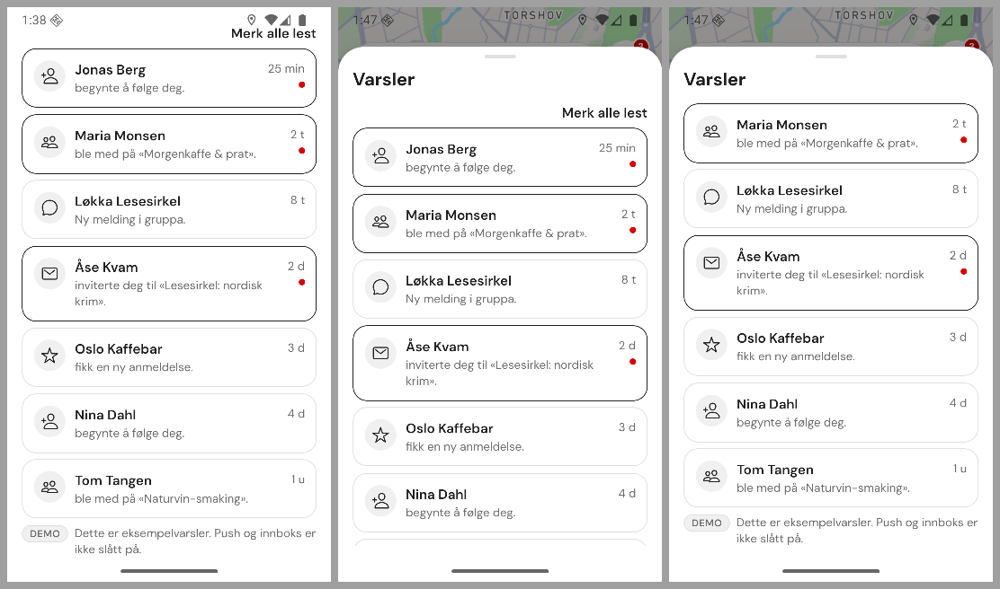
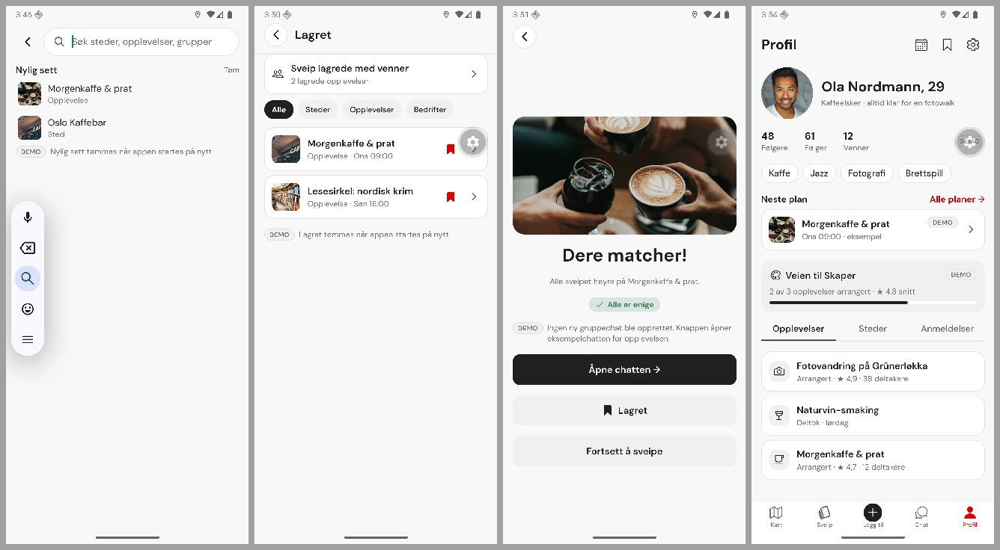
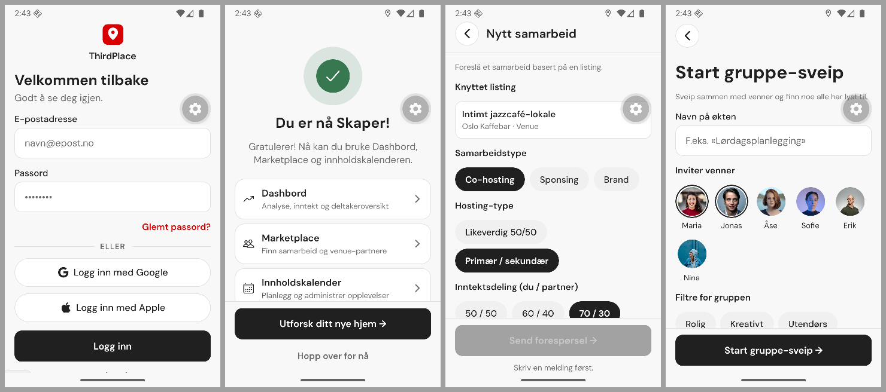
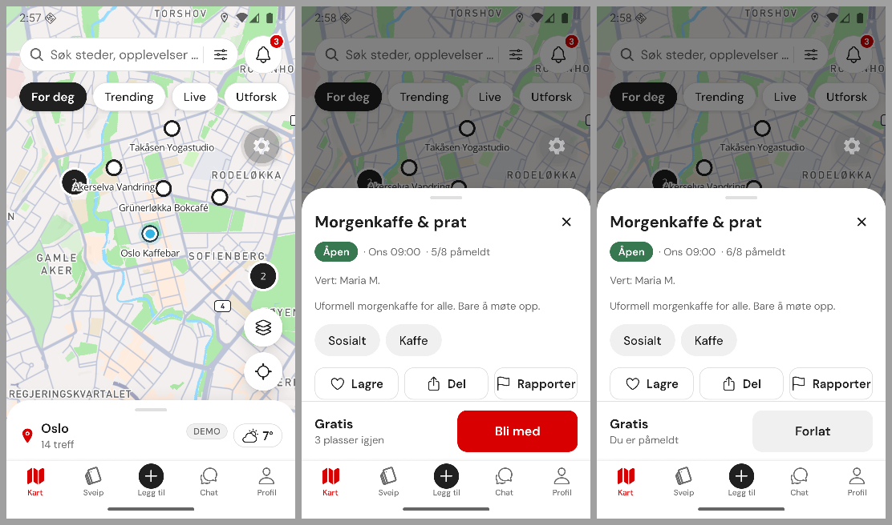

# ThirdPlace feel review, 6 November 2026 (Phase 10)

Branch `feat/design-system`, local commits only. Android emulator dev client (Android 16, Pixel-class 411×914 dp, plus a 360×640 dp override for short phones). iOS was not run.

The founder asked for every screen to be checked for feel, look, reaction, feedback, retention and use of the whole screen. Phase 6 (`APP_REVIEW_2026-11-06.md`) had already covered look, consistency, accessibility and the human-made check, so this pass leans on the four lenses Phase 6 did not measure: **reaction**, **feedback**, **whole screen** and **retention**.

## 1. Summary

- **Reaction was better than it looked.** On the dev build every tap took 2–2.8 s to show; on the production JS bundle tab switches, chips, card → detail, calendar dates and chat send all paint within one frame. The real slow spots were the Filtre sheet's own deferred mount (lower half settled 1.2–1.4 s after the tap), the swipe card's 0.9 s exit glide, and fake waits (splash 1.2 s, map 0.5 s). All three are fixed.
- **Feedback had holes.** Buttons with no action ("Bli medlem"), rows with chevrons that did nothing, text that looked like links, chips that buzzed but did nothing, confirm buttons that only closed their sheet, and actions that went to the wrong place. Each now answers honestly or stops looking tappable.
- **Short phones lost the main action.** On 360×640 dp the notifications sheet pushed its title off the screen, the keyboard covered wizard footers (edge-to-edge Android does not resize), and primary buttons sat under the fold. Sheets now cap and scroll, forms ride above the keyboard, and single-goal screens pin their action.
- **Retention got the spec-backed basics plus four approved surfaces.** Notification read state is shared (bells drop), unsave offers "Angre", saved and plan rows open their detail, and the founder approved Nylig sett, group swipe from Lagret, Til samtalen and Neste plan.

17 slices, ledger 0196–0212. Everything stays demo-honest: local state is labelled as local and clears on restart, and nothing claims a backend result.

## 2. Method

1. **Speed harness** (`scratchpad/tap_time.js`): screen recording with touch dots, ffmpeg presentation timestamps, three taps per action, on the production JS bundle (`expo start --no-dev --minify`) served to the dev client. Numbers are before/after on the same emulator, not phone latency.
2. **Captures:** all 48 routes at 411×914 dp and 360×640 dp, plus sheets and keyboard states scripted by hand; after the slices, a second full pass for regressions.
3. **Code sweeps:** one for every action and its feedback, one for how each screen uses the screen.
4. **Reviewers:** a fresh-eyes visual review of the tall/short contact sheets (filtered against the Phase 6 "Kept (PDF)" list) and a growth/retention review limited to spec-backed, contract-free ideas.
5. **PDF check per screen** before any layout change. State screens (p27) and the Add picker (p10) stay as drawn; the experience detail's pinned bar comes from p6.

## 3. Founder decisions (6 November 2026)

| Topic                | Decision                                                                                                         |
| -------------------- | ---------------------------------------------------------------------------------------------------------------- |
| Retention            | Spec-backed fixes plus a list of new surfaces, each built only after a yes. All four proposed surfaces approved. |
| Demo confirm buttons | Close the sheet and show an honest toast.                                                                        |
| Speed test           | Production JS on the dev client, timed from screen recordings.                                                   |
| Artificial waits     | Remove where nothing loads.                                                                                      |

## 4. Lenses (1–5, before → after this phase)

| Lens         | Before | After | Why                                                                                                                       |
| ------------ | ------ | ----- | ------------------------------------------------------------------------------------------------------------------------- |
| Feel         | 3.5    | 4     | Instant swaps became short fades, the swipe glide is quicker, presses scale on 34 more controls, haptics follow one rule. |
| Look         | 4      | 4     | Readable disabled buttons, unread chats that look unread, one-line chip rows. Phase 6 already set the look.               |
| Reaction     | 3      | 4.5   | Fake waits and the Filtre deferral removed; everything measured paints within a frame or settles with its animation.      |
| Feedback     | 2.5    | 4     | No dead controls left in the sweep; every demo confirm says what (did not) happen; disabled buttons say why.              |
| Whole screen | 2.5    | 4     | Sheets fit 640 dp, keyboard-safe forms, pinned primary actions, map tools on the measured peek.                           |
| Retention    | 2      | 3.5   | Spec §11 basics plus four approved surfaces. Counts, reminders and ranking stay contract-blocked.                         |

## 5. Reaction: production bundle timings (tall phone, three taps each)

| Action                                                         | Before                                                        | After                                           |
| -------------------------------------------------------------- | ------------------------------------------------------------- | ----------------------------------------------- |
| Tab switch, mode chip, card → detail, calendar date, chat send | within a frame (detail settles 0.09–0.41 s, send 0.15–0.21 s) | unchanged                                       |
| Filtre open, lower sections settled                            | 1.24–1.40 s (400 ms deferred mount)                           | 0.02–0.33 s                                     |
| Filtre open, top settled                                       | 0.26–0.33 s                                                   | 0.07–0.23 s                                     |
| Sveip skip, next card settled                                  | 0.83–0.93 s, taps dropped meanwhile                           | 0.62–0.72 s                                     |
| First Sveip visit after cold start                             | first paint 0–1.18 s, settled 0.53–1.69 s                     | first paint within a frame, settled 0.47–0.62 s |
| Splash → Welcome                                               | 1.2 s hold after fonts                                        | next frame once navigation is ready             |
| Map content on open                                            | 0.5 s fake load                                               | immediate (loading still shown on "Prøv igjen") |

## 6. Findings and what happened

Status: **Fixed** (ledger) · **Kept (PDF)** · **Not done** (with reason).

| #   | Lens         | Finding                                                                                                                                 | Status                                                                                   |
| --- | ------------ | --------------------------------------------------------------------------------------------------------------------------------------- | ---------------------------------------------------------------------------------------- |
| R1  | Whole screen | Content sheets had no max height or scroll; notifications lost its title on 640 dp                                                      | Fixed 0196                                                                               |
| R2  | Feedback     | Chat thread opened at the oldest message; sends landed out of view                                                                      | Fixed 0197                                                                               |
| R3  | Feedback     | "Bli medlem" had no action                                                                                                              | Fixed 0198                                                                               |
| R4  | Feedback     | Valuta, Tidssone and FAQ rows were no-ops with chevrons                                                                                 | Fixed 0198                                                                               |
| R5  | Feedback     | Avblokkér, Kopier lenke, Legg til profilbilde looked tappable but were text                                                             | Fixed 0198                                                                               |
| R6  | Feel         | Display chips buzzed and scaled with no action                                                                                          | Fixed 0198                                                                               |
| R7  | Feedback     | Disabled buttons gave no reason (Add, listing, collab, Send klage)                                                                      | Fixed 0198                                                                               |
| R8  | Feedback     | Vis på kartet, group match, Kalender Rediger, Analyse chart, collab rating, Marketplace Lagre went to the wrong place or did not update | Fixed 0199                                                                               |
| R9  | Feedback     | Nine confirm buttons only closed their sheet                                                                                            | Fixed 0200                                                                               |
| R10 | Whole screen | Keyboard covered wizard footers and sheet buttons on edge-to-edge Android                                                               | Fixed 0201                                                                               |
| R11 | Feedback     | Auth forms swallowed the first tap with the keyboard open                                                                               | Fixed 0201                                                                               |
| R12 | Whole screen | Primary CTA under the fold on 640 dp (creator welcome, group swipe, Nytt samarbeid, login)                                              | Fixed 0202                                                                               |
| R13 | Look         | Disabled buttons were a faded ink fill                                                                                                  | Fixed 0203                                                                               |
| R14 | Whole screen | Orphan chips wrapping at 360 dp; Sveip bar cut "Steder"                                                                                 | Fixed 0203                                                                               |
| R15 | Feedback     | People list showed example counts with no honesty marker                                                                                | Fixed 0203                                                                               |
| R16 | Look         | Unread chats looked read                                                                                                                | Fixed 0203                                                                               |
| R17 | Whole screen | Map experience detail hid "Bli med" until the end of the scroll (PDF p6 pins it)                                                        | Fixed 0204                                                                               |
| R18 | Feel         | ~45 raw presses without a pressed state; inconsistent haptics                                                                           | Fixed 0205 (34 converted)                                                                |
| R19 | Reaction     | Splash 1.2 s, map 0.5 s, lobby 1.2 s per friend                                                                                         | Fixed 0206                                                                               |
| R20 | Feel         | Instant swaps (wizard steps, detail stack, Steder, group card); 0.9 s swipe glide                                                       | Fixed 0207                                                                               |
| R21 | Retention    | Notification reads reset; bell badges never dropped                                                                                     | Fixed 0208                                                                               |
| R22 | Retention    | No undo after unsave; saved and plan rows not tappable; guests could save from the browse list only                                     | Fixed 0208                                                                               |
| R23 | Reaction     | Filtre deferred mount slowed the lower half                                                                                             | Fixed 0212                                                                               |
| R24 | Whole screen | State screens centred with no close button                                                                                              | Kept (PDF p27)                                                                           |
| R25 | Whole screen | Add picker leaves the top blank                                                                                                         | Kept (PDF p10 draws a bottom sheet)                                                      |
| R26 | Whole screen | Chat-list FAB overlaps the last section row at rest on 640 dp                                                                           | Kept (PDF p9 FAB over the list; the list scrolls clear)                                  |
| R27 | Feel         | A tap during the swipe glide is dropped                                                                                                 | Not done (shorter window; a queue needs state inside an effect)                          |
| R28 | Reaction     | First Sveip visit pays the tab mount and photo decode                                                                                   | Not done (eager mount would slow the map's cold start; measure on a release build first) |
| R29 | Feel         | ~30 presses with dynamic classes remain raw                                                                                             | Not done (most already show their own selected state)                                    |
| R30 | Retention    | Collab payment-status timeline and next-step links (Bli Skaper rows, Veien til Skaper, workspace Kom i gang)                            | Not done (need PDF checks; left for the next pass)                                       |

## 7. New surfaces (founder-approved, no PDF slot)

All are in-memory demo state with a DemoNote, and none adds counts, ranking or reminders. They are recorded in `SCREEN_INVENTORY.md` under "Founder-approved additions".

- **Nylig sett** (0209): places and experiences whose detail opened this session, shown under the recent searches in map search.
- **Sveip lagrede med venner** (0210): Lagret starts a group swipe on the saved experiences. The deck ends instead of looping.
- **Lagre til senere** (0210): saves the matched experience from the group-swipe match screen.
- **Til samtalen** (0211): an upcoming plan links to the experience's example chat.
- **Neste plan** (0211): Profil shows the next plan with "Alle planer →".

## 8. Slices

| Ledger | Commit    | Slice                                                                                     |
| ------ | --------- | ----------------------------------------------------------------------------------------- |
| 0196   | `569b3a5` | Content sheets stop below the status bar and scroll; safe-area bottom padding             |
| 0197   | `1d32557` | Chat thread opens at the newest message and follows sends; pinned bar under the header    |
| 0198   | `6b93987` | Dead or misleading controls answer honestly or stop looking tappable                      |
| 0199   | `4c74093` | Actions land where they say and update what they touch                                    |
| 0200   | `038f698` | Demo confirm buttons close and say nothing happened                                       |
| 0201   | `e9df0cf` | Forms and sheets stay above the keyboard on edge-to-edge Android                          |
| 0202   | `1c13ed2` | StickyFooter keeps primary actions on screen on short phones                              |
| 0203   | `c0e7708` | Readable disabled buttons, one-line chip rows, Sveip bar fit, People marker, unread chats |
| 0204   | `4b210a1` | Experience detail pins its join bar (PDF p6); map tools sit on the peek                   |
| 0205   | `7582bd0` | Pressed feedback on 34 more controls; consistent haptics                                  |
| 0206   | `3d4033a` | No fake waits where nothing loads                                                         |
| 0207   | `b84b735` | Faded content swaps; quicker swipe glide                                                  |
| 0208   | `848951e` | Shared notification reads, undo on unsave, rows that open                                 |
| 0209   | `3fb6e24` | Nylig sett                                                                                |
| 0210   | `0272441` | Group swipe from Lagret; save the match                                                   |
| 0211   | `e8db829` | Til samtalen on plans; Neste plan on Profil                                               |
| 0212   | `3908538` | Filtre mounts every section with the sheet                                                |

## 9. Honest not-done

- **iOS** not run. The keyboard pattern (`KeyboardAvoidingView` padding) is the standard iOS approach but is unverified there.
- **Timings** are emulator numbers with screen recording running, before/after on one setup; no release APK and no real phone.
- **Haptics** were checked in code, not felt.
- **R27–R30** above are open, with reasons.
- **Contract-blocked:** real counts, reminders, ranking, persistence of saves/reads/history (all clear on restart), chat membership.
- **Emulator for testing:** the AVD's hardware keyboard was turned off to reproduce the soft keyboard and is restored at the end of this run.
