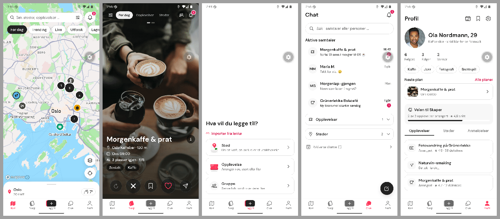
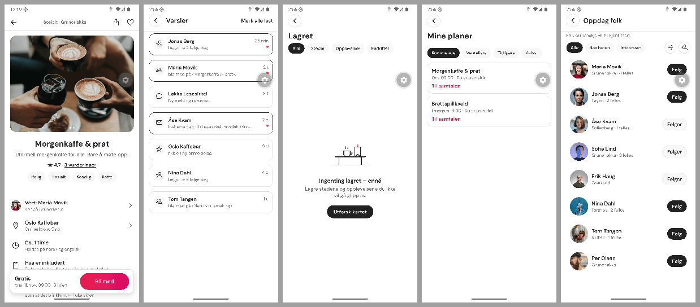
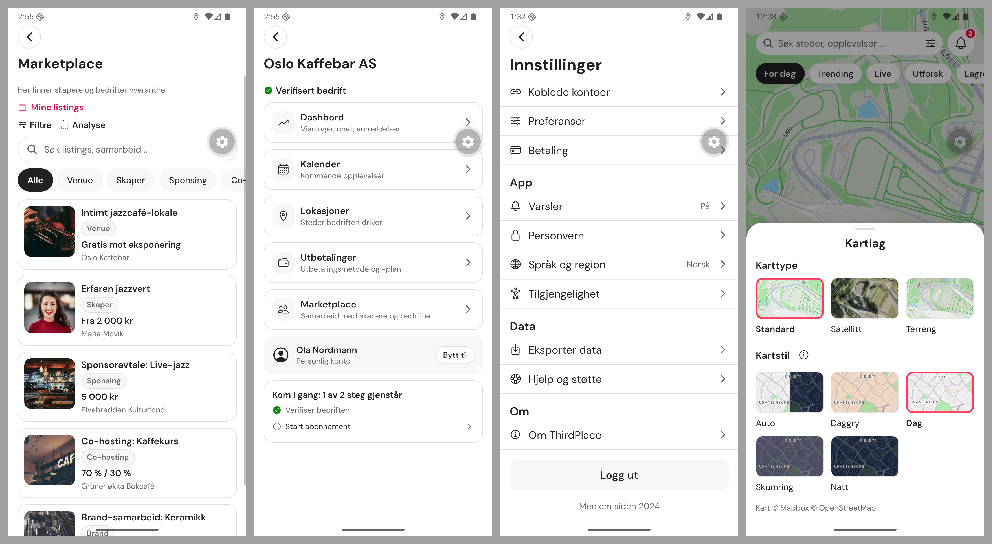

# Section benchmark: ThirdPlace against the leading apps (7 November 2026)

The founder asked to compare each section of the app with the leading apps in that category. For each section: the apps that set expectations, what they do that users now take for granted, where ThirdPlace stands today (the build at commit db44ce6), and what to do about it.

This is a benchmark only. Nothing here copies another app's look, names or layout; a suggestion describes a common pattern that ThirdPlace would build in its own design system. Each suggestion carries a tag:

- **UI** — buildable now on the fixtures, inside the governance rules (no invented counts, rules, payments or backend success). Still a founder call, because the PDF does not draw it.
- **UI + native** — as UI, but needs a native module and a rebuild of the test app.
- **Policy** — needs a written rule (privacy, safety, moderation) before it can be built.
- **Contract** — needs the backend contract (V2.2).

Sources for the 2025–2026 features are listed at the end; well-established patterns (Google Maps, WhatsApp, Instagram) are described from the apps as they ship.

## Summary

| Section               | Benchmarks                                                          | Where ThirdPlace stands                                                                         | Top gap                                                                  |
| --------------------- | ------------------------------------------------------------------- | ----------------------------------------------------------------------------------------------- | ------------------------------------------------------------------------ |
| Kart                  | Google Maps, Airbnb map search, Snap Map / Instagram Map            | Close: category pins, clusters, browse sheet with count, shared filters, Kartlag with map types | The list ignores where you panned ("Søk i dette området"); no directions |
| Sveip                 | Tinder, Hinge, BFF by Bumble                                        | Close: full-bleed cards, gestures with undo, like → join the chat, group swipe                  | No first-time hint; nothing shows who else is going                      |
| Opplevelse / sted     | Airbnb Experiences, Meetup, Partiful, Google Maps place sheet       | Close: Airbnb-style page with reviews, times, meeting point, chat, things to know               | No "who's going" faces, no add to calendar, no directions                |
| Legg til              | Partiful, Meetup, Airbnb hosting                                    | Good: Sted / Opplevelse / Gruppe wizards with review and success                                | No "start from a past experience"; no live preview                       |
| Chat                  | WhatsApp, Instagram DMs, Meetup event chat, BFF Groups              | Behind: list, thread, info, members, invite link                                                | No reactions or replies; no unread badge on the tab; no polls            |
| Profil                | Instagram, Airbnb profile, Hinge                                    | Good: counts from lists, interests, next plan, tabs                                             | No "people you've met"; no prompts that start a conversation             |
| Varsler               | Instagram activity, Airbnb                                          | Good: cards, unread, mark all read, taps open the item                                          | Not grouped by day; no inline "Følg tilbake"                             |
| Lagret / Mine planer  | Airbnb Wishlists and Trips, Meetup "Your events"                    | Good: tabs, onward empty states, "Til samtalen"                                                 | No countdown on the next plan; no calendar                               |
| Oppdag folk           | BFF by Bumble, Instagram suggestions                                | Good: shared interests, follow, filter, invite                                                  | Thin reason for a suggestion; no light first hello                       |
| Bedrift / Marketplace | Airbnb Host, Instagram professional dashboard, Meetup organizer app | Good: hub, calendar, analytics from lists, listings, collaborations                             | No "today" view for hosts                                                |
| Innstillinger         | iOS Settings, Instagram, Airbnb account                             | On par for its size: sections, account, privacy, Tilgjengelighet, Om / Lisenser                 | Legal pages wait for texts (launch checklist)                            |

## Kart

**Leaders do:** Airbnb and Google Maps refresh the results for the area you pan to (a "search this area" button, or automatic refresh), and the list and the map always show the same set. Google Maps' place sheet puts **Directions** first and lets you choose standard, satellite or terrain from a layers sheet. Snap Map and the Instagram map (August 2025) show friends who chose to share their location, with per-friend controls, and content posted from places.

**ThirdPlace today:** category-coloured pins with glyphs, clusters, a browse sheet with "N treff", the map's Filtre shared with Sveip, Kartlag with Standard / Satellitt / Terreng and times of day, Posisjon that flies to you, a search page with recent searches. The Venner mode is a same-for-everyone shell (FA-2).

| Gap                                        | Suggestion                                                                                                                     | Tag               |
| ------------------------------------------ | ------------------------------------------------------------------------------------------------------------------------------ | ----------------- |
| The list is per mode, not per visible area | "Søk i dette området" after a pan: the browse list and the count follow the visible map (client-side filter over the fixtures) | UI                |
| No way to get there                        | "Veibeskrivelse" on a place and on "Hvor vi møtes", opening the phone's maps app at the coordinate                             | UI                |
| Friends on the map                         | Opt-in location sharing with chosen friends (the Instagram / Snap model)                                                       | Policy + Contract |

## Sveip

**Leaders do:** Tinder's cards with photo tap zones and Rewind (undo the last swipe); Tinder **Double Date** (2025) lets two friends swipe together on other pairs and opens a four-person chat; Tinder's **Chemistry** gives a daily curated pick from a Q&A. Hinge lets you like one specific photo or answer and add a comment. BFF by Bumble (relaunched September 2025 as its own app) moved from swiping to a scroll with "waves" and added a **Groups** tab with chat rooms and an in-app calendar. A one-time hint on the first card is the usual way to teach the gestures.

**ThirdPlace today:** one deck for experiences and places, full-bleed cards with photo carousel and tap zones, velocity gestures with stamps, one-level undo, like → "Bli med i samtalen", the map's filters, and group swipe from Lagret ("Sveip lagrede med venner").

| Gap                             | Suggestion                                                                                 | Tag                       |
| ------------------------------- | ------------------------------------------------------------------------------------------ | ------------------------- |
| A new user meets the deck cold  | A one-time hint on the first card (swipe right to join the chat, left to skip, up to save) | UI                        |
| You can't see who else is going | Small avatar stack and "N skal" on the card, from the experience's attendee list           | Policy (who may be shown) |
| Daily curated pick              | A "Dagens forslag" card                                                                    | Contract (ranking)        |

## Opplevelse- og stedsider

**Leaders do:** Airbnb Experiences (2025 social features) show **who's going** before you book, with where they are from, let you message co-guests, and add the people you met to **Connections** on your profile, all with a per-experience opt-in. Partiful event pages show the guest list, comments and a shared photo album, send **text blasts** and let guests vote between date options. Meetup has an attendee list, event chat and a waitlist that moves people up automatically. Event apps add the event to your calendar; Google Maps puts directions on the place.

**ThirdPlace today:** an Airbnb-style page (gallery, rating line, rows, what you'll do, reviews with sort, times, "Hvor vi møtes" with a map card and "Send melding", the chat section, things to know, a pinned join card), a place page in the same layout, Deltakere behind a row.

| Gap                    | Suggestion                                                                                              | Tag         |
| ---------------------- | ------------------------------------------------------------------------------------------------------- | ----------- |
| Faces of who's going   | Avatar stack on the join card and next to Deltakere                                                     | Policy      |
| Add to calendar        | "Legg til i kalender" on the page and on Mine planer (the spec says calendar export "may be supported") | UI + native |
| Directions             | "Veibeskrivelse" next to the meeting-point map                                                          | UI          |
| Photos after the event | A shared album                                                                                          | Contract    |

## Legg til

**Leaders do:** Partiful builds an event page from a few fields and lets a host invite the same guests again next time; Meetup organizers can copy an event; Airbnb's hosting flow saves progress and shows a preview before publishing. Instagram and TikTok keep "create" one tap from anywhere.

**ThirdPlace today:** Sted / Opplevelse / Gruppe, import from link, step wizards with a review step and a success screen, published experiences on the map. The centre button now turns grey when another tab is open.

| Gap                                | Suggestion                                                                | Tag      |
| ---------------------------------- | ------------------------------------------------------------------------- | -------- |
| Hosts retype repeating experiences | "Start fra en tidligere opplevelse": prefill the wizard from one of yours | UI       |
| No preview until the end           | A small "Slik ser det ut" card on the step footer                         | UI       |
| Co-hosts, date polls               | Co-host invites; let guests vote between times                            | Contract |

## Chat

**Leaders do:** WhatsApp and Instagram set the baseline: long-press reactions, swipe-to-reply with a quoted message, an unread count on the tab, polls and events in group chats (WhatsApp), photos and voice notes. Instagram keeps **message requests** from people you don't follow apart. Meetup has an event chat for attendees; BFF Groups are chat rooms with plans.

**ThirdPlace today:** the chat list (Aktive, Opplevelser, Steder, Arkiverte), the thread with the pinned experience, chat info, members, invite link and QR, Demp, Forlat (with confirmation), Rapporter.

| Gap                                        | Suggestion                                                                                                   | Tag      |
| ------------------------------------------ | ------------------------------------------------------------------------------------------------------------ | -------- |
| No reactions or replies                    | Long-press a message for a reaction row; swipe right to reply with the quoted message (local to the session) | UI       |
| Unread chats are invisible from other tabs | An unread count on the Chat tab, counted from the chats                                                      | UI       |
| Polls for "when do we meet"                | A poll message type                                                                                          | Contract |
| Message requests                           | Keep DMs from people you don't follow apart                                                                  | Policy   |

## Profil

**Leaders do:** Airbnb's 2025 profile shows past trips and the people you met (Connections); Hinge profiles use prompts that give others an easy opening line; Instagram shares a profile by link or QR.

**ThirdPlace today:** name and age, bio, Følgere / Følger / Venner counted from the lists, interests, Neste plan, Veien til Skaper, tabs for Opplevelser / Steder / Anmeldelser.

| Gap                          | Suggestion                                             | Tag                            |
| ---------------------------- | ------------------------------------------------------ | ------------------------------ |
| No record of who you met     | "Folk du har møtt", from experiences you attended      | Contract (attendance) + Policy |
| Hard to start a conversation | One or two prompts ("Spør meg om …") in Rediger profil | UI (new profile fields)        |
| Can't share your profile     | "Del profil" (link)                                    | UI                             |

## Varsler

**Leaders do:** Instagram groups activity by period (today, this week, earlier) and puts the action on the row ("Follow back"); Airbnb links each notice to its trip or message.

**ThirdPlace today:** cards with type glyphs, unread dots, "Merk alle lest", each card opens its person, experience, chat or place.

| Gap                                 | Suggestion                                                         | Tag |
| ----------------------------------- | ------------------------------------------------------------------ | --- |
| One long list                       | Headings "I dag", "Denne uken", "Tidligere" from the fixture times | UI  |
| An extra tap for the obvious action | "Følg tilbake" on follow notices (the follow store already exists) | UI  |

## Lagret og Mine planer

**Leaders do:** Airbnb wishlists (named lists) and Trips with what's next; Meetup "Your events"; Timeleft keeps a countdown to your next event on the lock screen.

**ThirdPlace today:** Lagret with type tabs and an onward empty state, Sveip lagrede med venner, Mine planer with Kommende / Venteliste / Tidligere / Avlyst, "Til samtalen", "Vurder opplevelsen", Neste plan on Profil.

| Gap                  | Suggestion                                                                      | Tag         |
| -------------------- | ------------------------------------------------------------------------------- | ----------- |
| No sense of how soon | A "om 2 dager" / "i kveld" chip on upcoming plans and Neste plan                | UI          |
| Calendar             | "Legg til i kalender"                                                           | UI + native |
| Named lists          | Collections were weighed and left out in Phase 10; revisit only if saving grows | —           |

## Oppdag folk og venner

**Leaders do:** BFF by Bumble sends a light "wave" instead of a full message and builds groups; Instagram explains a suggestion ("followed by …").

**ThirdPlace today:** people with shared interests, Følg, Filter folk, Inviter venner and kontakter, Følgere / Følger / Venner, Melding on the person page.

| Gap                                 | Suggestion                                                             | Tag                           |
| ----------------------------------- | ---------------------------------------------------------------------- | ----------------------------- |
| The reason for a suggestion is thin | Name the overlap ("Kaffe og jazz", "Begge skal på Morgenkaffe & prat") | UI (from fixtures)            |
| A message is a big first step       | A light "Hei"-wave                                                     | Policy (who may contact whom) |

## Bedrift, Marketplace og Workspace

**Leaders do:** Airbnb Host opens on **Today** (who arrives, what needs you), with Calendar, Listings, Messages and Insights; Instagram's professional dashboard and Meetup's organizer app put the next action first.

**ThirdPlace today:** the workspace hub (Dashbord, Kalender, Lokasjoner, Utbetalinger, Marketplace), Analyse and Marketplace-analyse computed from the lists, listings, Venteliste, collaborations.

| Gap                      | Suggestion                                                                                         | Tag      |
| ------------------------ | -------------------------------------------------------------------------------------------------- | -------- |
| No "what needs me today" | An "I dag" block on the hub: today's and this week's experiences from Kalender, the waitlist count | UI       |
| Attendance on the day    | Check-in list for the host                                                                         | Contract |
| Message all guests       | A host broadcast                                                                                   | Contract |

## Innstillinger

**Leaders do:** short sections, account first, privacy controls with plain explanations, legal pages one tap away.

**ThirdPlace today:** Konto, App, Data, Om; Kontoinformasjon with Passord and sessions; Personvern with Datadeling; Tilgjengelighet that works; Om ThirdPlace and Lisenser. On par for an app this size; the legal pages wait for their texts ([../LAUNCH_CHECKLIST.md](../LAUNCH_CHECKLIST.md)).

## What to build first

UI-only suggestions, ordered by how much they close the gap to the leaders for a meet-new-people app:

1. **Chat reactions and replies**, plus the unread count on the Chat tab.
2. **"Søk i dette området"** on the map, and **Veibeskrivelse** from places and meeting points.
3. **Countdown chips** on upcoming plans, and **Varsler grouped by day** with "Følg tilbake".
4. **Start a new experience from a past one**, and a **first-time hint** on Sveip.
5. **An "I dag" block** on the business hub.

Needs a decision first: who's going (faces), friends on the map, light waves, message requests (privacy rules); add to calendar (native module and a rebuild).

## Sources

- Airbnb, [Introducing social features for Airbnb Experiences](https://news.airbnb.com/introducing-social-features-for-airbnb-experiences) and [2025 Summer Release](https://news.airbnb.com/airbnb-2025-summer-release).
- TechCrunch, [Bumble BFF's revamped app is here](https://techcrunch.com/2025/09/18/bumble-bffs-revamped-app-is-here-focusing-on-friend-groups-and-community-building/) (18 September 2025).
- Tinder, [Double Date help article](https://www.help.tinder.com/hc/en-us/articles/34712866048653-Double-Date) and [Tinder Sparks 2026](https://www.tinderpressroom.com/2026-03-12-Tinder-Debuts-Inaugural-Product-Keynote-Tinder-Sparks-2026-Start-Something-New).
- Hinge, [Your Turn Limits](https://hinge.co/newsroom/your-turn-limits).
- Partiful, [App Store listing](https://apps.apple.com/us/app/partiful-party-invite-maker/id1662982304) and [partiful.com](https://partiful.com/).
- Timeleft, [How does Timeleft work](https://timeleft.com/blog/how-does-timeleft-work/) and [App Store listing](https://apps.apple.com/us/app/timeleft-make-new-friends-irl/id6466442949).
- Meta, [New Instagram features to help you connect](https://about.fb.com/news/2025/08/new-instagram-features-help-you-connect/) (the Instagram map, August 2025).
- Meetup, [Enable a waitlist for your Meetup event](https://help.meetup.com/hc/en-us/articles/360003883411-Enable-a-Waitlist-for-your-Meetup-event).

## ThirdPlace today, by section

